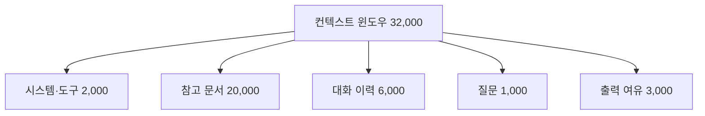
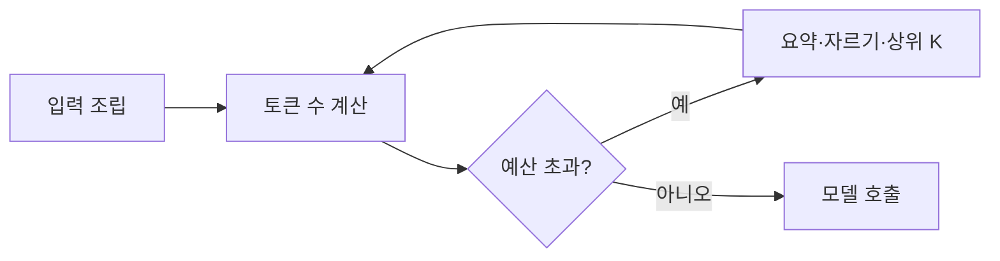

# 토큰 예산

> 한 작업(또는 한 호출)에 쓸 **토큰 총량을 미리 나눠 정하고 관리**하는 방식. 컨텍스트 윈도우는 입력과 출력을 합친 한정된 공간이므로, 지시문·참고 자료·대화 이력·출력 여유를 칸으로 나눠 배분하고 초과를 막는다.

## 쉽게 말하면
여행 경비를 숙박·식비·교통비로 나눠 정해 두는 것과 같다. 한 칸이 새면 다른 칸이 모자라고, 예비비(출력 여유)가 없으면 마지막에 답이 잘린다.

## 자세히
- **구성 칸**: ① 시스템 지시, ② 도구 정의, ③ 참고 문서(검색 결과·첨부), ④ 대화 이력, ⑤ 사용자 질문, ⑥ **출력 여유**(`max_tokens`, 추론 토큰 포함 — [최대 출력 토큰](#output-token-limit)). 합계가 컨텍스트 윈도우를 넘으면 안 된다.
- **직접 측정 예**(tiktoken `o200k_base`, 한국어): 시스템 지시 한 줄 32토큰, "회의록 "을 1,500번 이어 붙인 문서는 4,500토큰. 글자 수가 아니라 **토큰 수로 재야** 한다([언어별 토큰 비용](#token-cost-language)).
- **예산표 예시**(가정: 윈도우 32,000, 숫자는 설명용):

| 칸 | 할당(토큰) | 비고 |
|---|---|---|
| 시스템·도구 | 2,000 | 고정, 캐싱 대상 |
| 참고 문서 | 20,000 | 검색 결과 상한 |
| 대화 이력 | 6,000 | 오래된 턴은 요약 |
| 사용자 질문 | 1,000 | |
| 출력 여유 | 3,000 | `max_tokens` |

- **관리 요령**: ① 호출 전에 토큰 수를 세어 상한 초과 시 자르기·요약·재검색, ② 검색 결과는 상위 K개와 길이 제한, ③ 오래된 대화는 요약으로 압축, ④ 고정 지시는 프롬프트 캐싱 활용(공급사 지원 시), ⑤ 칸별 사용량을 로그로 남겨 낭비 구간을 찾는다.
- **비용과 연결**: 토큰은 과금 단위이기도 하다. 예산은 품질(충분한 맥락)과 비용·속도(적은 토큰) 사이의 균형이다([토큰 가격 읽기](#token-pricing)).
- 한계: 윈도우 크기·가격은 모델·시점마다 다르므로 공식 문서로 확인한다.

## 그림으로 보기



## 예시
```python
import tiktoken
enc = tiktoken.get_encoding("o200k_base")
def fit(chunks, limit):
    out, used = [], 0
    for c in chunks:
        n = len(enc.encode(c))
        if used + n > limit: break
        out.append(c); used += n
    return out
```
- 사내 문서 챗봇: 검색된 조각을 점수 순으로 담다가 참고 문서 칸 20,000토큰에서 멈춘다.

## 헷갈리는 것과 비교
| 개념 | 차이 |
|---|---|
| 토큰 예산 | 칸별 토큰 배분·관리 |
| [컨텍스트 윈도우](#context-window) | 모델이 한 번에 볼 수 있는 총 한도 |
| [최대 출력 토큰](#output-token-limit) | 출력 쪽 상한(예산의 한 칸) |
| [토큰 가격 읽기](#token-pricing) | 토큰을 비용으로 환산 |

## 더 읽을거리
- [Anthropic: Messages API](https://platform.claude.com/docs/en/api/messages) — `max_tokens`와 thinking 토큰의 한도 포함 규칙.
- [tiktoken (PyPI)](https://pypi.org/project/tiktoken/) — 토큰 수 세기 도구.
