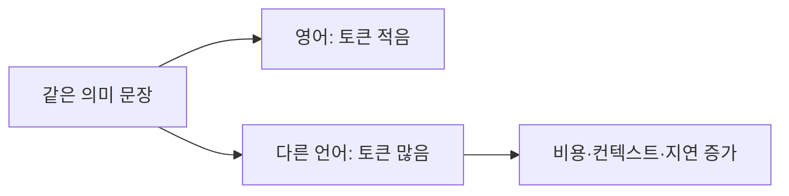
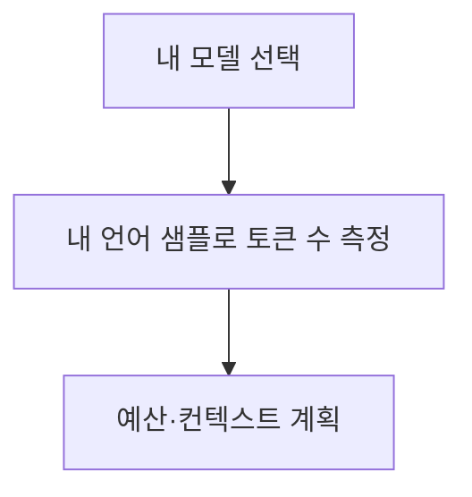

# 언어별 토큰 비용

> 같은 뜻의 문장도 **언어에 따라 토큰 수가 크게 달라** 요금, 컨텍스트 여유, 응답 속도가 달라진다. 토크나이저 단계에서 이미 불균형이 생긴다.

## 쉽게 말하면
택배비를 무게가 아니라 상자 개수로 받는데, 어떤 언어는 같은 물건을 작은 상자 여러 개에 나눠 담아야 한다면 그 언어 사용자가 더 낸다. 토큰이 그 상자다.

## 자세히
(Petrov 외, arXiv 2305.15425 초록 확인)
- 언어 간 격차는 모델이 입력을 처리하기 전, **토큰화 단계**에서 생긴다. 같은 텍스트의 토큰 수가 언어에 따라 **최대 15배**까지 차이 나는 경우가 있다. 다국어 토크나이저도 격차가 있고, 글자·바이트 수준 모델도 일부 언어쌍에서 4배 넘게 차이 난다.
- 실질 영향 세 가지: **비용**(토큰이 많은 언어의 사용자가 상용 서비스에 더 지불), **컨텍스트 창**(긴 토큰열이 고정 한도에서 담을 내용을 줄임), **지연**(토큰이 많으면 처리 시간 증가).
- 저자들은 향후 모델이 **다국어 공정한 서브워드 토크나이저**로 학습돼야 한다고 결론낸다.
- 한국어의 구체 배수는 이 글에서 측정하지 않았다. 모델·토크나이저 버전마다 달라 직접 세어 봐야 한다(권고).
- 실무: 예산 산정 시 영어 기준 글자 수가 아니라 **실제 토큰 수**로, 프롬프트는 간결하게, 반복 지시는 캐시 활용(제공사 기능 확인).

## 그림으로 보기



## 예시
```python
import tiktoken
enc = tiktoken.get_encoding("cl100k_base")
for s in ["Hello, how are you?", "안녕하세요, 잘 지내세요?"]:
    print(len(enc.encode(s)), s)   # 직접 측정해서 비교
```
- 교육 자료 한 편을 두 모델로 토큰 수를 재 비교해 예산 표에 넣기.

## 헷갈리는 것과 비교
| 개념 | 차이 |
|---|---|
| 토큰 수 | 요금·한도의 단위 |
| 글자 수 | 사람이 세는 길이, 토큰과 비례하지 않음 |
| [WordPiece·Unigram](#wordpiece-unigram) | 어휘 구성이 토큰 수에 영향 |
| 컨텍스트 윈도우 | 토큰 수로 재는 입력 한도 |

## 더 읽을거리
- [Language Model Tokenizers Introduce Unfairness Between Languages](https://arxiv.org/abs/2305.15425)
