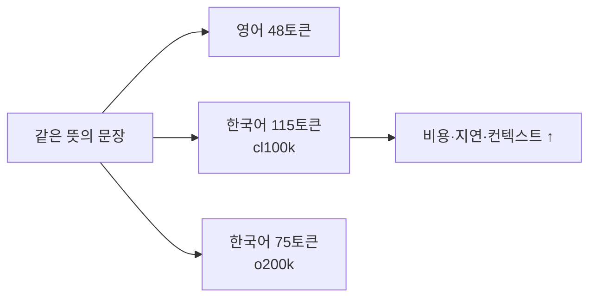
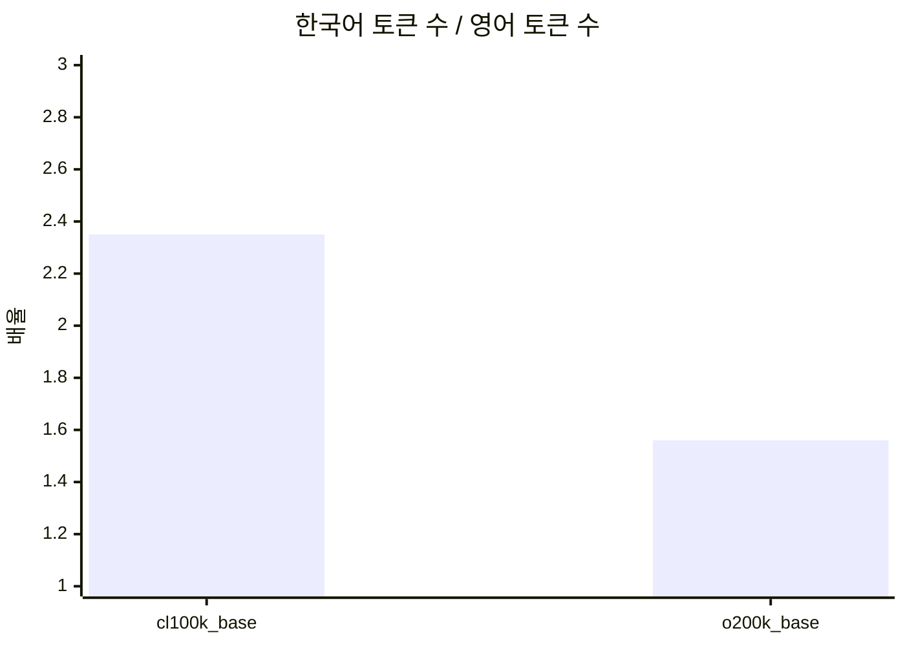

# 언어별 토큰 비용

> 같은 뜻의 문장도 **언어에 따라 토큰 수가 다르다.** 토크나이저가 영어 위주 데이터로 만들어졌다면 한국어는 같은 내용이 훨씬 많은 토큰이 되어 **비용·속도·컨텍스트 소모**가 모두 커진다. 새 토크나이저일수록 격차가 줄어드는 추세다.

## 쉽게 말하면
택배 요금이 "상자 개수"로 매겨지는데, 영어 짐은 큰 상자 한 개에 담기고 한국어 짐은 작은 상자 여러 개로 쪼개져 담기는 셈이다. 상자 규격(토크나이저)이 새로워지면 한국어도 더 큰 상자에 담겨 격차가 준다.

## 자세히
- **직접 측정**(tiktoken 0.14.0, 같은 뜻의 영어·한국어 문장 3쌍(업무 문장)의 토큰 수 합계):

| 토크나이저 | 영어 3문장 | 한국어 3문장 | 한국어/영어 배율 |
|---|---|---|---|
| `cl100k_base` (GPT-4 계열) | 49 | 115 | **2.35배** |
| `o200k_base` (GPT-4o 계열) | 48 | 75 | **1.56배** |

  어휘 크기가 약 10만(cl100k) → 약 20만(o200k)으로 커지며 한국어 효율이 좋아졌다(예: "안녕하세요, 반갑습니다."는 11토큰 → 7토큰, "인공지능"은 4토큰 → 3토큰).
- 영향: ① **API 비용**(토큰 단위 과금)과 **응답 속도**, ② **컨텍스트 윈도우**를 더 빨리 소진, ③ 프롬프트가 길수록 격차가 누적된다.
- 모델·회사마다 토크나이저가 다르므로 위 수치는 OpenAI 토크나이저 두 종에 대한 예시일 뿐, Claude·Gemini 등은 직접 재야 한다. 문장 3쌍은 작은 표본이다.
- **줄이는 법**: 반복되는 지시는 간결하게, 불필요한 서식·중복 제거, 긴 고정 지시는 프롬프트 캐싱 활용(공급사 지원 시), 입력은 영어·출력은 한국어로 나누는 전략은 품질 영향을 먼저 시험한다.

## 그림으로 보기



## 예시
```python
import tiktoken
for name in ("cl100k_base", "o200k_base"):
    enc = tiktoken.get_encoding(name)
    print(name, len(enc.encode("인공지능은 기업이 반복적인 업무를 자동화하고 데이터로 더 나은 결정을 내리도록 돕습니다.")))
```
- 사내 문서 1만 자를 요약 호출하기 전에 토큰 수를 먼저 재어 예산·한도를 확인한다.

## 헷갈리는 것과 비교
| 개념 | 차이 |
|---|---|
| 글자 수 | 사람이 세는 단위, 비용과 직접 무관 |
| 토큰 수 | 모델이 읽고 과금되는 단위 |
| [토큰과 토큰화](#token-tokenization) | 기본 개념 |
| [토큰 가격 읽기](#token-pricing) | 토큰 수를 비용으로 바꾸기 |
| [컨텍스트 윈도우](#context-window) | 토큰으로 재는 한도 |

## 더 읽을거리
- [tiktoken (PyPI)](https://pypi.org/project/tiktoken/) — OpenAI 토크나이저 라이브러리.
