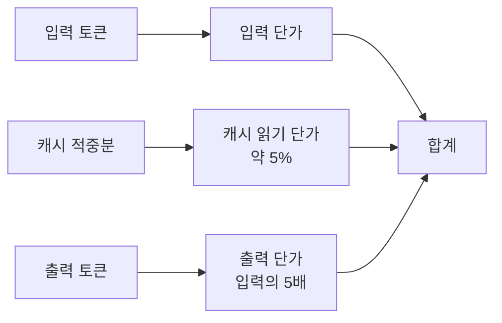

# 토큰 가격 읽기

> LLM API 요금표의 입력·출력·캐시 단가를 읽고, 내 작업의 월 비용을 추산하는 법.

## 쉽게 말하면
택시 미터기와 같다. 기본요금(입력), 거리요금(출력), 단골 할인(캐시)이 따로 붙는다. 어디에 얼마가 붙는지 알아야 "이번 달 얼마 나올까"를 계산할 수 있다.

## 자세히
단위는 보통 **MTok(100만 토큰)당 달러**. 2026-11-03 Anthropic 공식 가격 페이지 기준 예시(MTok당):

| 모델 | 입력 | 5분 캐시 쓰기 | 캐시 읽기 | 출력 |
|---|---|---|---|---|
| Opus 5.5 | $4 | $5 | $0.20 | $20 |
| Sonnet 5.5 | $2 | $2.50 | $0.10 | $10 |
| Haiku 5.5 (100K 이하) | $0.10 | $0.125 | $0.01 | $0.50 |

- **출력이 입력의 5배**인 구조가 흔하다. 긴 답변을 줄이면 비용이 크게 준다.
- **캐시 읽기는 입력의 약 5%**: 반복되는 앞부분(시스템 프롬프트, 문서)은 [프롬프트 캐싱](#prompt-caching)으로 싸진다.
- **배치 API**는 동일 모델을 약 절반 가격(Sonnet 5.5: 입력 $1, 출력 $5)에 비동기로 처리한다.
- 한글은 영어보다 토큰이 더 든다. 같은 글자 수라도 토큰 수가 늘 수 있어 실측이 필요하다.
- 에이전트는 매 턴 대화 전체를 다시 보내므로 입력 비용이 누적된다([컨텍스트 윈도우](#context-window)).
- 가격은 자주 바뀐다. 계산 전에 공식 페이지를 확인한다.

월 비용 추산식: `요청수 × (평균 입력토큰 × 입력단가 + 평균 출력토큰 × 출력단가) ÷ 1,000,000`

## 그림으로 보기

## 예시
Sonnet 5.5로 하루 1,000건, 평균 입력 2,000 / 출력 500 토큰: 1,000 × (2,000×$2 + 500×$10) ÷ 1e6 = $9/일(약 $270/월). 입력 중 1,500 토큰이 캐시 적중이면 입력비가 크게 준다.

## 헷갈리는 것과 비교
| 개념 | 차이 |
|---|---|
| 토큰 가격 | API 호출 단가 |
| 구독 요금 | 월정액, 사용 한도 방식 |
| [API vs 자체 호스팅](#api-vs-self-host) | 종량제 대 고정비 |

## 더 읽을거리
- [Pricing(Anthropic 공식)](https://platform.claude.com/docs/en/about-claude/pricing) — 모델별 단가·캐시·배치.
