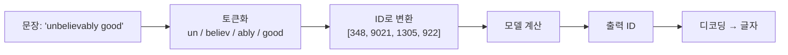

# 토큰과 토큰화

> 토큰은 LLM이 글을 읽고 쓰는 최소 단위(단어 조각)이고, 토큰화는 글을 토큰으로 쪼개 숫자 ID로 바꾸는 과정이다.

## 쉽게 말하면
레고 블록을 떠올리자. 문장은 완성품이 아니라 블록의 나열로 저장된다. 자주 쓰는 말("the", "안녕")은 큰 블록 하나이고, 드문 단어는 작은 블록 여러 개로 쪼개진다. LLM은 글자가 아니라 이 블록 번호를 보고 계산한다. 그래서 사용량·비용·길이 한도도 글자 수가 아니라 **토큰 수**로 센다.

## 자세히
- **왜 숫자인가**: 모델은 숫자만 처리하므로 토크나이저가 텍스트를 입력 ID로 바꾼다(encode). 출력은 반대로 ID → 글자(decode). 모델마다 토크나이저가 달라서, 학습 때 쓴 것과 같은 것을 써야 한다(Hugging Face LLM Course).
- **쪼개는 방식 세 가지**
  - 단어 단위: 단순하지만 어휘가 너무 커지고 "dog"/"dogs"를 별개로 본다.
  - 글자 단위: 어휘는 작지만 한 단어가 10개 이상 토큰이 될 수 있다.
  - **서브워드(BPE·WordPiece·Unigram)**: 자주 나오는 말은 통째로, 드문 말은 의미 있는 조각으로. 오늘날 LLM의 표준.
- **실무 영향**: ① API 요금과 [컨텍스트 윈도우](#context-window)가 토큰 기준 ② 같은 뜻이라도 언어·모델에 따라 토큰 수가 다르다(한국어는 영어보다 대체로 토큰이 더 든다 — 주장: 모델·토크나이저마다 다름, 직접 세어 확인) ③ 글자 수 세기·철자 뒤집기 같은 작업이 약한 이유 중 하나.
- Claude API는 보내기 전 토큰을 세는 token counting 기능을 제공한다(비용·한도 관리, 모델 라우팅용).

## 그림으로 보기

> 위 토큰 조각과 ID는 이해를 돕기 위한 가상 예시다.

## 예시
- 비용 어림: 입력 5만 토큰짜리 문서를 매번 붙이면 호출마다 5만 토큰 요금 → 필요한 부분만 발췌([컨텍스트 엔지니어링](#context-engineering)).
- 프롬프트 줄이기: 같은 뜻이면 군더더기 문장을 줄여 토큰을 아낀다.
- 직접 확인: Claude API의 token counting 엔드포인트나 각 사 토크나이저 도구에 문장을 넣어 보기.

## 헷갈리는 것과 비교
| 개념 | 차이 |
| --- | --- |
| 토큰 | 모델이 보는 단위. 단어·조각·기호 |
| 단어/글자 수 | 사람이 세는 단위. 토큰 수와 1:1 아님 |
| [임베딩](#embedding-clip) | 토큰 ID를 의미를 담은 숫자 벡터로 바꾼 것 |
| [컨텍스트 윈도우](#context-window) | 한 번에 담을 수 있는 토큰의 최대치 |

## 더 읽을거리
- [Hugging Face LLM Course: Tokenizers](https://huggingface.co/learn/llm-course/chapter2/4) — 단어/글자/서브워드 비교
- [Claude Docs: Token counting](https://platform.claude.com/docs/en/build-with-claude/token-counting) — 전송 전 토큰 세기
