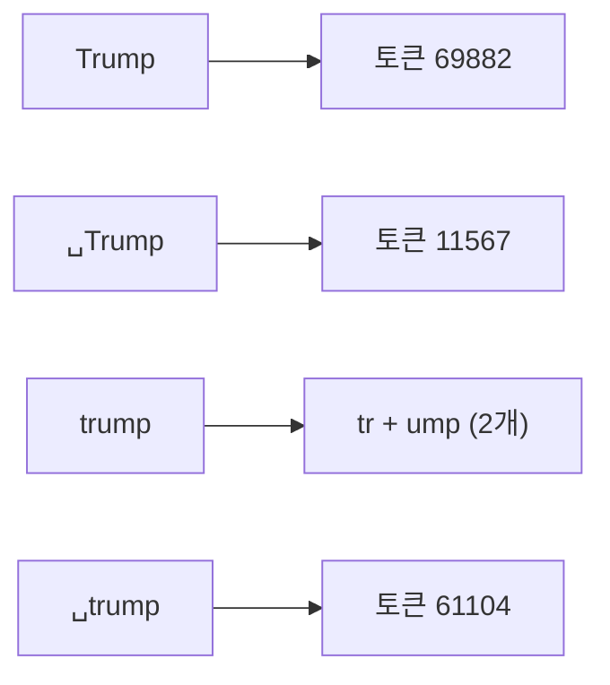
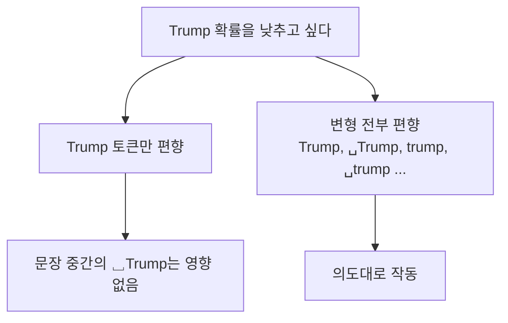

# 앞 공백 토큰 문제

> 토크나이저에서 "Trump"와 " Trump"(앞에 공백이 붙은 단어)는 서로 다른 토큰이다. 그래서 특정 단어의 확률을 조절하는 로짓 편향 같은 기법은 공백 유무를 모두 고려하지 않으면 안 먹힌다.

## 쉽게 말하면
도서관 색인에서 "사과"와 "(공백)사과"를 다른 항목으로 취급한다고 생각해 보자. "사과"를 금지어로 등록해도 문장 중간에 나오는 " 사과"는 다른 항목이라 그대로 통과한다. 모델은 단어를 글자가 아니라 이런 조각(토큰) 단위로 본다.

## 자세히
- **BPE 토크나이저**: 텍스트를 자주 쓰는 조각으로 나눠 숫자로 바꾼다. 가역적이고 어떤 텍스트에도 적용되며 평균 약 4바이트당 1토큰이다(tiktoken README).
- **공백은 토큰의 일부다**: 영어 단어는 문장 중간에서 보통 앞 공백을 붙인 형태로 나타난다. 직접 확인한 결과(tiktoken 0.14.0, `o200k_base`):
  - `"Trump"` → 토큰 1개(69882)
  - `" Trump"` → 토큰 1개(11567, 전혀 다른 번호)
  - `"trump"` → 2개(`tr` + `ump`), `" trump"` → 1개(61104)
  - `"hello world"` → `hello` + ` world`
- **결과**: 단어 하나가 위치(문장 처음·줄 첫머리 vs 중간)와 대소문자에 따라 여러 토큰 ID로 나뉜다.
- **영향 1 — 로짓 편향**: API의 `logit_bias`는 토큰 ID 단위로 작동한다([로짓 편향](#logit-bias)). "Trump"만 막으면 " Trump"는 못 막는다. 편향을 주려면 **공백 유무·대소문자 변형을 모두** 찾아 각각 적용해야 한다.
- **영향 2 — 프롬프트 끝의 공백**: 프롬프트를 공백으로 끝내면 모델이 다음 토큰으로 "공백 없는 단어"를 내야 해서 어색한 출력이 나올 수 있다(많은 토크나이저에서 공백이 단어 앞에 붙기 때문). 일반 대화형 API에서는 템플릿이 처리해 주므로 덜 문제지만, 원시 완성형 프롬프트에서 중요하다.
- **영향 3 — 한국어 등 다른 언어**: 직접 측정(tiktoken): `"안녕하세요"`는 `cl100k_base`에서 5토큰, `o200k_base`에서 2토큰이다. 토크나이저 버전에 따라 토큰 수(비용)와 분할이 크게 달라진다. 앞 공백이 붙으면(`" 안녕하세요"`) `o200k_base`에서 토큰 ID가 달라진다(24497 vs 14307).
- **영향 4 — 평가·후처리**: 정답이 " A"인지 "A"인지에 따라 로그확률 비교 방식이 달라진다.
- **실무 팁**: ①토큰 ID는 반드시 쓰는 모델의 토크나이저로 구한다(모델마다 다름) ②금지·유도 단어는 변형 전부를 등록 ③핵심 제약은 로짓 편향보다 [제한 디코딩](#constrained-decoding)이나 프롬프트·후처리로.

## 그림으로 보기




## 예시
```python
import tiktoken
enc = tiktoken.get_encoding("o200k_base")
for s in ["Trump", " Trump", "trump", " trump"]:
    print(repr(s), enc.encode(s))
# 'Trump' [69882] / ' Trump' [11567] / 'trump' [371, 2643] / ' trump' [61104]
```
업무 예: 브랜드명 경쟁사 이름 노출을 `logit_bias`로 줄이려면 대소문자·앞 공백 변형을 모두 넣어 시험한다. 그래도 한계가 있어 최종 출력 검수를 둔다.

## 헷갈리는 것과 비교
| 개념 | 차이 |
|---|---|
| 토큰 | 모델이 보는 조각. 단어와 1:1이 아님 |
| [로짓 편향](#logit-bias) | 토큰 ID별 점수 가감. 공백·대소문자 변형은 다른 ID |
| [제한 디코딩](#constrained-decoding) | 문법에 맞는 토큰만 허용. 형식 제어에 더 안정적 |
| [토큰 가격](#token-pricing) | 언어·토크나이저에 따라 같은 문장도 토큰 수가 다름 |

## 더 읽을거리
- [tiktoken (OpenAI)](https://github.com/openai/tiktoken) — BPE 토크나이저와 인코딩 사용법
