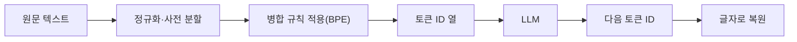
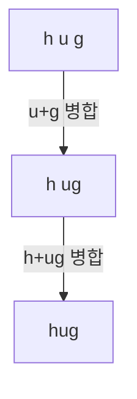

# 토큰화

> **토큰화**는 글을 모델이 처리하는 최소 단위인 **토큰(조각)** 으로 나누고 각 조각에 번호(ID)를 붙이는 일이다. LLM은 글자가 아니라 이 토큰 번호열을 읽고 쓴다.

## 쉽게 말하면
레고 블록으로 문장을 조립한다고 생각해 보자. 자주 쓰는 덩어리(예: "hug")는 큰 블록 하나로, 드문 단어는 작은 블록 여러 개로 쪼갠다. 블록 종류가 정해져 있어서 처음 보는 단어도 작은 블록으로 조립해 표현할 수 있다.

## 자세히
- **왜 단어 단위가 아닌가**: 단어 사전은 드문 단어·신조어를 못 담는다(미등록 단어 문제). Sennrich 외(2015, arXiv 1508.07909)는 희귀어를 **서브워드**로 쪼개 번역 품질을 WMT 15에서 영어-독일어 +1.1 BLEU, 영어-러시아어 +1.3 BLEU 올렸다고 보고했다.
- **BPE(Byte-Pair Encoding)** 학습 순서(Hugging Face LLM 코스 설명):
  1. 기본 어휘 = 코퍼스에 나온 모든 기호.
  2. 가장 자주 붙어 나오는 인접 쌍을 하나로 합쳐 새 토큰 추가(병합 규칙).
  3. 목표 어휘 크기까지 반복.
  - 예: hug(10)·pug(5)·pun(12)·bun(4)·hugs(5)에서 `u+g→ug`(20회), `u+n→un`(16회), `h+ug→hug`(15회) 순으로 병합.
- **바이트 수준 BPE**(GPT-2, RoBERTa): 글자 대신 바이트 256개를 기본 어휘로 삼아 어떤 문자도 표현 가능 → 미등록 토큰이 생기지 않는다.
- 다른 방식: WordPiece, Unigram(SentencePiece) 등(이 글에서 직접 확인하지 않음).
- **실무 영향**(일반 지식): 가격·컨텍스트 한도가 토큰 수 기준이라 같은 뜻도 언어에 따라 토큰 수가 다르다. 한국어는 영어보다 토큰이 많이 드는 경향이 있어 모델·토크나이저마다 직접 세어 봐야 한다. 철자 세기·숫자 계산이 약한 것도 토큰 단위로 보기 때문이라는 설명이 흔하다.

## 그림으로 보기



## 예시
```python
import tiktoken
enc = tiktoken.get_encoding("cl100k_base")
ids = enc.encode("토큰화 예시 hello")
print(len(ids), ids)          # 토큰 수와 ID
print([enc.decode([i]) for i in ids])  # 조각 확인
```
- 업무 예: 프롬프트 비용을 추정할 때 글자 수가 아니라 토큰 수로 계산한다.

## 헷갈리는 것과 비교
| 개념 | 차이 |
|---|---|
| 토큰 | 모델 입출력 단위(단어·서브워드·바이트) |
| 단어 | 공백 기준 낱말, 토큰과 1:1 아님 |
| 임베딩 | 토큰 ID를 벡터로 바꾼 것, 토큰화 다음 단계 |
| 컨텍스트 윈도우 | 토큰 수로 재는 입력 한도 |

## 더 읽을거리
- [Hugging Face LLM 코스: BPE 토큰화](https://huggingface.co/learn/llm-course/chapter6/5) — 병합 규칙 계산 예시.
- [Neural Machine Translation of Rare Words with Subword Units](https://arxiv.org/abs/1508.07909) — 서브워드 BPE 원 논문.
