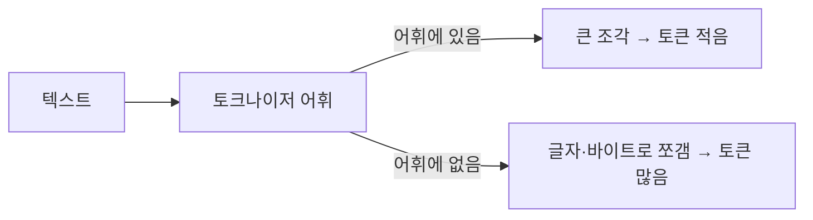

# 토크나이저 fertility

> 토크나이저가 **단어(또는 글자) 하나를 평균 몇 개의 토큰으로 쪼개는가**를 나타내는 값(tokens per word). 값이 클수록 같은 내용에 토큰이 많이 들어 **비용·지연·컨텍스트 소모**가 커진다. 언어마다 크게 다르며, 새 토크나이저일수록 비영어권 fertility가 낮아지는 경향이다.

## 쉽게 말하면
같은 책을 번역해 소포로 보내는데, 영어책은 상자 1.15개에 담기고 한국어책은 3.7개가 필요하다면 배송비가 3배 이상 든다. "한 단어를 몇 상자로 쪼개는가"가 fertility다.

## 자세히
- **정의**: fertility = 토큰 수 ÷ 단어 수. 띄어쓰기가 없는 언어(일본어·중국어)는 단어 수를 세기 어려워 **글자당 토큰** 또는 **토큰당 글자(chars/token)** 로 비교한다.
- **직접 측정**(tiktoken 0.14.0, 같은 의미의 문장 한 개씩, 매우 작은 표본이므로 경향만 참고):

| 언어/종류 | cl100k_base 토큰 | cl100k chars/token | o200k_base 토큰 | o200k chars/token |
|---|---|---|---|---|
| 영어(102자·13단어) | 15 | 6.80 | 14 | 7.29 |
| 스페인어(120자·18단어) | 25 | 4.80 | 22 | 5.45 |
| 한국어(49자·11어절) | 41 | 1.20 | 27 | 1.81 |
| 일본어(47자) | 53 | 0.89 | 40 | 1.18 |
| Python 코드(65자) | 17 | 3.82 | 17 | 3.82 |

  - 영어의 fertility는 15/13 ≈ **1.15**, 한국어(어절 기준)는 41/11 ≈ **3.7**(cl100k) → 27/11 ≈ **2.5**(o200k).
  - o200k_base(어휘 약 20만)는 한국어·일본어·스페인어에서 눈에 띄게 개선됐고, 영어·코드는 거의 같았다.
- **왜 생기나**: 토크나이저(BPE 등)는 학습 말뭉치에서 자주 나오는 문자 조합을 어휘로 합친다. 말뭉치에 영어가 많으면 영어 단어는 통째로 어휘에 있고, 적게 나온 언어는 글자·바이트 단위로 쪼개진다.
- **영향**: ① API 비용·응답 속도, ② 컨텍스트 소진, ③ 일부 언어에서 모델 성능 저하 보고(주장 수준, 직접 확인하지 않음). 
- **활용**: 모델을 고를 때 내 언어의 fertility를 직접 재 보고 토큰 가격과 곱해 **실제 비용**을 비교한다([언어별 토큰 비용](#token-cost-language)).

## 그림으로 보기

```mermaid
xychart-beta
  title "문장당 토큰 수(cl100k vs o200k)"
  x-axis ["영어","스페인어","한국어","일본어"]
  y-axis "토큰" 0 --> 60
  bar [15, 25, 41, 53]
  bar [14, 22, 27, 40]
```



## 예시
```python
import tiktoken
enc = tiktoken.get_encoding("o200k_base")
text = "인공지능은 기업이 반복적인 업무를 자동화하고 데이터로 더 나은 결정을 내리도록 돕습니다."
print(len(enc.encode(text)), len(text.split()))   # 토큰 수, 어절 수 → fertility
```

## 헷갈리는 것과 비교
| 개념 | 차이 |
|---|---|
| fertility | 단어당 토큰 수(쪼개짐 정도) |
| [언어별 토큰 비용](#token-cost-language) | 같은 뜻 문장의 언어 간 토큰 배율 |
| [BPE·서브워드](#bpe-subword) | 토큰으로 쪼개는 알고리즘 |
| [토큰과 토큰화](#token-tokenization) | 기본 개념 |

## 더 읽을거리
- [tiktoken (PyPI)](https://pypi.org/project/tiktoken/) — OpenAI 토크나이저 라이브러리.
