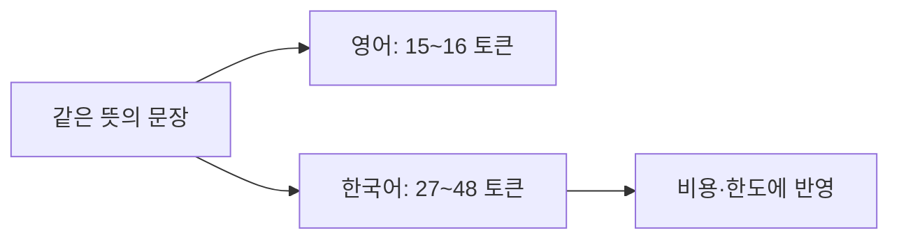
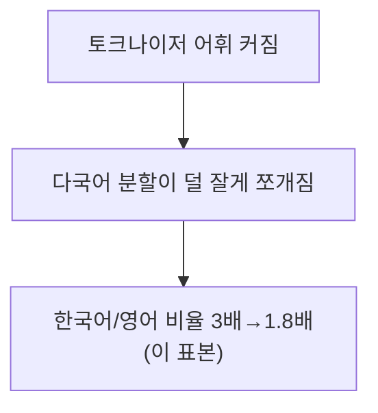

# 언어별 토큰 수

> 같은 뜻의 문장도 **언어와 토크나이저에 따라 토큰 수가 크게 다르다.** 한국어는 영어보다 토큰이 더 들어 비용·입력 한도에 영향을 준다. 토크나이저 버전에 따라 격차가 달라진다.

## 쉽게 말하면
같은 짐을 싸도 택배사마다 상자 개수가 달라진다. 영어에 맞춰 만든 상자(토큰 어휘)는 한국어 짐을 잘게 쪼개 상자를 더 많이 쓴다.

## 자세히
- 직접 측정(2026-11-28, `tiktoken`): 내가 쓴 같은 뜻의 문장 3개로 비교. 한국어·일본어 문장은 번역문이라 정확히 같은 정보량은 아니다.
  | 토크나이저 | 영어(86자) | 한국어(49자) | 일본어(40자) |
  |---|---|---|---|
  | cl100k_base | 16 토큰 | **48 토큰** | 45 토큰 |
  | o200k_base | 15 토큰 | **27 토큰** | 31 토큰 |
- 해석: cl100k_base에서 한국어 문장은 영어의 **약 3배**(48/16)였지만 o200k_base에서는 **약 1.8배**(27/15)로 줄었다. 어휘가 커지고 다국어 비중이 늘면 격차가 줄어드는 경향을 보여 주는 한 사례다(문장 1개 기준이므로 일반화는 금물).
- 영향: ① API 요금(토큰당) ② 컨텍스트 한도 ③ 응답 속도. 한국어 서비스의 비용 추정은 **영어 기준 단가×문자 수가 아니라 실제 토큰 수**로 해야 한다.
- 모델마다 토크나이저가 달라(Claude는 자체 토크나이저) 위 수치를 다른 모델에 그대로 적용할 수 없다. 해당 공급사의 토큰 계산 도구로 직접 재야 한다.
- 이유(일반 설명, 이번에 출처로 확인하지는 않음): 학습 데이터에서 자주 나오는 문자열을 합쳐 어휘를 만드는 [BPE](#bpe-subword) 특성상 영어가 한 토큰으로 합쳐지는 비율이 높다.
- 한계: 표본 문장 하나, 두 인코딩 한정. 더 신뢰할 결과를 내려면 문서 수백 개로 측정한다.

## 그림으로 보기



## 예시
```python
import tiktoken
enc = tiktoken.get_encoding("o200k_base")
len(enc.encode("인공지능은 업무를 돕습니다."))
```
- 교육: 수강생이 자기 업무 문서 10개의 토큰 수를 측정해 월 비용을 추산하는 실습.

## 헷갈리는 것과 비교
| 개념 | 차이 |
|---|---|
| 글자 수 | 눈에 보이는 길이 |
| 토큰 수 | 모델이 처리·과금하는 단위 |
| [BPE](#bpe-subword) | 토큰을 만드는 방식 |

## 더 읽을거리
- [tiktoken (OpenAI)](https://github.com/openai/tiktoken) — 직접 측정에 쓴 도구.
- [Neural Machine Translation of Rare Words with Subword Units](https://arxiv.org/abs/1508.07909) — 서브워드 개념(초록 읽음).
