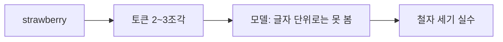
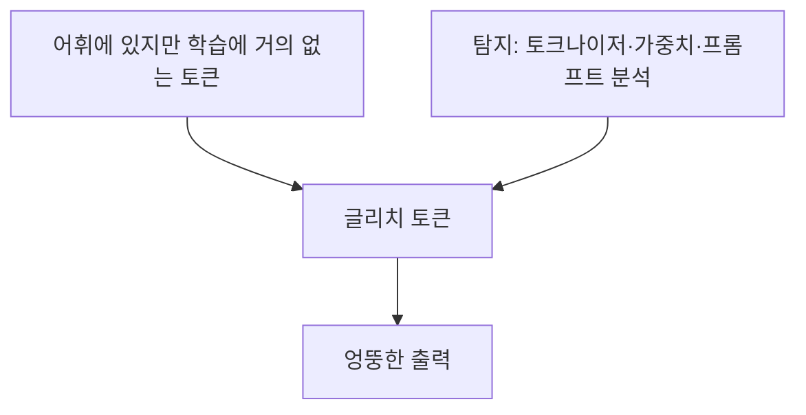

# 토크나이저가 만드는 실수

> 모델은 글자가 아니라 **토큰 조각**을 보기 때문에, 철자 세기·숫자 처리 같은 일에서 이상한 실수를 하고, 학습이 덜 된 **글리치 토큰**에서 엉뚱한 행동을 보이기도 한다.

## 쉽게 말하면
모델은 책을 "글자"가 아니라 "미리 잘려 있는 퍼즐 조각"으로 본다. 조각 안의 글자가 몇 개인지는 따로 배워야 하고, 한 번도 조립해 본 적 없는 조각을 만나면 당황한다.

## 자세히
- **글리치 토큰**(Land & Bartolo, *Fishing for Magikarp*, EMNLP 2024 초록 확인): 토크나이저는 모델 학습과 별도로 만들어져서, 어휘에는 있지만 **모델 학습 데이터에 거의/전혀 나오지 않는 토큰**이 생긴다(예: SolidGoldMagikarp). 이런 토큰은 원치 않는 동작을 일으킬 수 있다. 저자들은 토크나이저 분석·모델 가중치 지표·프롬프트 기법을 조합해 자동 탐지하며, 다양한 모델에서 흔하다고 한다. 코드: `github.com/cohere-ai/magikarp`.
- **철자·세기 실수**(일반 지식): 단어가 하나의 토큰이면 내부 글자 수를 직접 보지 못한다. "strawberry에 r이 몇 개?" 같은 질문이 대표 사례로 자주 언급된다. 글자를 한 줄씩 나열해 세게 시키면 개선되는 경우가 많다.
- **숫자·공백·대소문자**(일반 지식): 숫자가 임의로 쪼개져 자릿수 계산이 흔들리고, 앞 공백 유무로 다른 토큰이 되기도 한다.
- 대응(권고): 정확한 문자 처리는 코드 도구로 맡기고, 의심되는 입력은 토큰 단위로 출력해 확인하고, 모델 업데이트 시 같은 질문으로 재시험한다.

## 그림으로 보기

## 예시
- 실습: `enc.decode([i])`로 문장의 각 조각을 출력해 보고, "글자 수 세기"를 직접 시켜 결과 비교.
- 업무: 글자 수 제한이 중요한 문구(광고 제목 30자)는 모델 응답을 코드로 길이 검사.

## 헷갈리는 것과 비교
| 개념 | 차이 |
|---|---|
| 글리치 토큰 | 어휘엔 있으나 학습이 부족한 토큰 |
| 환각 | 사실과 다른 내용을 생성 |
| 철자 실수 | 토큰 단위 인식의 한계 |
| [토큰화](#tokenization) | 이 현상들의 원인이 되는 단계 |

## 더 읽을거리
- [Fishing for Magikarp](https://arxiv.org/abs/2405.05417)
