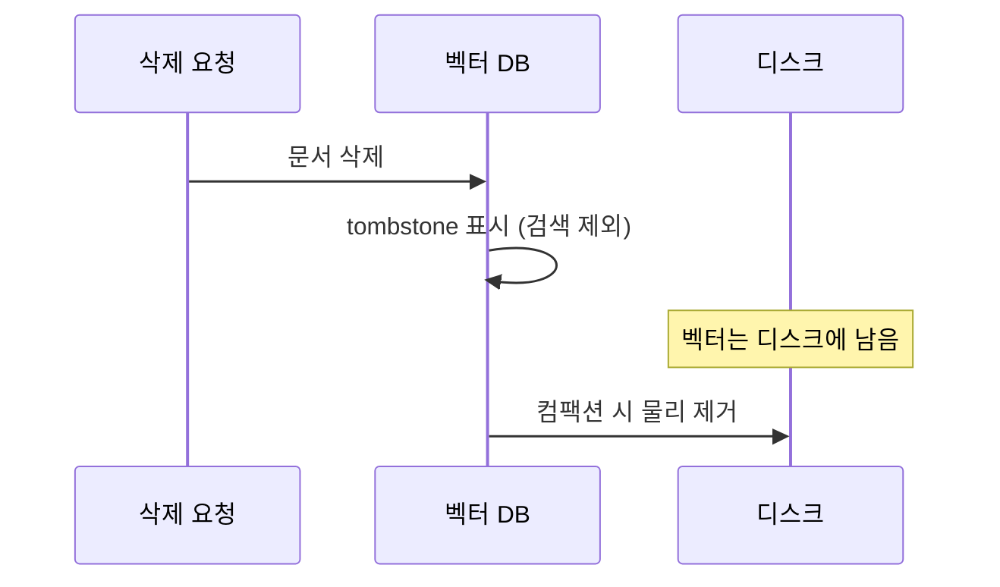
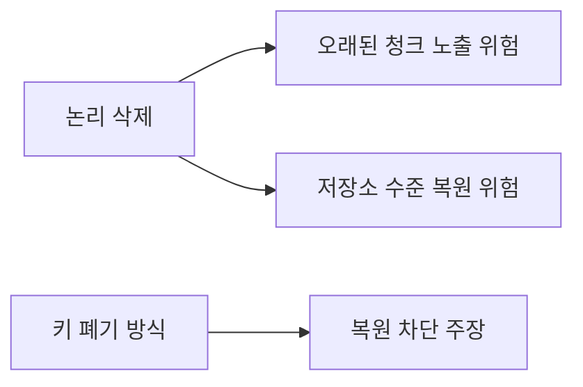

# Tombstone 삭제

> **Tombstone(묘비) 삭제**는 데이터를 즉시 지우지 않고 **"삭제됨" 표시만 해 두고 나중에(정리 작업 때) 실제로 제거**하는 방식이다. 벡터 DB가 흔히 쓰지만, 표시와 실제 삭제 사이의 간극이 오래된 정보 노출과 개인정보 문제를 낳는다.

## 쉽게 말하면
도서관이 폐기한 책을 서가에서 바로 빼지 않고 "폐기 예정" 스티커만 붙여 두는 것과 같다. 검색 화면에서는 안 보이지만 책은 창고에 남아 있다. 정리 날짜가 오기 전에 창고에 들어가면 그 책을 읽을 수 있다.

## 자세히
(출처: 검색 결과 요약, Ghost Vectors 논문 arXiv 2606.18497 초록을 WebFetch로 직접 확인. 이 논문은 **2026-06-16 제출된 비동료심사 프리프린트**다. Zilliz 등 벤더 FAQ의 엔진별 동작은 직접 열어 보지 못했고 검색 요약만 근거다.)
- **동작 원리(검색 요약)**: 삭제 시 엔진은 삭제 마커·삭제 로그를 남겨 검색이 해당 벡터를 무시하게 한다. 물리적 정리는 나중에 **컴팩션**에서 이뤄진다. HNSW에서는 tombstone이 된 객체는 그래프 검색에서 제외되지만, 백그라운드 정리 전까지 색인 상태가 남는다. 컴팩션은 그래프 구조를 바꿀 수 있다.
- **엔진별 차이(벤더 FAQ 요약, 검증 필요)**: Milvus는 삭제 비율이 임계값을 넘는 세그먼트를 자동 컴팩션, Qdrant는 임계값에서 자동, Weaviate는 수동 호출이 필요하다고 소개된다.
- **RAG에서의 문제**: 좀비 청크가 검색에 다시 나오거나 원본이 지워졌는데 색인이 남는 문제. → [좀비 문서](#zombie-documents)
- **보안·규정 문제(Ghost Vectors 초록)**: 소프트 삭제된 임베딩이 **디스크에 그대로 남고**, API를 우회해 **원시 색인 파일을 읽으면 복원**할 수 있다고 주장한다. 도메인 미세조정 없는 **Vec2Text** 역변환으로 Wikipedia 전기 데이터에서 정확한 인명 25.5%, 지명 46.4%, NIH Synthea(합성 환자 기록)에서 나이·성별 표지 100%, 얼굴 이미지 임베딩에서 상위 1 신원 99% 복원 등을 보고했다(수치는 논문 주장). **GDPR 제17조(삭제권)·HIPAA** 준수 위험과 연결한다.
- **제안된 완화(논문)**: **Epoch Key Rotation** — 벡터를 암호화해 두고 삭제 시 키를 폐기. 실험에서 관측된 PII 복원이 0%로 줄었고 벡터 500개 삭제에 약 2.5ms, 서명된(ECDSA) 삭제 기록을 감사용으로 남긴다고 한다(저자 보고, 독립 검증 없음).
- **실무 점검(해석)**: 민감 데이터는 "논리 삭제 = 삭제 완료"로 간주하지 않는다. 컴팩션 주기·물리 삭제 확인, 저장소 수준 접근 통제, 삭제 감사 기록을 둔다.

## 그림으로 보기

## 예시
- 퇴사자 개인 문서를 삭제했는데 RAG 챗봇이 계속 인용 → tombstone 표시 후 정리 전이라 색인에 남은 경우를 점검.
- 교육 활동: "삭제 버튼 = 즉시 소멸인가?"를 토론하고 컴팩션 주기를 가정해 노출 기간을 계산.

## 헷갈리는 것과 비교
| 개념 | 차이 |
|---|---|
| Tombstone(논리 삭제) | 표시만 하고 나중에 물리 삭제 |
| 물리 삭제 | 즉시 제거. 비용·그래프 단절 위험 |
| [좀비 문서](#zombie-documents) | 삭제가 색인에 전파 안 된 결과 |
| [사이드카 청크 매핑](#sidecar-chunk-mapping) | 정확한 청크 ID를 찾아 지우기 위한 표 |

## 더 읽을거리
- [Ghost Vectors: Soft-Deleted Embeddings Remain Reconstructible in HNSW Vector Databases (arXiv 2606.18497)](https://arxiv.org/abs/2606.18497) — 소프트 삭제 복원 가능성과 Epoch Key Rotation(초록 확인, 프리프린트).
- [Maintaining Index Freshness (dev.to)](https://dev.to/beefedai/maintaining-index-freshness-incremental-updates-for-vector-databases-16eb) — tombstone 선호와 삭제 처리(직접 확인).
