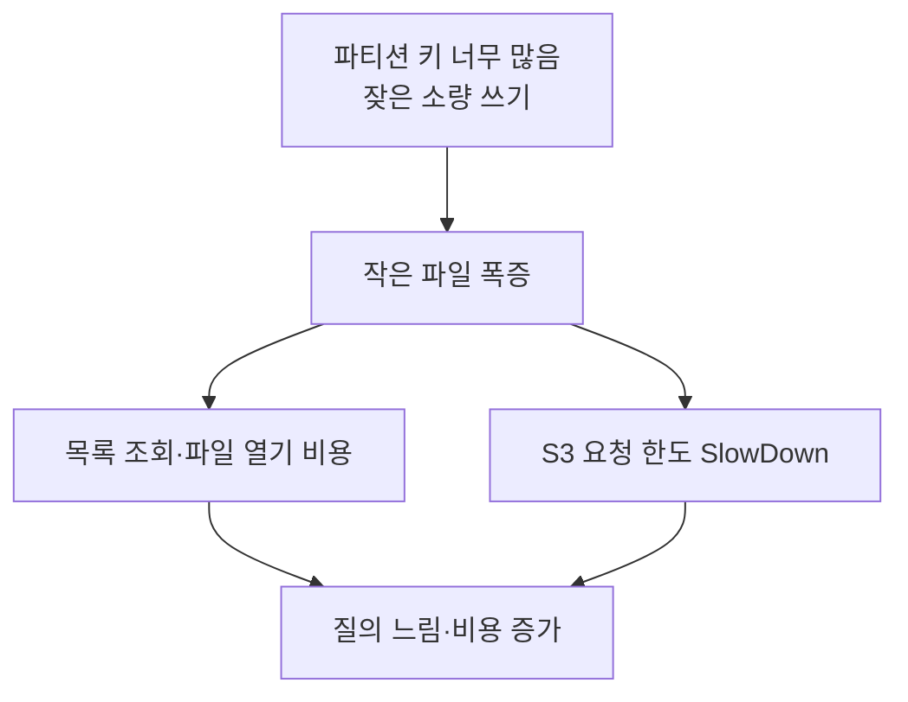
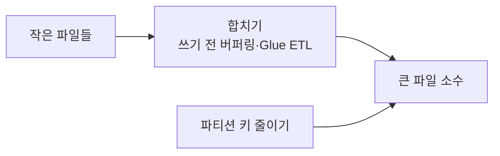

# 작은 파일 폭증 문제

> 파티션을 너무 잘게 나누거나 조금씩 자주 쓰면 **작은 파일이 수만 개** 생겨, 파일을 나열하고 여는 비용 때문에 질의가 오히려 느려지고 비싸지는 문제다.

## 쉽게 말하면
책 한 권을 낱장 1만 장으로 찢어 서랍 1천 개에 넣어 두면, 필요한 내용을 찾으러 서랍을 일일이 열고 닫느라 시간이 다 간다. 두꺼운 책 몇 권이면 훨씬 빠르다. 데이터 파일도 "적당히 큰 파일 몇 개"가 "자잘한 파일 수만 개"보다 낫다.

## 자세히
(AWS Athena 성능 최적화 문서 "Optimize data"를 직접 읽었다. 같은 AWS 서비스 기준의 설명이지만 원리는 다른 객체 저장소 기반 엔진에도 통한다.)
- **왜 느려지나(문서)**: 작은 파일이 많은 데이터셋은 전체 질의 성능이 나쁘다. 질의를 계획할 때 **모든 파티션 위치를 나열(list)** 하는 데 시간이 들고, 파일마다 처리·요청 오버헤드가 있다. 같은 레코드라면 큰 파일 하나가 작은 파일 여러 개보다 빨리 읽힌다. 특히 **컬럼형 포맷(Parquet·ORC)** 은 작은 파일에서 포맷 오버헤드가 이점을 넘어선다.
- **S3 한도(문서)**: S3는 단일 인덱스 파티션당 초당 **5,500건** 요청을 지원한다. 파일이 수천 개를 넘으면 Athena 요청이 한도를 넘을 수 있고, 같은 데이터에 동시 질의가 여러 개이거나 다른 애플리케이션이 같은 파일을 읽어도 넘을 수 있다. 한도를 넘으면 `SlowDown: Please reduce your request rate` 오류가 난다. 먼저 한 질의 때문인지 여러 질의 때문인지 가리고, 후자면 질의를 조율(큐·재시도)한다.
- **파티션 안 파일 수(문서)**: S3는 목록 한 번에 객체 **1000개**만 돌려주므로 한 파티션에 1000개를 넘으면 순차 목록 작업이 여러 번 필요하다. 파티션 아래에 추가 디렉터리 계층을 두면 목록이 여러 번 일어나므로 파일을 파티션 위치에 **평평하게** 둔다.
- **파티션 키가 많을 때(문서)**: 키가 너무 많으면 데이터가 파편화되어 파일이 너무 많고 작아진다. 반대로 키가 너무 적거나 없으면 필요 이상으로 스캔한다. 자주 하지 않는 질의를 위해 시간별로 쪼개지 말고(일 단위 질의가 많다면 시간 파티션 금지) 타임스탬프로 **정렬해** 두면 짧은 구간 질의도 거의 비슷하게 효율적이라고 한다.
- **해결책(문서)**: ① 쓰는 쪽을 바꿔 더 큰 파일을 쓴다(레코드를 더 오래 버퍼링) ② 한곳에 모아 Glue ETL 같은 도구로 큰 파일로 합친 뒤 테이블 위치로 옮긴다 ③ **파티션 키 수를 줄인다**. 작은 파일은 "쓰기 전에" 합치는 것이 가장 좋다고 문서는 말한다.
- **컬럼형 파일 크기(문서)**: Parquet의 row group 기본 128MB, ORC stripe 64MB. 열이 많으면 키우고, 기본값보다 줄이는 것은 권장하지 않는다.
- **압축 텍스트 주의(문서)**: 압축된 텍스트 파일은 보통 병렬로 쪼개 읽을 수 없어 너무 큰 파일과 너무 많은 작은 파일 사이에서 균형을 잡아야 한다. 이 문서는 적정 파일 크기 수치(예: MB)를 직접 제시하진 않는다.

## 그림으로 보기

## 예시
- 시간·분 단위 파티션으로 하루 1,440개 폴더에 파일 몇 개씩 → 일 단위 파티션 + 타임스탬프 정렬 Parquet로 합침(예시 설계).
- 교육 소재: "서랍 1,000개 vs 서랍 5개"로 비용 체감.

## 헷갈리는 것과 비교
| 개념 | 차이 |
|---|---|
| 작은 파일 폭증 | 너무 잘게 쪼갠 결과의 비용 |
| [Hive식 파티셔닝](#hive-style-partitioning) | 폴더로 나누는 표기 방식 |
| [파티션 키 고르기](#partition-key-selection) | 폭증을 막는 설계 |
| 컴팩션(compaction) | 작은 파일을 합치는 작업 |

## 더 읽을거리
- [Optimize data (AWS Athena)](https://docs.aws.amazon.com/athena/latest/ug/performance-tuning-data-optimization-techniques.html) — 작은 파일, S3 한도, 해결책(직접 읽음).
