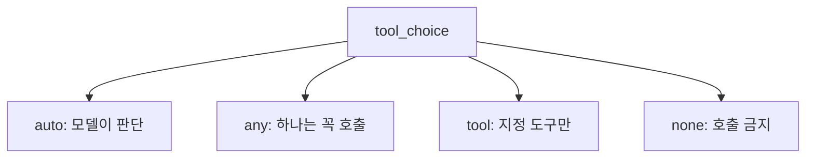
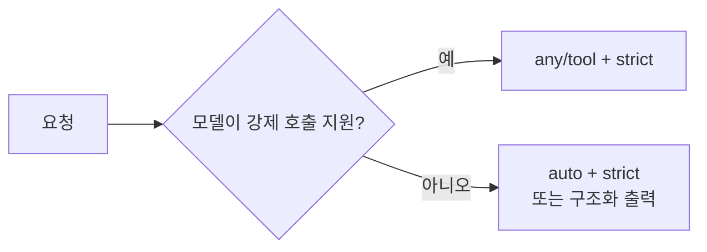

# tool_choice와 strict

> `tool_choice`는 모델이 도구를 부르는 방식(자동·반드시 하나·특정 도구·금지)을 정하는 API 옵션이고, `strict`는 도구 인자가 스키마를 어기지 않도록 보장하는 옵션이다.

## 쉽게 말하면
`tool_choice`는 직원에게 내리는 지시다. "알아서 판단해"(auto), "아무 도구든 꼭 하나 써"(any), "이 도구로만 해"(tool), "도구는 쓰지 마"(none). `strict`는 양식 검수대로, 칸에 숫자만 적어야 하는데 글자가 들어가는 사고를 막는다.

## 자세히
Anthropic 문서(2026-11 확인):
- `auto`: 기본값(도구가 있을 때). `any`: 제공 도구 중 하나는 반드시 호출. `tool`: 지정한 도구를 반드시 호출. `none`: 호출 금지(도구가 없을 때 기본).
- `any`/`tool`이면 API가 어시스턴트 응답을 미리 채워 **도구 호출 전 설명 문장이 나오지 않는다**. 설명이 필요하면 `auto` + 사용자 메시지에 지시.
- 강제 호출은 사고(thinking)를 건너뛴다. 수동 확장 사고(`thinking: {type:"enabled"}`)와는 `any`/`tool`이 오류.
- **모델 제약**: Opus 5.5, Sonnet 5.5, Fable 5.1, Mythos 5.1에서는 `any`/`tool`이 400 오류. 대안은 `auto` + strict, 또는 구조화 출력(structured outputs). `none`은 가능.
- `strict: true`를 도구 정의에 켜면 입력이 스키마를 따르도록 검증한다. 지원 모델에서는 `any`와 함께 써 "도구 호출 + 스키마 준수"를 보장할 수 있다.
- `tool_choice`를 바꾸면 프롬프트 캐시의 메시지 블록이 무효화된다(도구·시스템 프롬프트는 유지).

## 그림으로 보기

## 예시
분류 결과를 항상 `classify_ticket` 도구 인자로 받고 싶다 → 지원 모델이면 `tool_choice: {"type":"tool","name":"classify_ticket"}`, 아니면 `auto` + strict 스키마로 enum 값을 강제한다.

## 헷갈리는 것과 비교
| 개념 | 차이 |
| --- | --- |
| tool_choice | *호출 여부/대상* 통제 |
| strict | *인자 형식* 보장 |
| 구조화 출력 | 응답 자체를 고정 JSON으로 |
| [도구 스키마 설계](#function-calling-schema) | 스키마를 어떻게 쓰나 |

## 더 읽을거리
- [Define tools — Claude 문서](https://platform.claude.com/docs/en/agents-and-tools/tool-use/define-tools) — tool_choice 표와 모델 제약
