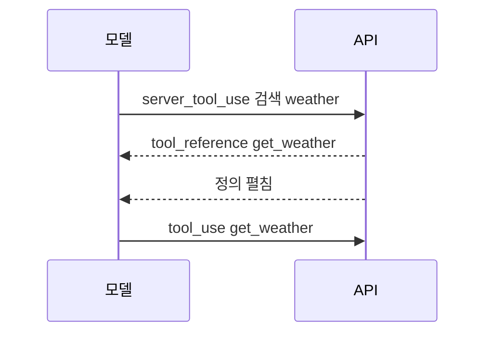

# 도구 검색 (Tool search)

> 도구 검색은 도구 정의를 전부 컨텍스트에 미리 넣는 대신, 모델이 필요할 때 도구 카탈로그를 검색해 필요한 도구만 불러오게 하는 기법이다. 도구가 수백~수천 개일 때 토큰과 선택 오류를 함께 줄인다.

## 쉽게 말하면
도서관의 책 전체를 책상에 쌓아 놓고 일하는 대신, 검색대에서 "날씨"를 치고 필요한 책 3~5권만 꺼내 오는 방식이다. 책상(컨텍스트)이 비어 있어 일이 빠르고 엉뚱한 책을 집을 일도 준다.

## 자세히
Anthropic 문서(2026-11 확인):
- **왜 필요한가**: GitHub·Slack·Sentry·Grafana·Splunk 같은 다중 서버 구성은 일을 시작하기도 전에 정의만 약 55k 토큰을 쓸 수 있다. 도구 검색은 이를 보통 85% 이상 줄이고 3~5개만 로드한다. 또 도구가 30~50개를 넘으면 모델의 선택 정확도가 떨어진다고 문서가 밝힌다.
- **변형 2종**: `tool_search_tool_regex_20251119`(모델이 파이썬 정규식 작성, 패턴 최대 200자, 대소문자 무시), `tool_search_tool_bm25_20251119`(자연어 질의, 최대 500자).
- **동작**: `tools`에 검색 도구 + 모든 도구 정의를 보내되, 처음엔 쓰지 않을 도구에 `defer_loading: true`. 모델이 검색하면 API가 `tool_reference`를 돌려주고 자동으로 전체 정의로 펼친다(기본 최대 5개, `limit` 1~10,000).
- **규칙**: 검색 도구 자신은 defer 금지, 최소 하나는 비지연 도구여야 한다(아니면 400). 자주 쓰는 3~5개는 비지연으로 둔다. 지연 도구는 요청당 최대 10,000개. `cache_control`과 같이 못 쓴다. 프롬프트 접두부는 안 건드려 캐시가 유지된다.
- **언제 쓰나**: 도구 10개 이상, 정의가 10k 토큰 초과, MCP 서버 여러 개(200+ 도구). 10개 미만이거나 정의가 작으면 불필요.
- 직접 구현도 가능: 커스텀 도구가 `tool_reference`를 담은 `tool_result`를 돌려주면 임베딩 검색 등을 쓸 수 있다.
- 이는 "필요할 때 불러온다"는 just-in-time 컨텍스트 원칙의 사례다.

## 그림으로 보기

## 예시
MCP 서버 5개(수백 개 도구)를 연결한 코딩 에이전트: 이름은 `github_`, `slack_`처럼 접두어를 붙이고 설명에 사용자가 말할 법한 키워드를 넣으면 검색 한 번에 해당 그룹이 잡힌다.

## 헷갈리는 것과 비교
| 개념 | 차이 |
| --- | --- |
| 도구 검색 | 도구 *정의*를 지연 로드 |
| RAG | 문서 *내용*을 검색해 주입 |
| [서버 vs 클라이언트 도구](#server-vs-client-tools) | 검색 도구는 서버 도구 |
| [도구 스키마 설계](#function-calling-schema) | 좋은 설명이 검색 적중률도 좌우 |

## 더 읽을거리
- [Tool search tool — Claude 문서](https://platform.claude.com/docs/en/agents-and-tools/tool-use/tool-search-tool) — 변형·한도·오류 처리 전체
- [Advanced tool use — Anthropic Engineering](https://www.anthropic.com/engineering/advanced-tool-use) — 문서가 추천하는 배경 글(이 실행에서는 열어 보지 않음)
