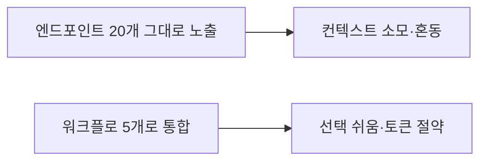
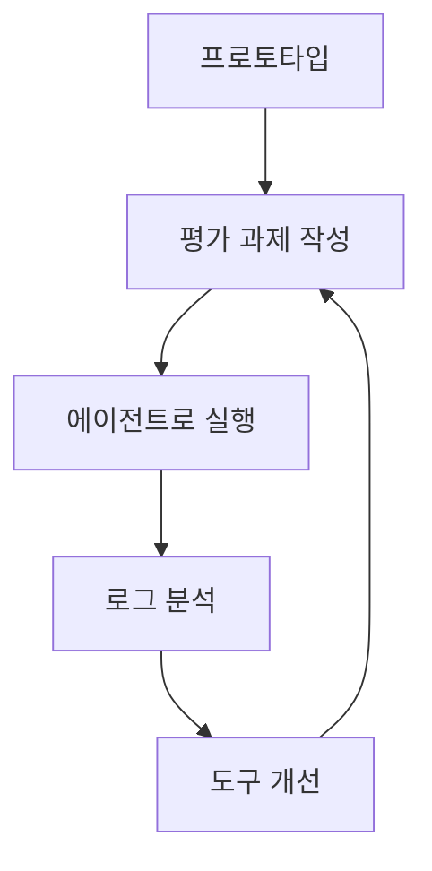

# 도구 노출 최소화

> 에이전트에게 **도구를 많이, 잘게 노출할수록** 정의가 컨텍스트를 먹고 선택이 흐려진다. 핵심 워크플로 단위로 **합치고, 이름을 정리하고, 응답을 짧게** 설계한다.

## 쉽게 말하면
공구함에 드라이버 50종을 늘어놓으면 일꾼은 뭘 쓸지 헤맨다. "전등 교체 세트"처럼 목적별로 묶어 주고 라벨을 붙여 주면 빨리 고른다.

## 자세히
(Anthropic 엔지니어링 블로그 "Writing tools for agents" 확인)
1. **신중히 선택**: API 엔드포인트를 그대로 감싸지 말고 영향이 큰 워크플로용 소수 도구를 만든다. 예: `list_users`·`list_events`·`create_event` 대신 가용 시간 확인+예약까지 하는 `schedule_event` 하나. `read_logs`보다 관련 줄과 주변 맥락만 주는 `search_logs`.
2. **합치고 이름 접두어**: 연쇄 호출은 한 호출로. `asana_search`처럼 서비스·자원 접두어로 묶어 고르기 쉽게 한다(접두어/접미어 중 무엇이 나은지는 자체 평가로 확인).
3. **의미 있는 맥락 반환**: `uuid` 대신 `name`처럼 읽을 수 있는 필드를 주면 환각이 줄었다. `response_format`(concise/detailed)으로 후속 호출에 필요할 때만 ID를 주면 Slack 예시에서 토큰이 약 1/3.
4. **토큰 효율**: 페이지네이션·범위 지정·필터·절단과 합리적 기본값. Claude Code는 도구 응답을 기본 **25,000 토큰**으로 제한한다. 오류도 불투명한 코드 대신 "더 좁게 검색하라"처럼 다음 행동을 안내한다.
5. **설명·스키마를 프롬프트처럼**: 새 입사자에게 설명하듯 쓰고, `user` 대신 `user_id`처럼 모호하지 않게. 설명의 작은 수정이 SWE-bench Verified 최고 성능으로 이어졌다고 한다.
- 개발 과정: MCP 서버로 로컬 프로토타입 → 검증 가능한 다단계 평가 과제 → 단순 에이전트 루프로 실행 → 로그 검토 후 개선, 별도 테스트 세트로 과적합 확인.

## 그림으로 보기

## 예시
- 캘린더 연동: 목록 조회 3개 도구를 `schedule_event` 하나로 합치고, 응답은 일정 이름·시간만 기본 반환.
- MCP 서버에 도구가 수십 개라면 업무에 필요한 것만 켜는 것을 검토.

## 헷갈리는 것과 비교
| 개념 | 차이 |
|---|---|
| 도구 노출 최소화 | 에이전트가 보는 도구 수·정의 크기 줄이기 |
| [JIT 검색](#just-in-time-retrieval) | 필요할 때 정보를 불러오기 |
| MCP | 도구를 연결하는 표준 프로토콜 |

## 더 읽을거리
- [Anthropic: Writing tools for agents](https://www.anthropic.com/engineering/writing-tools-for-agents) — 도구 설계 5원칙.
