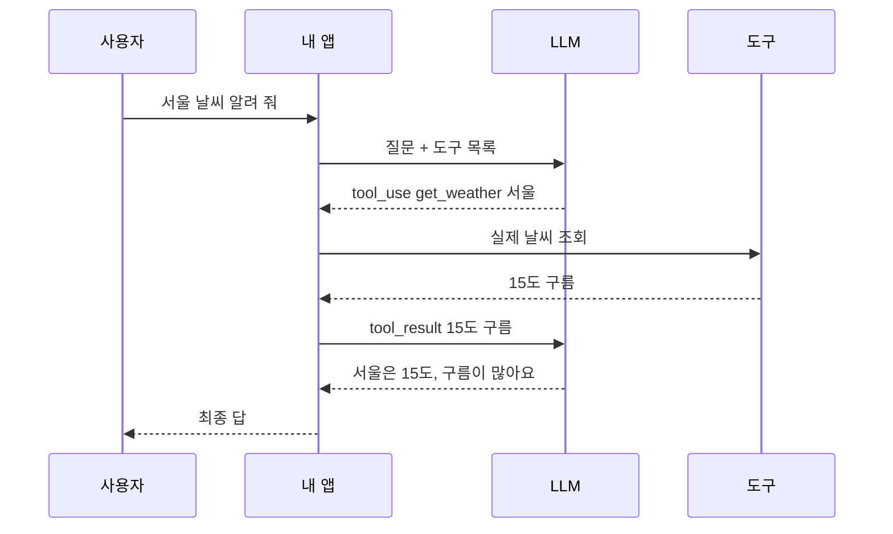
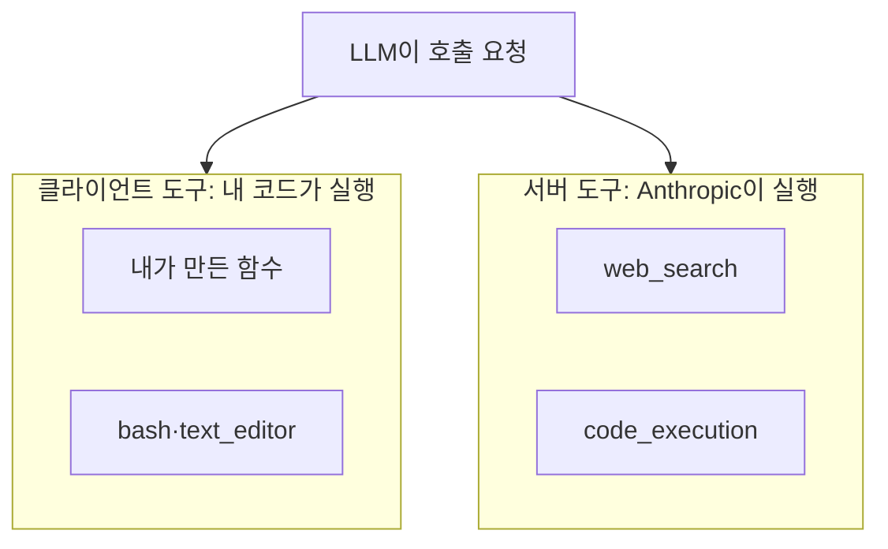

# 도구 사용(Tool use)

> LLM이 글만 쓰는 데서 멈추지 않고, 정해진 형식으로 "이 함수를 이 인자로 실행해 줘"라고 요청해 검색·계산·파일 수정 같은 바깥 일을 하게 만드는 방식. 함수 호출(function calling)이라고도 한다.

## 쉽게 말하면
LLM은 책상에 앉은 똑똑한 비서인데 전화기도 계산기도 직접 만질 수 없다. 대신 "계산기로 3,482×19를 눌러서 결과를 알려 줘"라는 쪽지를 낸다. 옆에 있는 사람(내 프로그램)이 실제로 눌러 결과를 쪽지로 돌려주면, 비서가 그걸 보고 답을 마무리한다. 모델은 "요청서"만 쓰고, 실행은 다른 쪽이 한다는 점이 핵심이다.

## 자세히
Anthropic API 문서(2026-10 확인) 기준 흐름:
- 개발자가 `tools`에 도구 이름·설명·`input_schema`(JSON Schema)를 넣어 보낸다.
- 모델이 필요하다고 판단하면 `stop_reason: "tool_use"`와 함께 `tool_use` 블록(도구 이름·인자·id)을 돌려준다.
- **클라이언트 도구**(내가 정의한 함수, `bash`, `text_editor` 등)는 내 코드가 실행하고 `tool_result` 블록으로 결과를 보낸다. **서버 도구**(`web_search`, `web_fetch`, `code_execution`)는 Anthropic이 대신 실행한다.
- `tool_choice`로 호출 방식을 정한다: `auto`(모델이 판단, 기본), `any`(아무 도구나 꼭 호출), `tool`(특정 도구 강제), `none`. `strict: true`를 주면 인자가 스키마와 정확히 맞게 나온다.
- 비용: 도구 정의·`tool_use`·`tool_result`가 모두 입력 토큰으로 계산된다(도구 사용용 시스템 프롬프트가 모델별로 약 286~800토큰 추가). 도구가 많을수록 매 요청이 무거워진다.
- 이 요청→실행→결과 반환을 되풀이하는 것이 [에이전트 루프](#agent-loop)다. 도구 사용은 그 루프의 "손"이다.

도구 설계 원칙(Anthropic "Writing tools for agents"):
- API 엔드포인트마다 얇은 래퍼를 만들지 말고, 업무 흐름 단위로 합친 도구를 만든다(예: `list`+`create` 대신 `schedule_event`).
- 설명은 신입 팀원에게 인수인계하듯 쓰고, 파라미터 이름은 `user`보다 `user_id`처럼 분명하게.
- 응답은 사람이 읽는 핵심 필드 위주로 짧게, 큰 결과는 페이지 나누기·잘라내기. 에러는 "무엇을 고치면 되는지" 예시와 함께.

## 그림으로 보기

## 예시
- 최소 정의: `{"name":"get_weather","description":"도시의 현재 날씨","input_schema":{"type":"object","properties":{"location":{"type":"string"}},"required":["location"]}}`
- 프롬프트로 성향 조절: "답하기 전에 도구로 먼저 확인해." (도구를 더 쓰게) / "필요할 때만 도구를 써." (보수적으로)
- 주의: 필수 인자가 빠진 질문("날씨 어때?")에서 모델이 위치를 추측해 채울 수 있다(문서에 따르면 Sonnet이 더 그렇다). 확인 질문을 하도록 지시하거나 `strict`를 쓴다.

## 헷갈리는 것과 비교
| 개념 | 차이 |
| --- | --- |
| 도구 사용 | 모델이 호출을 "요청"하는 기본 메커니즘 |
| [에이전트 루프](#agent-loop) | 도구 사용을 목표 달성까지 반복하는 구조 |
| [워크플로 vs 에이전트](#workflow-vs-agent) | 도구 호출 순서를 사람이 정했나, 모델이 정하나 |
| MCP | 도구를 표준 방식으로 연결·공유하는 프로토콜(도구 사용 위에 얹힘) |
| [RAG](#rag) | "검색"이라는 도구를 정해진 순서로 쓰는 특수한 경우로 볼 수 있음 |

## 더 읽을거리
- [Tool use with Claude (공식 문서)](https://platform.claude.com/docs/en/agents-and-tools/tool-use/overview) — 흐름·서버/클라이언트 도구·가격
- [Writing tools for agents (Anthropic)](https://www.anthropic.com/engineering/writing-tools-for-agents) — 도구 설계·평가 원칙
