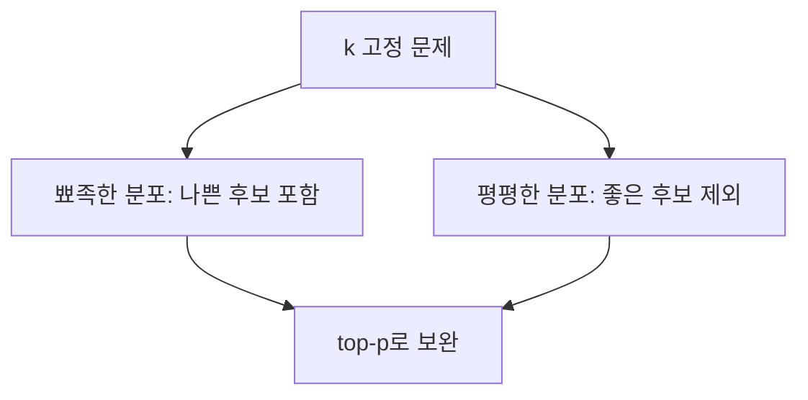

# top-k 샘플링

> 다음 토큰 후보를 **확률 상위 k개로 줄이고, 그 안에서 확률에 비례해 무작위로 뽑는** 방식. 이상한 꼬리 단어를 잘라 내면서 다양성을 유지한다.

## 쉽게 말하면
메뉴판에서 인기 메뉴 상위 50개만 남기고 그중에서 주사위로 고르는 것이다. 이상한 메뉴는 아예 못 고르지만, 평소 인기 3개뿐인 날에도 50개로 고정이라는 점이 문제다.

## 자세히
(Hugging Face 블로그 기준.)
- 동작: 상위 k개 후보의 확률을 다시 정규화해 그 안에서 샘플링. `top_k=50`으로 GPT-2를 돌렸을 때 예시 중 가장 사람다운 글이 나왔다고 한다.
- 한계: **k가 고정**이다. 분포가 뾰족하면(소수 후보가 압도) 질 나쁜 후보가 끼고, 평평하면(그럴듯한 후보 다수) 좋은 후보를 잘라 낸다.
- 대안 **top-p(nucleus)**: 누적 확률이 p를 넘는 최소 집합에서 샘플링해 집합 크기가 단계마다 달라진다(`top_p=0.92`면 어떤 단계는 9개, 어떤 단계는 3개). top-k와 함께 쓰기도 한다(`top_k=50, top_p=0.95`).
- 요약: 탐욕·빔은 반복적, top-k·top-p는 유창하고 다양하지만 모든 경우에 맞는 단일 방법은 없다.
- 이 글에서 Fan 외 2018 논문과 top-k의 기원을 연결하려 했으나, 그 논문의 초록 페이지에는 top-k가 언급되지 않아 기원 설명은 적지 않는다.

## 그림으로 보기



## 예시
```python
model.generate(input_ids, do_sample=True, top_k=50)
```
- 교육: k를 5·50·500으로 바꿔 같은 프롬프트의 글을 비교.

## 헷갈리는 것과 비교
| 개념 | 차이 |
|---|---|
| top-k | 후보 수 고정 |
| [nucleus 샘플링](#nucleus-sampling) | 누적 확률로 후보 수가 유동 |
| [탐욕 디코딩](#greedy-decoding) | 샘플링 없이 최대 확률만 |

## 더 읽을거리
- [How to generate text (Hugging Face)](https://huggingface.co/blog/how-to-generate) — top-k·top-p 설명(읽음).
- [Neural Text Degeneration](https://arxiv.org/abs/1904.09751) — nucleus 제안(초록 읽음).
