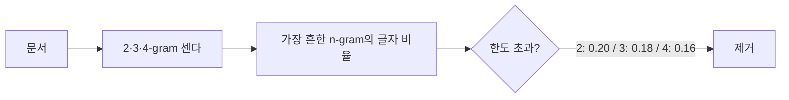
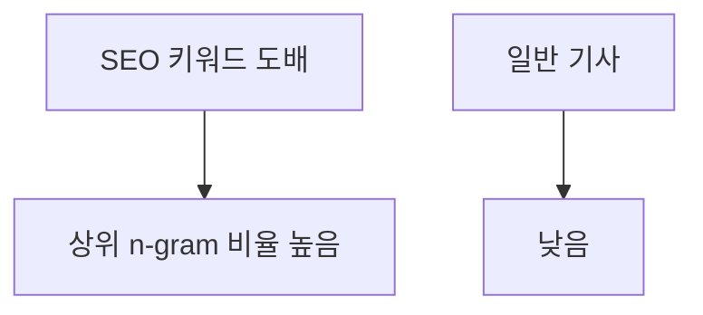

# 상위 n-그램 문자 비율

> 문서에서 가장 자주 나온 n-그램(2~4단어 묶음)이 전체 글자의 몇 %를 차지하는지 재는 반복 측정값이다. 너무 크면 같은 구절만 되풀이하는 저품질 문서로 보고 제거한다.

## 쉽게 말하면
작문 숙제에서 "그리고 나서 그리고 나서 …"만 가득하면 한눈에 이상하다. 가장 많이 나온 짧은 구절이 지면의 몇 %를 먹었는지 보는 것이다.

## 자세히
(Gopher 논문 arXiv 2112.11446 부록 A.1과 표 A1을 직접 읽고 확인.)
- 각 n ∈ {2,3,4}에 대해 **가장 자주 나오는 n-gram이 차지하는 글자 비율**을 계산한다.
- 제거 임계값(표 A1): 2-gram 0.20, 3-gram 0.18, 4-gram 0.16. 짧은 n일수록 한도가 높다 — 자연스러운 글에서도 짧은 구절은 더 자주 나오기 때문.
- "짧은 중복 구절이 많은 문서"를 잡는 용도이고, 길게 덩어리로 반복되는 문서는 [중복 n-그램 문자 비율](#duplicate-ngram-fraction)이 잡는다.
- 비율 계산은 단어 기준인지 글자 기준인지 등 구현 세부는 논문에 자세히 없다(제안: 직접 구현 시 토큰화 규칙을 문서화).

## 그림으로 보기

## 예시
- "무료 다운로드 무료 다운로드 …" 식의 스팸 페이지가 상위 2-gram 비율로 걸림.
- 교육 활용: 간단한 파이썬 `Counter`로 직접 측정해 보는 실습.

## 헷갈리는 것과 비교
| 개념 | 차이 |
|---|---|
| 상위 n-gram 비율 | 가장 흔한 한 구절의 점유율(n=2~4) |
| [중복 n-그램 비율](#duplicate-ngram-fraction) | 두 번 이상 나온 모든 n-gram(n=5~10) |
| [반복 임계값](#repetition-thresholds) | 이 측정들의 한도 모음 |

## 더 읽을거리
- [Gopher (arXiv 2112.11446)](https://arxiv.org/abs/2112.11446) — 표 A1.
