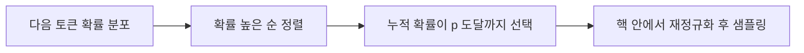
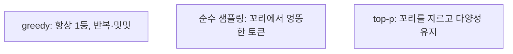

# top-p(핵 샘플링)

> **top-p(nucleus) 샘플링**은 다음 토큰 후보를 확률 순으로 더해 **누적 확률이 p에 닿을 때까지의 후보(핵)** 만 남기고, 그 안에서 뽑는 디코딩 방법이다. 신뢰할 수 없는 꼬리를 잘라 낸다.

## 쉽게 말하면
룰렛을 돌릴 때 확률이 낮은 이상한 칸은 아예 지워 두고, 그럴듯한 칸들 중에서만 돌리는 것이다. 자신 있는 문장에서는 후보가 적게, 막막한 문장에서는 후보가 많이 남는다.

## 자세히
(Holtzman 외, arXiv 1904.09751 초록 확인)
- **문제**: 우도 최대화는 **학습 목표**로는 좋지만 **디코딩**에 쓰면 **밋밋하고 반복적인** 퇴화(degenerate) 텍스트가 나온다. 사람과 기계 텍스트의 분포가 다르고, **같은 모델이라도 디코딩 전략만으로 품질이 크게 달라진다**.
- **해법**: **Nucleus Sampling(top-p)**: 확률 분포의 **동적 핵**에서 샘플링하고 신뢰할 수 없는 **꼬리를 잘라** 유창성·일관성을 사람 텍스트 수준으로 유지하면서 다양성을 높인다.
- **특징**: 후보 수가 고정이 아니라 분포 모양에 따라 변한다(고정 개수는 top-k).
- 설정(일반 지식): 보통 0.9~0.95 근처를 많이 쓰며, 사실 정확성이 중요한 작업은 낮추고 창작은 높인다. API에서는 temperature와 함께 조절하되 둘을 동시에 크게 바꾸지 않는 것이 흔한 권고다.

## 그림으로 보기



## 예시
```python
# OpenAI 호환 API 개념 예시
client.chat.completions.create(model=M, messages=msgs, top_p=0.9, temperature=1.0)
```
- 마케팅 문구 아이디어는 top_p 0.95, 계약서 요약은 낮은 값 또는 낮은 temperature.

## 헷갈리는 것과 비교
| 개념 | 차이 |
|---|---|
| top-p | 누적 확률 기준 가변 후보 수 |
| top-k | 상위 k개 고정 |
| temperature | 분포의 날카로움 조절 |
| 탐욕 디코딩 | 항상 최대 확률 선택 |

## 더 읽을거리
- [The Curious Case of Neural Text Degeneration](https://arxiv.org/abs/1904.09751)
