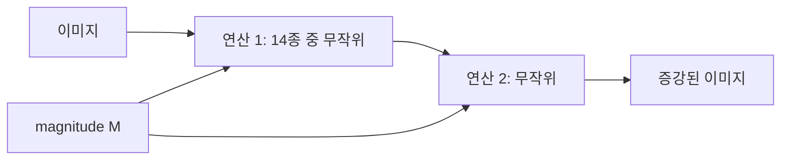
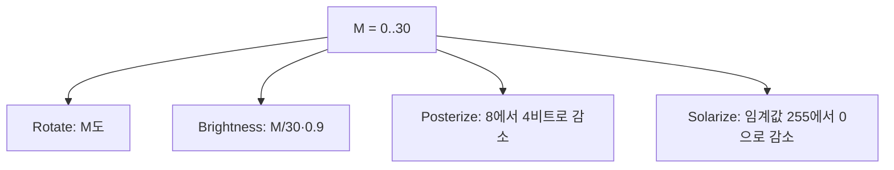

# torchvision RandAugment 사용법

> `torchvision.transforms.RandAugment(num_ops=2, magnitude=9)`는 이미지마다 **연산 14종 중 `num_ops`개를 무작위로 골라 같은 강도 `magnitude`로** 적용한다. 조절할 값이 사실상 두 개(개수 N, 강도 M)라 탐색이 간단하다.

## 쉽게 말하면
사진 보정 앱에서 필터 14개 중 2개를 무작위로 뽑아 "강도 9"로 적용하는 버튼이다. 강도를 올리면 회전은 더 많이, 밝기 변화는 더 크게 걸린다. 어떤 필터가 뽑힐지는 운이라 매번 다른 사진이 나온다.

## 자세히
- **인자**(torchvision 0.29.2 설치해 확인, 공식 문서 확인): `num_ops`(기본 2) 한 이미지에 순서대로 적용할 연산 수, `magnitude`(기본 9) 모든 연산에 쓰는 강도, `num_magnitude_bins`(기본 31) 가능한 강도 단계 수(그래서 magnitude는 0~30), `interpolation`(기본 NEAREST), `fill`(빈 칸 채움).
- **RandAugment 논문**(Cubuk 외 2019, arXiv 1909.13719 초록 확인): 탐색 공간을 크게 줄여 **별도 탐색·대리 과제 없이 목표 과제에서 바로 학습**할 수 있고, 해석 가능한 하이퍼파라미터 하나로 정칙화 강도를 조절한다고 한다. ImageNet 85.0%, 객체 검출에서 기준 증강 대비 1.0~1.3% 향상 등을 보고했다.
- **연산 14종**(직접 확인): Identity, ShearX/Y, TranslateX/Y, Rotate, Brightness, Color, Contrast, Sharpness, Posterize, Solarize, AutoContrast, Equalize.
- **강도 M이 실제 값으로 바뀌는 방식**(직접 확인, 32×32 이미지 기준, 방향은 연산에 따라 ±가 무작위):

| 연산 | M=9 | M=30 |
|---|---|---|
| Rotate(도) | 9 | 30 |
| ShearX | 0.09 | 0.30 |
| TranslateX(픽셀) | 4.35 | 14.50 |
| Brightness 변화율 | 0.27 | 0.90 |
| Posterize(비트) | 7 | 4 |
| Solarize(임계값) | 178.5 | 0 |

  Posterize는 비트가 줄고 Solarize는 임계값이 낮아질수록 강해진다. 즉 M은 연산마다 방향이 다른 값을 "같은 강도 눈금"으로 바꿔 주는 약속이다.
- **직접 실행**(digits 손글씨 200장을 32×32 RGB uint8로 확대, N=2, 이미지당 한 번씩): 평균 절대 픽셀 변화(0~255)는 M=0에서 9.3, M=5에서 22.3, M=9에서 35.9, M=15에서 46.7, M=30에서 72.1로 M이 클수록 단조 증가했다. M=0에서도 변화가 있는 것은 AutoContrast·Equalize 같은 강도와 무관한 연산이 뽑히기 때문이다(해석). 한 번씩 측정한 값이라 분포 전체를 대표하지 않는다.
- **사용법**: 이미지 텐서(uint8) 또는 PIL 이미지에 적용한다. 학습용 변환에만 넣고 검증에는 넣지 않는다.

## 그림으로 보기



## 예시
```python
from torchvision.transforms import v2, RandAugment
train_tf = RandAugment(num_ops=2, magnitude=9)   # 기본값
img_aug = train_tf(uint8_image_tensor)
```
- 작은 모델·작은 데이터에는 M을 낮게(예: 5), 큰 모델·긴 학습에는 높게 시도.
- 교육: M을 0·9·30으로 바꿔 같은 이미지를 증강해 한 장씩 나란히 보여 주기.

## 헷갈리는 것과 비교
| 개념 | 차이 |
|---|---|
| RandAugment | 연산 무작위 선택, 강도 공통, 탐색 변수 2개 |
| [AutoAugment](#autoaugment-search-space) | 정책을 별도 탐색해 학습 |
| `num_ops` N | 연산 개수 |
| `magnitude` M | 모든 연산의 공통 강도 |

## 더 읽을거리
- [RandAugment 논문 초록](https://arxiv.org/abs/1909.13719) — 탐색 공간 축소와 결과(열어 확인).
- [torchvision RandAugment 문서](https://docs.pytorch.org/vision/main/generated/torchvision.transforms.RandAugment.html) — 인자 설명(열어 확인).
