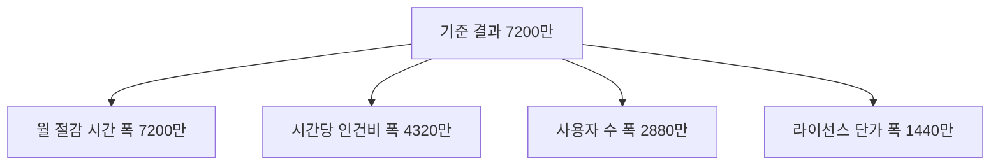

# 토네이도 차트

> 입력 변수를 하나씩만 낮은 값·높은 값으로 바꿨을 때 결과(예: 연간 순효과)가 얼마나 움직이는지를 막대로 그려, 영향이 큰 순서대로 위에서부터 정렬한 민감도 차트. 막대가 위에서 아래로 좁아져 토네이도 모양이 된다.

## 쉽게 말하면
요리에서 소금·설탕·불 세기를 하나씩만 바꿔 맛이 얼마나 변하는지 재고, 맛을 가장 크게 바꾸는 재료부터 순서대로 적어 둔 표다. 어떤 숫자를 먼저 더 정확히 알아봐야 할지 알려 준다.

## 자세히
- **만드는 법(MetricGate, GoldSim 문서, 열람)**: ① 입력별 기준값과 변동 범위를 적는다. ② 기준 결과를 계산한다. ③ 한 번에 한 입력만 낮은 값·높은 값으로 바꾸고 나머지는 기준값으로 두고 모델을 다시 돌린다(GoldSim은 변수마다 하한·중앙·상한 3회 실행, 변수 10개면 30회). ④ 변수별 폭(swing)=높은 값 결과와 낮은 값 결과의 차이의 절댓값. ⑤ 폭 순으로 정렬해 기준 결과를 중심선으로 막대를 그린다.
- **범위 선택**: 기본으로 ±20%를 쓰는 경우가 많지만 신뢰구간 같은 그럴듯한 한계가 있으면 그것이 낫고, 모든 입력에 같은 논리를 써야 순위가 범위 폭이 아니라 영향을 반영한다.
- **한계**: 입력 간 상관·동시 이동을 못 보여 준다(각각 고정하고 하나만 변경). 전체 불확실성은 못 재므로 확률적 민감도 분석(PSA)이나 [몬테카를로](#monte-carlo-roi)가 보완한다. 대칭 퍼센트 범위가 실제 불확실성과 다를 수 있고, 막대가 15~20개를 넘으면 읽기 어렵다(MetricGate 기준, 한 출처의 가이드).
- **ICER 주의**: 비용효과 분석 문서의 예(ΔE가 0이거나 부호가 바뀌면 ICER 정의 불가)는 보건경제학 맥락이며, AI ROI에서는 "순효과" 같은 차이값을 결과로 쓰면 이 문제를 피한다(해석).

## AI ROI 가상 예시(이 글에서 직접 계산한 가상 수치)
기준: 사용자 100명, 월 3시간 절감, 시간당 인건비 3만 원, 라이선스 월 3만 원/인 → 연 순효과 = 100×3×12×30,000 − 100×30,000×12 = 7,200만 원.

| 입력 | 낮은 값 → 높은 값 | 순효과 낮음 | 순효과 높음 | 폭 |
|---|---|---|---|---|
| 월 절감 시간 | 2h → 4h | 3,600만 | 10,800만 | 7,200만 |
| 시간당 인건비 | ±20% | 5,040만 | 9,360만 | 4,320만 |
| 사용자 수 | 80 → 120 | 5,760만 | 8,640만 | 2,880만 |
| 라이선스 단가 | ±20% | 7,920만 | 6,480만 | 1,440만 |

→ 월 절감 시간이 가장 영향이 큰 입력이므로, 파일럿에서 가장 먼저 실측해야 할 값이다.

## 그림으로 보기

## 예시
- 위 표를 스프레드시트로 만들어 막대 차트(가로 누적 막대 트릭)로 토네이도를 그린다.
- 교육 실습: 자기 AI 도입안의 입력 5개에 ±20%를 적용해 폭을 계산하고 순위를 매긴다.

## 헷갈리는 것과 비교
| 개념 | 차이 |
|---|---|
| 토네이도 차트 | 입력을 하나씩 바꾼 영향 순위 |
| 시나리오 분석 | 여러 입력을 함께 바꾼 시나리오 |
| [몬테카를로 ROI 시뮬레이션](#monte-carlo-roi) | 입력을 분포로 두고 반복해 범위를 얻음 |
| 민감도 분석 | 상위 개념 |

## 더 읽을거리
- [MetricGate: Deterministic sensitivity tornado](https://metricgate.com/docs/deterministic-sensitivity-tornado/) — 단계·범위·함정(열람)
- [GoldSim: Tornado chart](https://help.goldsim.com/Modules/5/sensitivityanalysistornadochart.htm) — 막대 읽는 법(열람)
