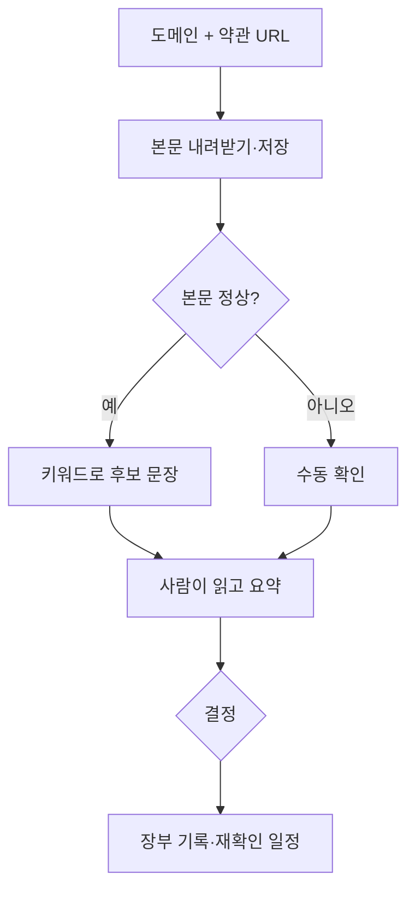
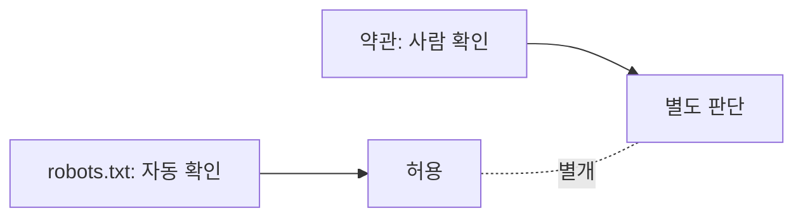

# 수집 전 약관 확인 단계

> 웹 데이터를 학습용으로 수집하기 전에 **크롤러가 읽지 못하는 이용약관을 사람이 읽고 판단하는 단계**다. robots.txt는 프로그램이 자동으로 확인할 수 있지만, AI 학습·스크래핑에 관한 약관 조항은 사람이 확인해야 한다.

## 쉽게 말하면
출입문의 자동 보안 게이트(robots.txt)는 센서가 읽어 열어 주지만, 건물 안내문(약관)에 "촬영 금지"가 적혀 있는지는 사람이 읽어야 안다. 센서가 열어 줬다고 안내문까지 지킨 것은 아니다.

## 자세히
(RFC 9309와 상위 노드 [robots.txt vs 이용약관](#robots-txt-vs-tos)의 내용을 바탕으로, 약관 4곳을 직접 내려받아 키워드 검색을 해 보았다. 법률 자문이 아니다.)
- **왜 사람이 보나**: RFC 9309는 robots.txt 규칙이 접근 권한 부여가 아니라고 명시한다. 약관은 별도 계약이고 AI 학습 허용·금지가 약관에만 적혀 있을 수 있다([도메인별 허용 의사 기록](#domain-consent-registry)).
- **직접 실험(2026-11-22, 이 환경에서 약관 페이지 4곳을 내려받아 키워드 `scrap*`, `crawl*`, `machine learning`, `artificial intelligence`, `AI`, `text and data mining`, `automated means`, `robot` 등을 검색)**
  | 사이트 | 내려받은 글자 수 | 키워드 일치 | 관찰 |
  |---|---|---|---|
  | NYTimes 약관 | 약 58,900 | 22건 | 머신러닝·AI 시스템의 개발·학습·미세조정에 콘텐츠를 쓰는 것을 제한하는 문장, 스크래핑·텍스트·데이터 마이닝 관련 문구 |
  | Reddit 이용약관 | 약 90,000 | 8건 | 크롤링은 robots.txt의 매개변수에 따라 조건부 허가, 스크래핑은 별도 제한이라는 취지의 문장 |
  | Wikimedia 이용약관 | 약 52,700 | 1건(`robot`) | AI 학습 관련 직접 언급은 없고 API 문서(User-Agent, Robot Policy)를 약관에 편입한다고 적힘 |
  | BBC 약관 페이지 | 약 3,000 | 0건 | 본문이 짧아 실제 약관 본문을 받지 못한 것으로 보임(스크립트로 불러오는 페이지일 수 있음) |
  키워드 검색은 **후보 문장을 찾아 주는 보조 도구**일 뿐이다. BBC 사례처럼 본문을 못 받으면 0건이 "문제 없음"으로 오해되고, Wikimedia 사례처럼 다른 문서를 편입해 참조하는 구조는 키워드로 안 잡힌다. 일치 문장이 있어도 해석은 사람이(필요하면 법무가) 한다. 위 문장의 정확한 의미·집행 가능성은 판단하지 않았다.
- **단계(제안)**
  1. 도메인별 약관·이용정책 URL 찾기(푸터 링크, 별도 AI·개발자 정책 문서 포함)
  2. **본문이 실제로 내려받아졌는지** 확인(글자 수가 너무 짧으면 수동 확인)
  3. 키워드로 후보 문장 추출 → 사람이 읽고 AI 학습·스크래핑·재배포·API 요건을 요약
  4. 결정(사용 / 제외 / 보류), 결정자·날짜·약관 스냅샷(저장본·해시) 기록
  5. 편입된 문서(API 정책·콘텐츠 정책)와 별도 계약이 있는지 확인
  6. 변경 감지를 위해 재확인 일정 설정
- **더 엄격한 쪽을 기준으로**: robots.txt가 허용이어도 약관이 금지면 약관 쪽을 따르는 보수적 원칙(상위 노드 권고).

## 그림으로 보기

## 예시
- 사내 학습 말뭉치용 도메인 30개: 약관 본문 저장 → 키워드 후보 추출 → 법무가 AI 조항 확인 → 결정 열에 기록. 본문 길이가 3,000자 미만인 도메인은 수동 열람 목록으로.
- 교육 소재: 약관 4곳을 위 표 방식으로 비교해 "약관에 AI 학습이 어떻게 적혀 있는가"를 읽어 보는 워크숍.

## 헷갈리는 것과 비교
| 개념 | 차이 |
|---|---|
| 수집 전 약관 확인 단계 | 약관을 사람이 읽고 결정하는 절차 |
| [robots.txt vs 이용약관](#robots-txt-vs-tos) | 두 장치의 성격 차이 |
| [도메인별 허용 의사 기록](#domain-consent-registry) | 결과를 장부로 남김 |
| [이용약관의 AI 조항 검토](#tos-ai-clause-review) | 조항 읽는 방법 세부 |

## 더 읽을거리
- [RFC 9309: Robots Exclusion Protocol](https://www.rfc-editor.org/rfc/rfc9309.html) — robots.txt가 접근 권한이 아님(직접 확인).
