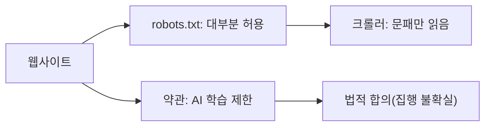
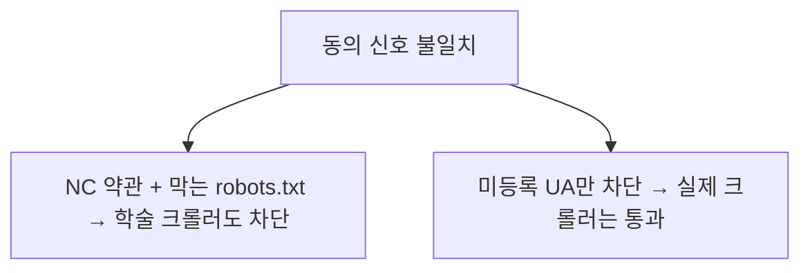

# 이용약관 vs robots.txt 불일치

> 같은 웹사이트라도 이용약관(법적 합의)은 AI 학습을 광범위하게 제한하는데 robots.txt(크롤러 안내)는 거의 막지 않는 식으로 두 신호가 어긋나는 문제다. AI 데이터 동의 표시 체계의 한계를 보여 준다.

## 쉽게 말하면
집 대문 문패(robots.txt)에는 "출입 가능"이라 적고 집 안 규정집(약관)에는 "촬영 금지"라고 적혀 있는 격이다. 크롤러는 보통 대문 문패만 읽는다.

## 자세히
(Longpre 외, "Consent in Crisis", arXiv 2407.14933 3.2절과 표 3·4를 하위 에이전트가 PDF로 읽은 노트 기준.)
- **토큰 비율(표 4)**: 제한적 약관 아래 토큰 — C4 43.2%, RefinedWeb 52.8%, Dolma 52.3%. 제한적 robots.txt 아래 — C4 5.0%, RefinedWeb 6.6%, Dolma 5.6%. 초록: C4의 **45%**가 약관으로 제한. 본문: 세 코퍼스 토큰의 45~55%가 약관에 데이터 사용 제한이 있다. 약관의 크롤링 제한은 최근 1년에 상대적으로 26~53% 증가.
- **성격 차이**: robots.txt는 크롤러용 지침, 약관은 법적 합의이며 대부분의 크롤러는 약관을 따르지 않지만 법적 집행 수단이 될 수 있다(논문 인용 사례 Bogard v. TikTok).
- **불일치**: 그림 3의 교차 집계에서 두 신호가 자주 엇갈린다. 비상업(NC) 전용 약관이 제한적 robots.txt와 함께 쓰여 학술 크롤러까지 의도치 않게 막을 수 있다.
- **크롤러 목록의 허점(표 3)**: 어떤 AI 업체라도 제한하는 사이트에서 OpenAI를 제한하는 비율 91.5%, Common Crawl 83.4%, Anthropic 83.4%, Google-Extended 72.0%. 사이트의 4.5%는 인식되지 않는 에이전트(ANTHROPIC-AI, CLAUDE-WEB)만 막고 ClaudeBot은 막지 않았다. AI 크롤러를 일일이 나열해야 하는 표현력의 한계다.
- 약관이 생성형 AI를 명시적으로 언급하기 시작한 것은 2024년부터라고 한다.

## 그림으로 보기

## 예시
- 학습 데이터 수집 전, 대상 사이트의 약관과 robots.txt를 둘 다 점검해 불일치 목록을 만든다.
- 교육 활용: "크롤링해도 되나?"가 기술(robots.txt)과 법(약관) 두 층의 질문임을 설명.

## 헷갈리는 것과 비교
| 개념 | 차이 |
|---|---|
| robots.txt | 크롤러에 대한 기술적 지침 |
| 이용약관 | 법적 합의, 집행은 별도 |
| [AI 데이터 커먼즈](#ai-data-commons) | 이 신호들이 줄이는 공개 데이터 풀 |

## 더 읽을거리
- [Consent in Crisis (arXiv 2407.14933)](https://arxiv.org/abs/2407.14933) — 표 3·4, 3.2절.
