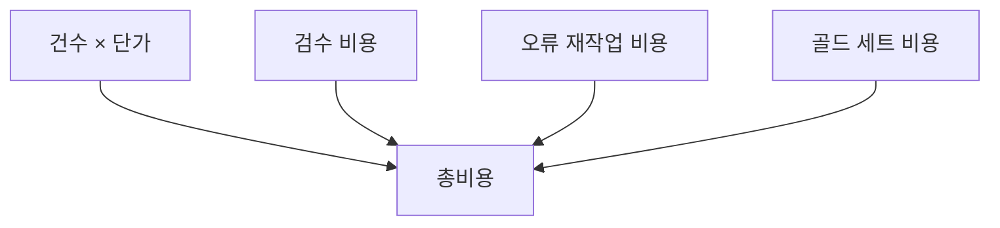
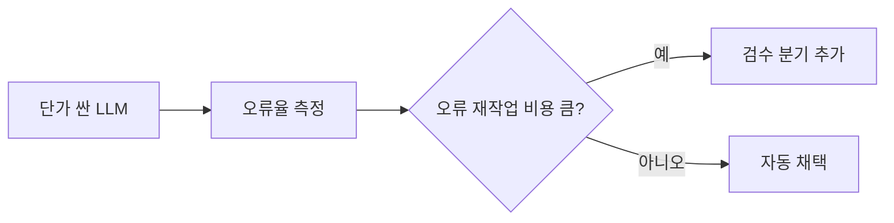

# 라벨링 총비용 계산

> 라벨링 비용은 **건당 단가만이 아니라 검수·재작업·정답(골드) 세트 비용까지 합친 총액**으로 비교해야 한다. 단가가 싼 방식이 총비용도 싼 것은 아니다.

## 쉽게 말하면
식당 가격표는 메뉴 값만 보여 주지만, 실제로 쓴 돈은 팁, 세금, 음식을 남겨 다시 주문한 값까지 더한 것이다. 라벨링도 가격표(단가)와 영수증(총비용)이 다르다.

## 자세히
- **단가의 근거(Gilardi 외, arXiv 2303.15056, 초록 직접 읽음)**: 트윗 2,382건의 관련성·입장·주제·프레임 탐지에서 zero-shot ChatGPT가 5개 작업 중 4개에서 크라우드워커보다 정확했고, 코더 간 일치도는 모든 작업에서 크라우드·훈련된 주석자보다 높았다. 건당 **0.003달러 미만**, MTurk보다 약 **20배 저렴**하다. 2023년 모델·가격 기준이고 영어 트윗 중심이라 지금 가격·다른 작업에는 그대로 적용할 수 없다.
- **총비용 공식(제안)**: 총비용 = 건수×단가 + 건수×검수율×검수 단가 + 건수×오류율×재작업 단가 + 골드 세트 건수×골드 단가.
  - 오류율은 사람 정답 세트와 비교해 잰다([사람 정답 세트 점검](#gold-set-check)).
  - 외부 API로 보낼 수 없는 데이터라면 비용 외 제약이 생긴다([라벨링 중 개인정보 문제](#data-privacy-in-annotation)).
- **가상 계산(모든 값은 가정, 실제 가격 아님)**: 건수 10만, 골드 500건(건당 1달러), 검수 단가 0.5달러, 재작업 단가 0.10달러로 두고
  - 크라우드: 단가 0.10, 검수율 5%, 오류율 12% → 약 **14,200달러**
  - LLM 단독: 단가 0.003, 검수율 5%, 오류율 15%(가정) → 약 **4,800달러**
  - LLM+불확실 건 사람 검수(검수율 20%, 오류율 5%) → 약 **11,300달러**
  이 숫자는 오류율·검수율 가정에 민감하다. 요점은 "LLM 단가가 압도적으로 싸도 검수·재작업이 총비용의 대부분이 된다"는 구조다. 검수율을 올리면 오류는 줄지만 비용이 급격히 늘어 균형점을 찾아야 한다.
- **실무 절차(제안)**: ① 골드 200~500건 확보 ② 후보 방식별 오류율 측정 ③ 위 공식에 대입해 총비용 비교 ④ 민감도 분석(오류율 ±5%p).

## 그림으로 보기

## 예시
| 방식(가정) | 총비용 |
|---|---|
| 크라우드 | 약 14,200달러 |
| LLM 단독 | 약 4,800달러 |
| LLM + 사람 검수 20% | 약 11,300달러 |
- 업무 장면: 교육 사례 분류 라벨 5만 건을 만들 때 골드 300건으로 오류율을 재고 세 방식의 총비용 표를 만들어 의사결정 자료로 쓴다.

## 헷갈리는 것과 비교
| 개념 | 차이 |
|---|---|
| 총비용 | 단가+검수+재작업+골드 |
| 건당 단가 | 총비용의 일부 |
| [주석 비용 비교](#annotation-cost-comparison) | 방식별 비교의 상위 틀 |
| [확신도 기반 사람 검수 분기](#llm-annotator-confidence-routing) | 검수 비용을 줄이는 방법 |

## 더 읽을거리
- [ChatGPT Outperforms Crowd-Workers for Text-Annotation Tasks (arXiv 2303.15056)](https://arxiv.org/abs/2303.15056) — 건당 단가·정확도 비교(초록 직접 읽음).
