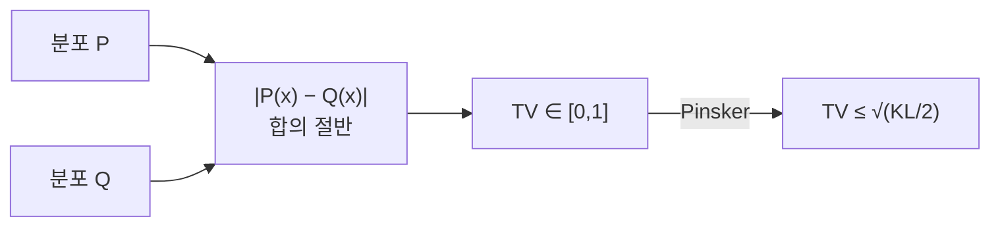

# 총변동 거리

> 총변동 거리(total variation distance, TV)는 두 확률분포가 같은 사건에 매기는 확률의 최대 차이다. 0이면 같은 분포, 1이면 완전히 안 겹친다. 이산 분포에서는 확률 질량 차이의 절대값 합의 절반이다.

## 쉽게 말하면
두 사람이 같은 주사위 게임의 결과를 예측한다. 어떤 사건(예: "짝수가 나온다")을 골라도 두 사람의 확률 차이가 항상 작다면 두 사람의 생각은 거의 같다. 그 "가장 크게 어긋나는 사건에서의 차이"가 TV다. 직관적이라 가장 이해하기 쉬운 분포 거리다.

## 자세히
- 정의: `δ(P,Q) = sup_A |P(A) − Q(A)|`.
- 이산: `½ Σ |P(x) − Q(x)|` (L1 거리의 절반). 연속: `½ ∫ |p(x) − q(x)| dx`.
- 범위 [0, 1]. 대칭이고 삼각부등식을 만족하는 진짜 거리다. KL과 달리 비대칭 문제가 없다.
- **결합(coupling) 해석**: X~P, Y~Q를 같이 뽑을 때 X≠Y일 확률의 최솟값. "같은 값으로 최대한 맞춰 뽑아도 어쩔 수 없이 달라지는 비율"이다. 비용 1(x≠y)·0(x=y)의 최적 수송 비용과 같다([바서슈타인](#wasserstein-distance)의 특수한 경우로 볼 수 있음).
- **KL과의 관계(Pinsker 부등식)**: `δ ≤ √(KL(P‖Q)/2)`. KL이 2를 넘으면 의미가 없어진다. Bretagnolle–Huber 부등식 `δ ≤ √(1 − e^{−KL})`은 KL이 커도 1 아래를 유지한다. (Wikipedia 정리 기준; BH식의 제곱근은 표준형으로 보정된 것이라 원문 표기와 다를 수 있다.)
- Hellinger 거리와는 `H² ≤ δ ≤ √2·H`. f-발산이자 적분 확률 척도(IPM)이기도 하다.
- 한계: 안 겹치는 두 분포는 얼마나 멀든 1로 똑같이 나와 기울기가 없다. 그래서 GAN 목적으로는 [JS](#gan-js-divergence)와 같은 약점이 있다.
- 쓰임: 두 모델 출력 분포의 최대 차이 보장(예: 추론 가속 speculative decoding의 거절 확률 해석), 가설검정 오류의 하한.

## 그림으로 보기


## 예시
P=(0.5, 0.5), Q=(0.7, 0.3): TV = ½(0.2+0.2) = 0.2. 가장 크게 어긋나는 사건은 "첫째 값"(0.5 vs 0.7)이다.
```python
tv = 0.5 * np.abs(p - q).sum()
```

## 헷갈리는 것과 비교
| 개념 | 차이 |
| --- | --- |
| TV | 최대 확률 차, 유계 [0,1], 대칭 |
| [KL](#kl-divergence) | 비대칭, 무한대 가능, 정보 이론 의미 |
| [JS](#jensen-shannon) | KL의 대칭·유계 평활화 |
| [바서슈타인](#wasserstein-distance) | 값 사이의 거리를 반영 |

## 더 읽을거리
- [Total variation distance of probability measures (Wikipedia)](https://en.wikipedia.org/wiki/Total_variation_distance_of_probability_measures) — 정의·결합 해석·Pinsker
