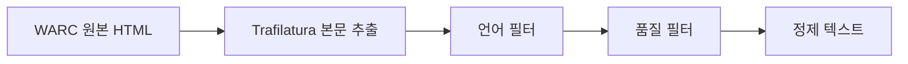
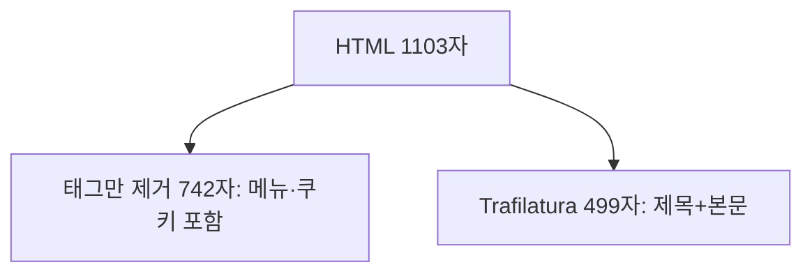

# Trafilatura 본문 추출

> Trafilatura는 웹페이지 HTML에서 메뉴·광고·푸터를 떼고 **본문 텍스트와 메타데이터만** 뽑아 주는 파이썬 라이브러리다. 웹 말뭉치를 만드는 파이프라인의 첫 단계에 자주 쓰인다.

## 쉽게 말하면
신문 한 면을 오려서 스크랩북에 붙일 때 기사만 오리고 광고와 목차는 버리는 가위다. HTML에는 기사보다 메뉴·쿠키 안내·관련 링크가 더 많은 경우가 흔해서, 그대로 학습에 쓰면 쓸모없는 반복 문구가 쌓인다.

## 자세히
- **기능**(공식 문서 확인): 자체 규칙 기반 추출기를 쓰고 jusText·readability-lxml을 보조 대안으로 둔다. 본문 외에 제목·작성자·날짜·사이트명·분류·태그 같은 메타데이터, 문단·목록·인용·코드 구조를 뽑고 댓글·링크·이미지·표는 선택이다. 사이트맵·피드 탐색, TXT·Markdown·JSON·XML 등 출력도 지원한다. 문서는 오픈소스 추출기 비교에서 "일관되게 앞선다"고 주장하지만 점수 수치는 해당 페이지에 없다(주장으로 취급).
- **직접 실행**(trafilatura, 합성 HTML 1,103자: 메뉴·쿠키 배너·본문 3문단·관련 링크·푸터·스크립트 포함): `trafilatura.extract(html)`은 499자를 반환했고 제목과 본문 3문단만 남았다. 단순히 태그만 지운 결과는 742자로 "Home Products Pricing Blog Login", "We use cookies…" 같은 메뉴·쿠키 문구가 그대로 섞였다. `favor_precision=True`도 이 예에서는 같은 499자였다. 작은 합성 페이지 1개라 실제 웹의 난이도를 대표하지 않는다.
- **정밀도 대 재현율**: 문서는 잡음을 줄이는 쪽(precision)과 본문을 빠뜨리지 않는 쪽(recall)을 균형 잡는다고 설명한다. 학습 말뭉치는 보통 잡음이 더 해로우므로 precision 쪽 옵션을 고르는 경우가 많다(해석).
- **파이프라인에서의 위치**: datatrove의 FineWeb 예시 스크립트는 WarcReader → URLFilter → Trafilatura(`favour_precision=True`) → 언어 필터 → 품질 필터 순이다([FineWeb 예시](#datatrove-fineweb-example)). Common Crawl이 미리 만든 텍스트(WET) 대신 WARC의 원본 HTML에서 직접 추출하는 구성이다. 왜 그렇게 했는지 이유는 이번에 연 출처에서 확인하지 못했다.
- 흔한 문제: 표·코드가 많은 페이지, 동적 렌더링(자바스크립트로 채우는) 페이지는 비어 나올 수 있다. 추출 길이가 너무 짧은 문서는 버리는 필터와 함께 쓴다.

## 그림으로 보기



## 예시
```python
import trafilatura
text = trafilatura.extract(html, favor_precision=True)  # 본문만, 없으면 None
```
- 사내 위키 HTML 덤프를 학습·검색용 텍스트로 바꿀 때: 메뉴·푸터가 모든 문서에 반복되면 [중복 제거](#training-data-deduplication)에서 뒤늦게 고생하므로 추출 단계에서 먼저 뗀다.
- 교육: 같은 페이지에 대해 단순 태그 제거와 Trafilatura 결과를 나란히 보여 준다.

## 헷갈리는 것과 비교
| 개념 | 차이 |
|---|---|
| 태그 제거(regex) | HTML 태그만 지움. 메뉴·푸터는 남음 |
| Trafilatura | 본문 위치를 추정해 나머지를 제거 |
| WET 파일 | Common Crawl이 미리 뽑은 텍스트(추출기 선택 불가) |
| [품질 필터](#fineweb-quality-filters) | 추출 뒤 문서 품질을 거름 |

## 더 읽을거리
- [Trafilatura 공식 문서](https://trafilatura.readthedocs.io/en/latest/) — 기능, 출력 형식, 평가 주장(열어 확인).
- [FineWeb 논문 초록](https://arxiv.org/abs/2406.17557) — 96개 스냅샷 15조 토큰 데이터셋 개요(열어 확인, 추출 방식 서술은 이 페이지에 없음).
