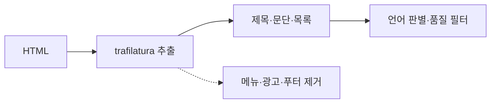
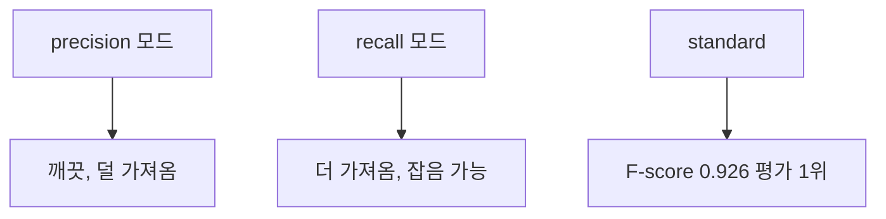

# trafilatura 본문 추출기

> **trafilatura**는 HTML에서 메뉴·광고·푸터를 빼고 **본문 텍스트(와 제목·목록)만 뽑아 주는 오픈소스 파이썬 라이브러리**다. 웹 크롤 데이터를 학습용 텍스트로 만드는 첫 단계에 쓰인다.

## 쉽게 말하면
신문에서 기사 본문만 오려 내는 가위다. 광고 박스와 목차, 하단 저작권 문구는 버리고 기사만 남긴다. 가위가 잘 들수록 뒤 단계(언어·품질 필터)가 쓸 만한 재료를 받는다.

## 자세히
- **직접 실행(2026-11-28, trafilatura 2.4.0 설치)**: 내비게이션 메뉴, "Buy now!" 광고 박스, 본문 문단 2개와 목록 2개, 푸터(저작권·개인정보 문구)가 있는 작은 HTML을 `trafilatura.extract(html)`에 넣었다. 결과는 **제목 + 문단 + 목록 + 문단**만 남고 메뉴·광고·푸터는 제거됐다. `favor_precision=True`와 `favor_recall=True` 결과가 이 작은 예제에서는 같았다. `output_format='markdown'`을 주면 `# 제목`과 `- 목록` 같은 서식이 유지됐다.
- **공식 평가 페이지(2026-10-02 갱신, 직접 읽음)**: 990개 문서(텍스트 2,951·보일러플레이트 2,966 세그먼트, 주로 독일어 웹 페이지와 영어·프랑스어·기타 유럽 언어·중국어·아랍어 약 20~30%)에서 비교. F-score는 **trafilatura 2.3.0 표준 모드 0.926**(정밀도 0.906·재현율 0.946), 정밀도 모드 0.922, 빠른 모드 0.920, 재현율 모드 0.919. 다른 추출기는 magic-html 0.889, justext 0.862, readability-lxml 0.853, news-please 0.836, goose3 0.810, boilerpy3 0.807, newspaper4k 0.803. goose3가 정밀도(0.936)는 가장 높지만 재현율은 0.713이었다. 이 평가는 제작자 측 벤치마크이고 데이터가 독일어 위주라 한국어 사이트에는 별도 확인이 필요하다.
- **모드 선택**: 정밀도 모드는 덜 가져오는 대신 깨끗하고, 재현율 모드는 더 가져오는 대신 잡음이 섞일 수 있다(일반 설명, 위 작은 예에서는 차이 없음).
- **코퍼스 파이프라인에서**: WARC 레코드의 HTML을 추출 → 언어 판별 → 품질 필터 → 중복 제거 순서다([오프셋으로 레코드 받기](#record-fetch-by-offset), [색인 언어 판정](#index-language-accuracy)). FineWeb은 WET 대신 WARC에서 직접 추출했고 trafilatura를 썼다고 알려져 있다(이번 글에서 FineWeb 본문 해당 부분은 확인하지 않음).
- **한계**: 표·댓글·페이지 구조가 특이한 사이트에서 누락·잔존이 생길 수 있고, 오래된 스캔 페이지의 OCR 오류는 해결하지 못한다([OCR 오류 패턴](#ocr-error-patterns)).

## 그림으로 보기



## 예시
```python
import trafilatura
text = trafilatura.extract(html)                       # 본문만
md = trafilatura.extract(html, output_format="markdown")  # 서식 유지
```
| 추출기(제작자 평가) | F-score |
|---|---|
| trafilatura 표준 | 0.926 |
| magic-html | 0.889 |
| readability-lxml | 0.853 |
| goose3 | 0.810 |
- 업무 장면: 사내 위키 HTML을 학습·검색용 텍스트로 바꿀 때 trafilatura와 다른 추출기를 같은 50페이지에 돌려 누락·잔존을 눈으로 비교한다.

## 헷갈리는 것과 비교
| 개념 | 차이 |
|---|---|
| trafilatura | 본문 추출 라이브러리 |
| WET 파일 | Common Crawl이 제공하는 텍스트 버전(보일러플레이트가 많이 남음, FineWeb 논문 3.2절 확인) |
| [보일러플레이트 제거](#boilerplate-removal) | 추출기가 하는 일 |
| [서식 보존 추출](#format-preserving-extraction) | 제목·목록을 유지하는 추출 |

## 더 읽을거리
- [trafilatura 평가 페이지](https://trafilatura.readthedocs.io/en/latest/evaluation.html) — 추출기 비교표(직접 읽음).
- [trafilatura 문서](https://trafilatura.readthedocs.io/) — 사용법(설치해 직접 실행 확인).
