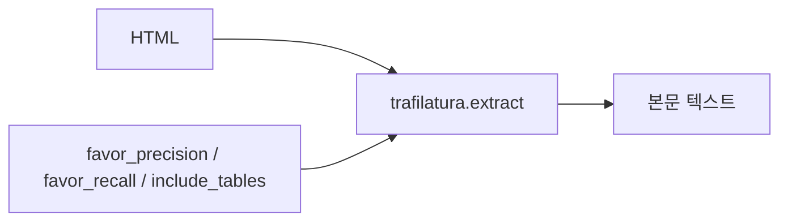
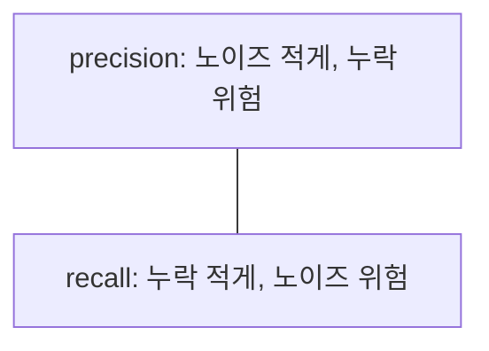

# trafilatura 옵션

> trafilatura는 웹 페이지 HTML에서 **본문 텍스트만 뽑아 내는 파이썬 라이브러리**다. `favor_precision`·`favor_recall`·`include_tables` 같은 옵션이 "더 깐깐하게 / 더 넉넉하게 / 표 포함 여부"를 정한다.

## 쉽게 말하면
신문 한 면에서 기사만 오려 내는 가위질이다. 깐깐 모드는 광고 조각이 섞일까 봐 가장자리를 많이 잘라 내고, 넉넉 모드는 기사가 빠질까 봐 가장자리를 남긴다.

## 자세히
- 직접 실행(2026-11-27, trafilatura 2.4.0, 영어 Wikipedia "Common Crawl" 페이지 HTML 149,993바이트, `trafilatura.extract(html, ...)`). 이 **한 페이지에서의** 결과:
  | 옵션 | 글자 수 | 단어 수 | 줄 수 |
  |---|---|---|---|
  | 기본값 | 8,436 | 1,347 | 64 |
  | `favor_precision=True` | 8,271 | 1,325 | 49 |
  | `favor_recall=True` | 8,436 | 1,347 | 64 |
  | `include_tables=False` | 8,086 | 1,288 | 54 |
  | `include_comments=True` | 8,436 | 1,347 | 64 |
  | `include_links=True` | 15,704 | 1,354 | 71 |
  | `no_fallback=True` | 8,436 | 1,347 | 64 |
- 읽는 법:
  - 기본값이 이미 8,436자로 본문 전체에 가깝다. 태그만 걷어 낸 원문은 24,774자(스타일·스크립트 포함)였다.
  - `favor_precision`은 약 165자(2%) 줄었고 줄 수가 64→49로 줄었다 — 짧은 조각(목록 항목 등)을 더 많이 버린 것으로 보인다(해석).
  - `favor_recall`은 이 페이지에서 기본과 **같았다**. 옵션 효과가 페이지마다 다르므로 한 페이지로 일반화하면 안 된다.
  - `include_tables=False`는 표 내용 약 350자를 뺐다. 기본값 출력 첫머리가 Wikipedia 정보 상자(회사 형태·설립 연도 등)를 표로 담고 있었다.
  - `include_links=True`는 글자 수가 약 86% 늘었지만 단어 수는 거의 같았다 — 링크 주소(마크다운 URL)가 문자 수를 부풀린 것이다. 학습 텍스트용이면 보통 끈다(제안).
  - `include_comments` 효과는 댓글이 없는 이 페이지에서는 나타나지 않았다.
- 선택 가이드(제안): 학습용 정제는 정밀도(노이즈 최소) vs 재현율(누락 최소) 중 목표를 정한 뒤 샘플 수십 페이지로 비교한다. 규모 평가는 [추출기 비교](#extractor-comparison) 참고.
- 한계: 이 실험은 영어 Wikipedia 1페이지다. 상업 사이트·한국어·포럼 페이지에서는 결과가 다를 수 있다.

## 그림으로 보기



## 예시
```python
import trafilatura
text = trafilatura.extract(html, favor_precision=True, include_tables=False)
```
- 교육: 같은 웹 페이지에서 옵션별로 달라지는 출력을 비교해 "정제는 설계 결정"이라고 보여 주는 실습.

## 헷갈리는 것과 비교
| 개념 | 차이 |
|---|---|
| favor_precision | 확실한 본문만, 덜 뽑음 |
| favor_recall | 의심스러워도 포함 |
| `include_*` | 표·링크·댓글 포함 여부 |
| [추출기 비교](#extractor-comparison) | 여러 라이브러리 간 비교 |

## 더 읽을거리
- [trafilatura 문서](https://trafilatura.readthedocs.io/) — 옵션 설명.
- 직접 실행: trafilatura 2.4.0 옵션별 출력 길이 비교.
