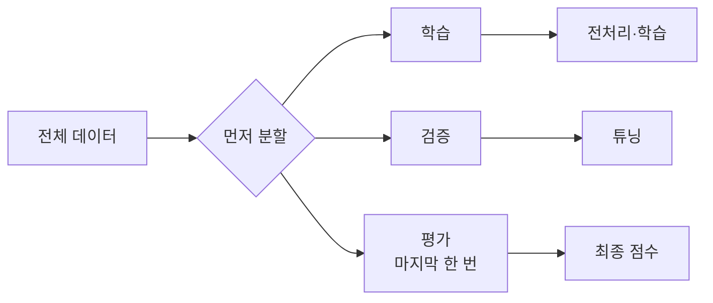
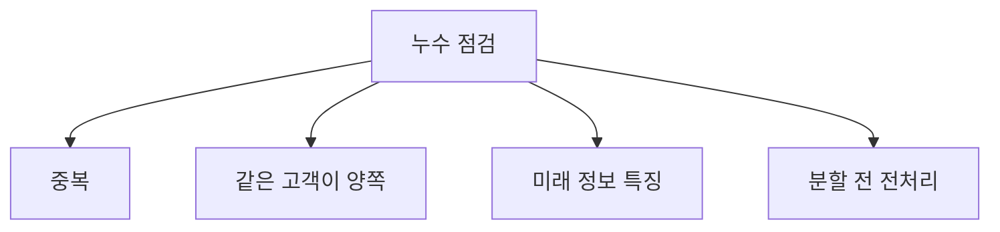

# 학습·검증·평가 분할

> 데이터를 학습용(train)·검증용(validation)·최종 평가용(test)으로 나눠, 평가 점수가 "모델이 이미 본 데이터"가 아닌 새 데이터에서의 성능을 반영하게 하는 기본 절차. 나누는 방식이 틀리면 데이터 누수로 점수가 부풀려진다.

## 쉽게 말하면
시험 공부에 쓴 문제집(학습), 모의고사(검증), 진짜 시험(평가)을 따로 두는 것이다. 진짜 시험 문제가 문제집에 이미 있었다면 점수가 높아도 실력이 아니다.

## 자세히
theorempath의 "Train/test split and data leakage" 정리(열람)를 기준으로 한다.
- **누수 유형**: 분할 전에 스케일러·PCA를 전체 데이터로 학습, 분할 전 계산한 범주 평균 인코딩(타깃 정보 유입), 예측 시점보다 나중에 기록된 특징(시간 누수), 분할 간 중복(반복 스크랩 텍스트·증강 이미지), 같은 환자·사용자·기기가 학습·평가에 모두 존재하는 그룹 누수, 수집 시간을 따라가는 행 ID처럼 정답의 결과인 대리 특징.
- **분할 방식**: 같은 개체의 모든 행을 한쪽에만 넣는 그룹 인식 분할, 과거로 학습해 중간 구간으로 검증하고 이후로 평가하는 시간 순 분할. 시계열을 무작위로 나누면 인접 시점이 닮아 누수된다.
- **전처리 순서**: 먼저 나누고, 모든 변환을 학습 데이터로만 맞춘 뒤 검증·평가 데이터에 적용.
- **검증 세트의 역할**: 튜닝 압력을 검증 세트가 흡수해 평가 세트를 깨끗이 유지한다. 평가 세트로 튜닝하면 오차가 낙관적이 되므로 프로젝트당 가급적 한 번만 쓴다.
- **LLM 특유 문제**: 사전학습 코퍼스와 미세조정 평가 데이터가 겹치면 지표가 부풀 수 있다. 코드 데이터에서 이를 시험한 논문(arXiv 2401.07930, 초록 열람)은 여러 과제에서 이 위협이 있고 미세조정 기법에 따라 악화된다고 보고했다. 오픈소스 모델도 영향을 받을 수 있다고 한다.
- **점검표 요약**: 학습 전처리 전에 분할 / 개체 반복 시 그룹 분할 / 시간 데이터는 시간 순 / 특징의 시점 점검 / 분할 간 중복 검색 / 지나치게 높은 정확도는 누수 경고 / 평가 세트는 모델 선택에 쓰지 않기 / 오프라인 결과와 배포 성능 비교.
- 검색 요약에는 의미가 비슷한 재문장화(근접 중복)를 임베딩·n-gram으로 찾는 조언도 있었으나 블로그 수준이다.

## 그림으로 보기

## 예시
- 고객 상담 데이터: 같은 고객의 문의가 여러 건 → 고객 ID 기준으로 분할.
- 교육 실습: 질문 100개를 무작위로 분할한 뒤, 같은 고객이 양쪽에 있는지 찾아 그룹 분할로 다시 나눈다.

## 헷갈리는 것과 비교
| 개념 | 차이 |
|---|---|
| 검증 세트 | 튜닝용 |
| 평가(테스트) 세트 | 최종 점수용, 가급적 한 번 |
| 데이터 누수 | 평가 정보가 학습에 새는 문제 |
| [LoRA 어댑터](#lora-adapters) | 분할이 지켜져야 어댑터 평가가 믿을 만함 |

## 더 읽을거리
- [theorempath: Train/test split and data leakage](https://theorempath.com/topics/train-test-split-and-data-leakage) — 누수 유형과 점검표(열람)
- [Inter-dataset code duplication (arXiv 2401.07930)](https://arxiv.org/abs/2401.07930) — 사전학습·미세조정 데이터 겹침(초록 열람)
