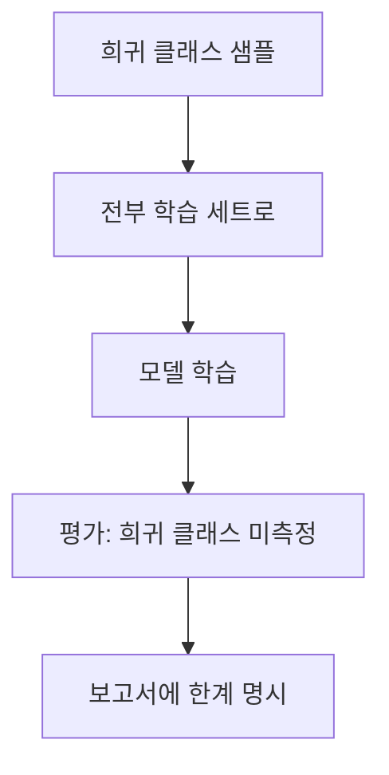
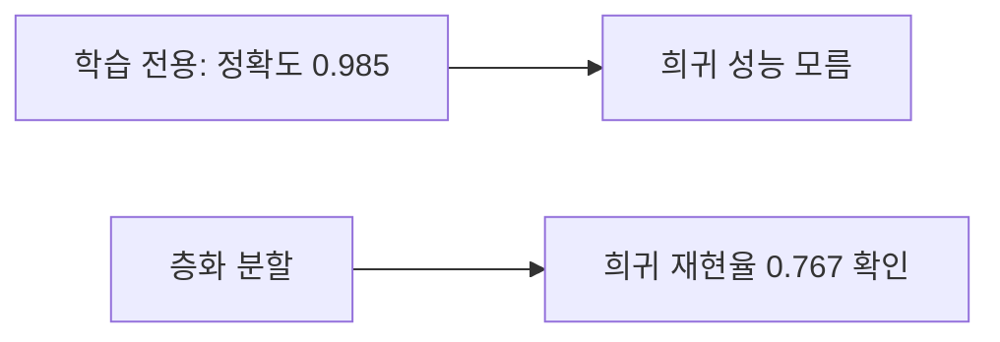

# 희귀 클래스 학습 전용 처리

> 희귀 클래스 학습 전용 처리는 샘플이 너무 적어 테스트 세트에 넣을 수 없는 클래스의 샘플을 전부 학습 세트에만 두는 방법이다. 모델은 그 클래스를 배우지만 그 클래스의 성능은 측정할 수 없다는 한계가 있다.

## 쉽게 말하면
아주 드문 병의 환자 30명을 모두 의대생 교육 자료로만 쓰고 시험에는 한 명도 내지 않는 것이다. 교육은 시켰지만 그 병을 얼마나 잘 진단하는지는 확인할 길이 없다.

## 자세히
- **직접 실험(scikit-learn 1.9.1, 가상 3클래스 3,000개: 크기 60%/37%/3%(희귀 90개), 로지스틱 회귀)**:

| 구성 | 결과 |
| --- | --- |
| 희귀 클래스 전부 학습에만, 테스트는 나머지 두 클래스 | 테스트 정확도 0.985, 테스트 내 희귀 샘플 0개 |
| 일반 층화 분할(희귀 27개 학습·희귀 30개 테스트 포함 비율) | 전체 정확도 0.980, **희귀 클래스 재현율 0.767**(테스트 희귀 30개) |

  학습 전용 처리의 정확도 0.985는 겉보기에 더 높지만 희귀 클래스를 재지 못한 숫자다. 층화 분할에서야 희귀 클래스를 76.7%밖에 못 찾는다는 사실이 드러난다. 전체 정확도가 높은 모델이 희귀 클래스에서는 약할 수 있다. (가상 데이터 한 번의 실험이다.)
- **쓰는 조건(해석)**: 평가 샘플을 모을 수 없지만 학습 신호는 필요할 때(임시 조치). 이때 ① 그 클래스 성능은 "미측정"이라고 보고서에 명시 ② 정기적으로 샘플을 모아 평가 가능해지면 평가 세트로 이동 ③ 학습에 쓴 샘플은 이후 평가에 재사용하지 않는다(누수 방지).
- **대안(해석)**: [희귀 클래스 추가 수집](#rare-class-collection)(평가 가능하게 만들기), [희귀 클래스 병합](#merge-rare-classes)(클래스 수 줄이기), 교차 검증(데이터를 아껴 쓰기, [pred_probs용 층화 폴드](#stratified-folds-for-pred-probs)), 위험이 큰 희귀 클래스는 사람 검수를 병행.
- **한계(해석)**: 학습 전용으로 둔 클래스는 정확도·재현율을 모르므로 실서비스에서 그 클래스 예측을 자동 확정하지 말고 사람 검토로 보낸다([위험-커버리지 트레이드오프](#risk-coverage-tradeoff)).

## 그림으로 보기

## 예시
- 희귀 클래스 "사기 의심" 샘플 20개를 전부 학습에 쓰고 보고서에 "사기 의심 성능 미측정, 예측 시 사람 검토"를 적는다.
- 교육 활용: 같은 데이터를 두 방식으로 평가해 전체 정확도와 희귀 재현율의 차이를 비교한다.

## 헷갈리는 것과 비교
| 개념 | 차이 |
| --- | --- |
| 학습 전용 | 평가 포기, 학습에만 사용 |
| [희귀 클래스 추가 수집](#rare-class-collection) | 평가 가능하게 샘플 확보 |
| [test_size와 클래스 수 규칙](#stratify-test-size-rule) | 층화 분할의 조건 |
| [희귀 클래스 병합](#merge-rare-classes) | 클래스를 합침 |

## 더 읽을거리
- [scikit-learn Cross-validation 가이드](https://scikit-learn.org/stable/modules/cross_validation.html) — 테스트 세트 분리와 층화 분할
