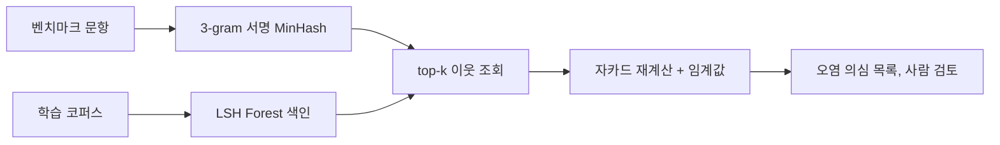
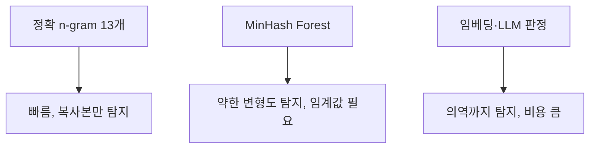

# 학습-평가 오염 탐지

> 벤치마크 문제가 학습 데이터에 섞여 들어갔는지를 찾는 일. 정확한 n-gram 겹침은 빠르지만 단어가 조금만 바뀌어도 놓치고, MinHash LSH Forest로 "가장 닮은 문서 top-k"를 뽑으면 약간 바뀐 사본도 잡는다.

## 쉽게 말하면
시험 문제가 참고서에 실렸는지 확인하는 일이다. "13단어 연속으로 똑같은 문장이 있나?"만 보면 숫자와 단어를 몇 개 바꾼 문제는 통과한다. "제일 닮은 참고서 쪽 5개를 보여 줘"로 찾으면 바꿔 쓴 문제도 걸린다. 다만 5개는 늘 나오므로, 정말 같은 문제인지는 따로 확인해야 한다.

## 자세히
- **n-gram 겹침(기존 방식)**: GPT-3는 사전학습 데이터와 13-gram이 하나라도 겹치는 평가 항목을 제거해 clean 세트를 만들었다. PaLM은 8-gram의 70% 이상이 학습셋에 있으면 오염으로 분류, Llama 2는 토큰 단위로 10토큰 넘는 공통 n-gram에 속한 토큰 비율을 쓴다(서베이 arXiv 2404.00699 열어 확인).
- **한계**: 바꿔 쓴 문장·번역을 놓치고, LLM이 만든 합성 데이터와 코드의 논리적 유사성도 잘 못 잡는다. 또 겹쳐도 점수 차는 작았다는 보고가 많다(GPT-3·PaLM·GPT-4).
- **유사도 기반**: 임베딩 코사인(Open-Platypus는 0.8 초과 제거)이나 MinHash 자카드로 이웃을 찾는다. 단점은 임계값 정하기가 어렵다는 것.
- **직접 실행**(datasketch 2.0.0, 합성 데이터, 1회): 평가 문항 100개(80단어)를 학습 문서 400개 노이즈와 섞은 코퍼스에 넣되, 단어 교체율 0·5·15·30%인 사본을 각 25개씩 심었다. 13-gram 탐지와 3-gram MinHash(num_perm=128, l=16) top-5 탐지를 비교했다.

| 교체율 | 13-gram 탐지 | Forest top-5에 포함 |
|---|---|---|
| 0% | 25/25 | 25/25 |
| 5% | 25/25 | 25/25 |
| 15% | 23/25 | 24/25 |
| 30% | **5/25** | **24/25** |

  해석: 교체율이 높아질수록 13-gram은 급격히 놓치고 Forest는 유지했다. 단, 이 표는 **"정답 문서가 top-5 안에 들었나"**일 뿐이다. top-k는 깨끗한 문항에도 5개를 돌려주므로 실제 판정에는 반환된 후보의 자카드를 다시 계산해 임계값(예: 0.3~0.5)을 넘는지 확인하는 단계가 필요하다. 합성 무작위 단어 데이터라 실제 문장의 어순·어휘 분포와는 다르며 1회 실행 결과다.

## 그림으로 보기

## 예시
- 새 평가셋을 공개하기 전: 문항 전부를 학습 코퍼스 색인에 질의해 상위 5개와 자카드가 0.4 넘는 문항을 목록화하고, 그 문항을 뺀 점수도 함께 보고.
- 교육: "복사본만 찾는 검사 vs 바꿔 쓴 것까지 찾는 검사" 비교 실습.

## 헷갈리는 것과 비교
| 개념 | 차이 |
|---|---|
| [코퍼스 내 벤치마크 정답](#benchmark-contamination-in-corpus) | 오염이 얼마나 있는지 측정한 사례 |
| [의역 오염](#rephrased-sample-contamination) | 바꿔 쓴 오염은 n-gram이 놓친다는 문제 |
| [LLM 디컨태미네이터](#llm-decontaminator) | 후보를 LLM으로 최종 판정 |
| [MinHash LSH Forest](#minhash-lsh-forest) | 이 탐지의 이웃 검색 부품 |

## 더 읽을거리
- [A Comprehensive Survey of Contamination Detection Methods in LLMs](https://arxiv.org/html/2404.00699v1) — n-gram·임베딩 방식과 한계(열어 확인).
- [datasketch LSH Forest 문서](http://ekzhu.com/datasketch/lshforest.html) — top-k와 2k 재정렬 팁.
