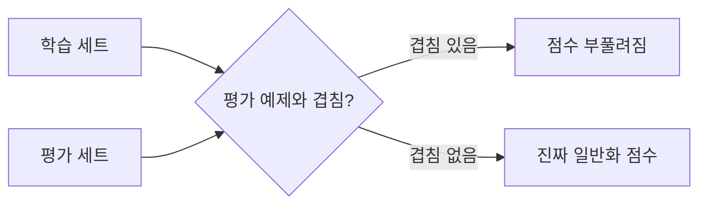
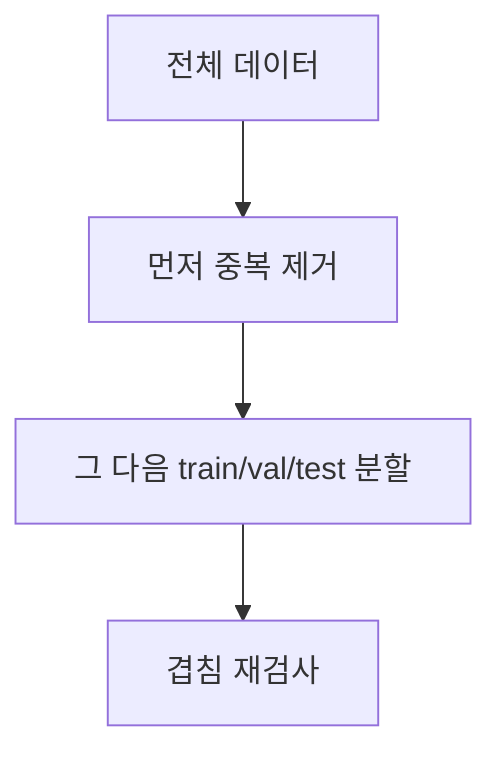

# 학습-시험 겹침

> 모델을 **평가하는 데이터의 일부가 이미 학습 데이터에 들어 있는 상태**다. 이러면 모델이 푼 것이 아니라 외운 것이 점수에 섞여 성능이 부풀려진다.

## 쉽게 말하면
시험 문제가 연습 문제집에 그대로 실려 있었다면 만점이어도 실력을 알 수 없다. 겹친 문제를 빼고 다시 채점해야 진짜 실력이 보인다.

## 자세히
(Lee 외, arXiv 2107.06499 PDF 본문을 직접 읽음)
- 측정: 근접 중복 탐지(NearDup)로 검증 세트 예제가 학습 세트에 근사 중복이 있는지 확인했다. C4 검증 세트의 4.6%, RealNews 검증 세트의 14.4%가 학습 세트에 근사 중복을 갖고 있었다. (초록의 "표준 데이터셋 검증 세트의 4% 넘게"는 이 측정을 요약한 표현이다.)
- 다른 연구 인용: Dodge 외(2021)는 C4에서 표준 과제의 테스트 예제가 최대 14.4%까지 그대로 발견된다고 분석했고, Radford 외(2019)는 GPT-2 학습 세트와 평가 데이터의 8-그램 겹침을 사후에 분석했다(Lee 논문이 인용).
- 효과: 중복 제거 데이터로 학습한 모델은 학습 세트에 중복이 있던 검증 예제에서 퍼플렉서티가 더 높았다(암기 이점이 사라짐). 중복이 없는(unique) 검증 예제에서는 원본·제거 모델이 비슷했다. 즉 겹침이 있는 예제에서만 점수가 부풀려졌다.
- 대응: ① 평가 세트와 학습 세트의 겹침을 탐지해 학습 쪽에서 제거 ② 평가 쪽에서 겹친 예제를 빼고 점수를 따로 보고 ③ 분할 전에 중복을 먼저 제거(특히 한 번 중복 제거 후 train/val/test를 나눌 때 그룹 단위로 분할).
- 한계: 겹침 탐지 임계값에 따라 비율이 달라진다. 이 수치는 해당 데이터셋·방법의 값이다.

## 그림으로 보기

## 예시
- 코딩 벤치마크 문제와 해설이 인터넷에 있고 그 글이 학습 데이터에 들어갔다면 점수가 높게 나온다. 학습 코퍼스에서 벤치마크 문자열을 검색해 겹침을 확인한다.
- 교육: "시험지 유출"에 빗대 평가 오염을 설명한다.

## 헷갈리는 것과 비교
| 개념 | 차이 |
|---|---|
| 학습-시험 겹침 | 평가 예제가 학습에 존재 |
| [데이터 누수](#data-leakage) | 특징·분할 과정에서 정답 정보가 새는 더 넓은 개념 |
| [암기](#memorization-from-duplicates) | 겹침의 결과로 점수가 오르는 메커니즘 |

## 더 읽을거리
- [Lee 외, Deduplicating Training Data Makes Language Models Better](https://arxiv.org/abs/2107.06499) — C4 4.6%, RealNews 14.4% 겹침과 퍼플렉서티 결과(본문 읽음).
