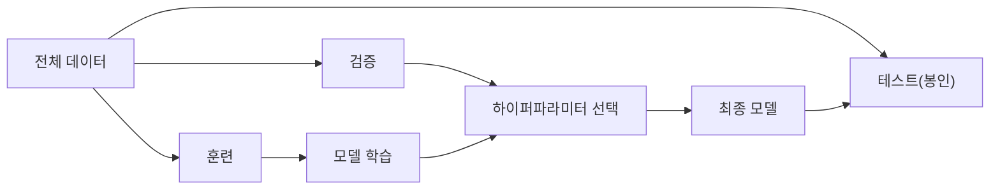
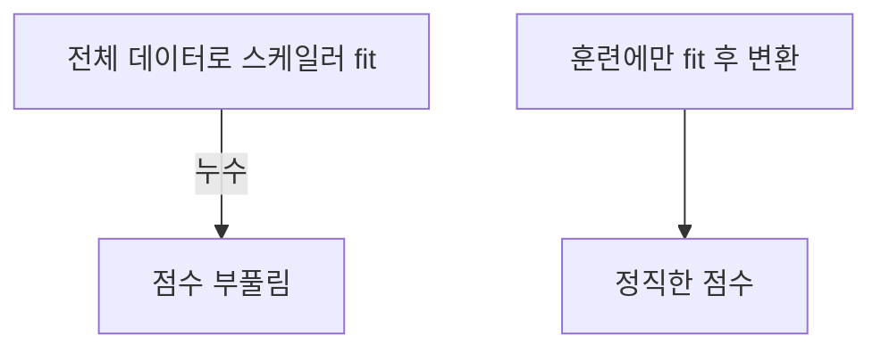

# 훈련·검증·테스트 분할

> 데이터를 **훈련(학습)·검증(튜닝)·테스트(최종 평가)** 로 나누는 것은, 모델이 외운 것이 아니라 **처음 보는 데이터에서의 실력**을 재기 위해서다.

## 쉽게 말하면
수업(훈련), 모의고사(검증), 수능(테스트)과 같다. 수능 문제를 미리 보고 공부하면 점수가 높아도 실력이 아니다. 테스트 데이터를 한 번이라도 보고 모델을 고치면 그 점수는 믿을 수 없다.

## 자세히
(scikit-learn 교차검증 문서 확인)
- **과적합**: 같은 데이터로 학습하고 테스트하면, 라벨을 그대로 외운 모델이 만점을 받지만 새 데이터에는 쓸모가 없다.
- 세트별 역할: 훈련 = 파라미터 학습 / 검증 = 하이퍼파라미터 비교 / 테스트 = 마지막에 한 번만 평가. 검증 없이 테스트로 튜닝하면 테스트 정보가 모델로 새어 점수가 낙관적이 된다.
- **데이터 누수(leakage)**: 평가 데이터의 정보가 학습에 영향을 주는 것. 흔한 원인은 **전처리**(스케일러·특징 선택을 전체 데이터에 맞춤 → 훈련 데이터에만 fit해야 함)와 **분할 방식**(시간순 데이터를 섞으면 미래를 보고 학습, 같은 환자 데이터가 양쪽에 걸침 → 그룹 단위 분할 `GroupKFold`).
- **k-겹 교차검증**: 훈련 데이터를 k조각으로 나눠 한 조각씩 검증으로 돌리고 평균을 낸다. 데이터가 적을 때 좋지만 계산 비용이 든다. 시계열은 `TimeSeriesSplit`.
- 고정 3분할의 단점: 학습 데이터가 줄고 결과가 무작위 분할에 좌우된다.
- LLM 시대의 변형: 벤치마크 문제가 학습 데이터에 섞이는 **오염**이 같은 문제다.

## 그림으로 보기



## 예시
```python
from sklearn.model_selection import train_test_split, cross_val_score
X_tr, X_te, y_tr, y_te = train_test_split(X, y, test_size=0.4, random_state=0)
scores = cross_val_score(clf, X_tr, y_tr, cv=5)   # 훈련 데이터 안에서만 CV
clf.fit(X_tr, y_tr); print(clf.score(X_te, y_te)) # 테스트는 마지막 한 번
```

## 헷갈리는 것과 비교
| 개념 | 차이 |
|---|---|
| 검증 세트 | 튜닝용, 여러 번 봄 |
| 테스트 세트 | 최종 평가용, 한 번 |
| 교차검증 | 검증 세트를 돌려 가며 사용 |
| [정규화](#regularization) | 과적합을 줄이는 기법, 분할은 과적합을 진단 |

## 더 읽을거리
- [scikit-learn: Cross-validation](https://scikit-learn.org/stable/modules/cross_validation.html) — 분할·누수·k-겹 설명과 코드.
