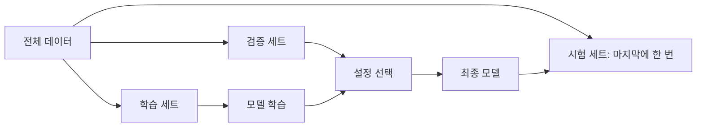
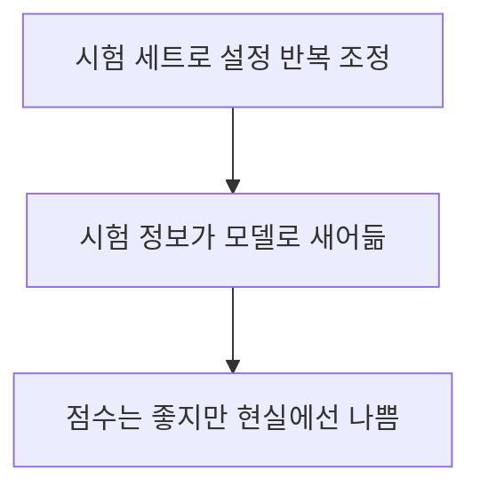

# 학습·검증·시험 분할

> 가진 데이터를 학습용(모델을 만든다)·검증용(설정을 고른다)·시험용(마지막에 한 번 채점한다) 세 덩어리로 나누는 일이다. 같은 데이터로 배우고 채점하면 점수가 거짓으로 좋게 나온다.

## 쉽게 말하면
수험생이 연습문제집(학습), 모의고사(검증), 본시험(시험)을 따로 갖는 것과 같다. 본시험 문제를 미리 풀어 본 학생은 점수가 좋아도 실력을 알 수 없다. 시험용 데이터는 "마지막에 딱 한 번" 열어야 의미가 있다.

## 자세히
scikit-learn 문서(교차 검증 절, 직접 열어 확인) 기준.
- **왜 나누나**: 같은 데이터로 학습하고 시험하면 본 것을 그대로 외운 모델이 만점을 받지만 새 데이터에는 쓸모가 없다. 이를 과적합이라 한다. 그래서 일부를 시험 세트로 따로 떼어 둔다.
- **세 세트의 역할**: 학습 = 파라미터를 맞춘다 / 검증 = 하이퍼파라미터를 고른다 / 시험 = 최종 일반화 성능을 한 번 확인한다. 시험 세트로 설정을 계속 고치면 시험 세트의 정보가 모델에 "새어" 들어가 평가가 일반화 성능을 말해 주지 못한다.
- **3분할의 비용**: 학습에 쓸 데이터가 줄고, 어떻게 우연히 나뉘었는지에 결과가 좌우된다.
- **교차 검증(k-fold)**: 시험 세트는 따로 두고, 학습 세트를 k조각으로 나눠 한 조각씩 검증용으로 돌려 가며 평균 성능을 낸다. 이때 별도 검증 세트는 필요 없다.
- **전처리 누수 주의**: 표준화·특징 선택 같은 변환도 **학습 부분에서만** 배워 시험 부분에 적용해야 한다. 분할 전에 전체 데이터로 scaler를 맞추면 시험 정보가 새어 든다. 교차 검증에서는 `Pipeline`이 이를 자동으로 처리한다. 자세한 것은 [데이터 누수](#data-leakage).
- **순서 있는 데이터**: 시간순 기사처럼 순서가 있는 데이터를 섞어서 나누면 점수가 부풀 수 있다. 시계열은 `TimeSeriesSplit`, 그룹이 있으면 그룹 단위 분할을 쓴다.
- **LLM에서**: 평가 세트가 학습 데이터에 섞이는 오염 문제도 같은 뿌리다(제안 연결). 비율(예: 8:1:1)은 정해진 규칙이 아니라 관행이며 데이터 크기에 따라 조절한다.

## 그림으로 보기



## 예시
```python
from sklearn.model_selection import train_test_split, cross_val_score
X_train, X_test, y_train, y_test = train_test_split(X, y, test_size=0.4, random_state=0)
scores = cross_val_score(clf, X_train, y_train, cv=5)  # 학습 세트에서만 교차 검증
clf.fit(X_train, y_train)
print(clf.score(X_test, y_test))  # 시험 세트는 한 번만
```
(scikit-learn 문서 예시를 줄임.)

## 헷갈리는 것과 비교
| 개념 | 차이 |
|---|---|
| 검증 세트 | 설정(하이퍼파라미터) 고르기용 |
| 시험 세트 | 최종 성능 확인, 한 번만 |
| 교차 검증 | 검증 세트를 돌려 가며 쓰는 방식 |
| [데이터 누수](#data-leakage) | 분할 규율이 깨져 시험 정보가 새는 문제 |
| [과적합](#overfitting) | 분할을 안 해서 눈에 안 띄는 문제 |

## 더 읽을거리
- [scikit-learn: Cross-validation](https://scikit-learn.org/stable/modules/cross_validation.html) — 시험 세트를 떼는 이유, 검증 세트, k-fold, 전처리 누수, TimeSeriesSplit(직접 열어 확인).
