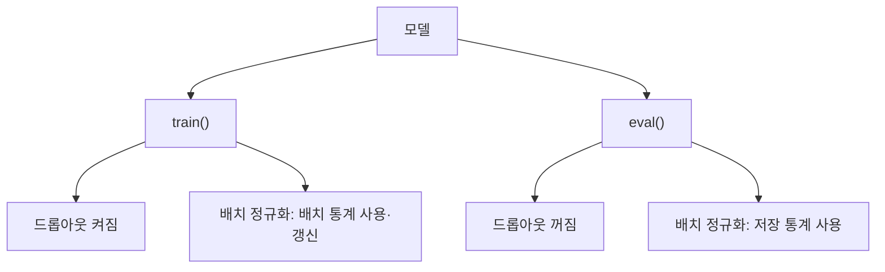

# train·eval 모드

> PyTorch 모델은 `model.train()`과 `model.eval()`로 모드를 바꾸며, 드롭아웃·배치 정규화 같은 층이 학습 때와 추론 때 서로 다르게 동작하도록 한다.

## 쉽게 말하면
운동선수의 훈련 모드(일부러 부하·방해를 줌)와 시합 모드(전력을 다함) 스위치다. 시합에서 훈련용 방해를 켜 두면 결과가 흔들린다.

## 자세히
- `model.train()`: 드롭아웃이 무작위로 뉴런을 끄고, 배치 정규화가 현재 배치의 통계를 쓰며 이동 평균을 갱신한다.
- `model.eval()`: 드롭아웃은 항등 함수([inverted dropout](#inverted-dropout)), 배치 정규화는 저장된 이동 평균 통계를 사용한다(일반 PyTorch 동작).
- 흔한 실수: 평가·추론 코드에서 `eval()`을 빼먹으면 결과가 **실행마다 달라지고** 성능이 떨어진다. 반대로 학습 중 `eval()`로 둔 채면 드롭아웃이 꺼져 정규화 효과가 사라진다.
- `torch.no_grad()`는 기울기 계산만 끄는 별개 기능이다. eval 모드와 둘 다 필요하다(일반 관행).
- 학습 중 검증 때: `model.eval()` → 검증 → `model.train()`으로 복귀. PyTorch Lightning 같은 프레임워크는 이를 자동 처리한다.
- 이 개념의 근거 설명은 공식 문서에 있으나 이번 세션에서 직접 열람하지 못해 일반 지식 기준(confidence: medium).

## 그림으로 보기


## 예시
```python
model.eval()
with torch.no_grad():
    pred = model(x)
model.train()   # 다시 학습으로 돌아갈 때
```
같은 입력인데 예측이 매번 다르다 → `eval()` 누락을 의심.

## 헷갈리는 것과 비교
| 개념 | 차이 |
|---|---|
| `train()`/`eval()` | 층의 동작 모드 |
| `torch.no_grad()` | 기울기 기록 끄기 |
| [드롭아웃](#dropout) | 모드에 따라 동작이 바뀌는 대표 층 |

## 더 읽을거리
- [Dropout 논문](https://jmlr.org/papers/v15/srivastava14a.html) — 학습·테스트 동작이 다른 이유의 배경.
