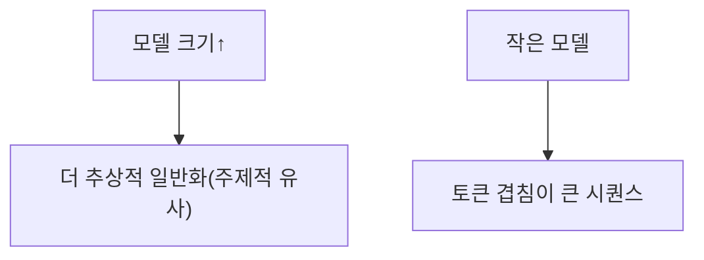

# 학습 데이터 기여 추적

> 모델의 특정 출력에 어떤 훈련 데이터가 얼마나 기여했는지를 영향 함수로 추적하는 분석이다. Grosse 외(2023)는 최대 52B 언어모델에 EK-FAC 영향 함수를 적용해 일반화 방식을 연구했다.

## 쉽게 말하면
AI가 어떤 답을 냈을 때 "그 답에 가장 큰 영향을 준 책·문장은 무엇인가"를 거슬러 찾는 일이다. 모델이 외웠는지, 개념을 일반화했는지 단서를 준다.

## 자세히
(Grosse 외 arXiv 2308.03296을 하위 에이전트가 원문으로 읽은 노트 기준.)
- **대상**: 810M, 6.4B, 22B, 52B 트랜스포머 LM, 시퀀스 길이 512 토큰, 꼬리 분석에는 500만+ 훈련 시퀀스 스캔. 영향 단위: 1 = 완성 로그확률 1 nat 증가.
- **핵심 발견(논문 목록)**
  1. EK-FAC은 LiSSA와 비슷한 정확도로 훨씬 빠르다.
  2. 영향은 **꼬리가 무거운(멱법칙)** 분포지만 **여러 시퀀스에 퍼져** 있다 → 소수 암기가 아님. 22B에서 상위 1% 시퀀스가 양의 영향의 **12~52%**를 차지. 영향 0.1 초과는 드물고 어떤 질의도 1 nat을 넘는 시퀀스가 없다.
  3. **큰 모델일수록 더 추상적으로 일반화**(역할극·프로그래밍·수학·다국어).
  4. 영향은 층에 고르게 퍼지며 하위·상위 층은 토큰에 가깝고 중간층이 추상적.
  5. **단어 순서에 민감**: 프롬프트 관련 구가 완성 관련 구보다 앞에 나올 때만 영향.
  6. 역할극("shutdown" 질의)은 비슷한 행동의 예·설명에 영향 → 계획이 아니라 **모방**으로 해석. 810M 모델의 상위 20개는 토큰이 겹치고 52B는 주제적으로 비슷하다.
- **한계**: 코퍼스의 일부만 탐색했고 모델이 최전선 규모보다 작다.

## 그림으로 보기

## 예시
- 이상한 응답의 원인 데이터를 찾아 데이터 정제에 활용(연구 수준).
- 교육 활용: "AI가 외웠다 vs 이해했다"를 영향도 분포로 설명.

## 헷갈리는 것과 비교
| 개념 | 차이 |
|---|---|
| 학습 데이터 기여 추적 | 출력에 영향 준 훈련 데이터 찾기 |
| 데이터 가치 평가(Shapley) | 데이터셋 성능 기여도 |
| [EK-FAC](#ek-fac) | 이를 가능하게 한 근사 |

## 더 읽을거리
- [Studying LLM Generalization with Influence Functions (arXiv 2308.03296)](https://arxiv.org/abs/2308.03296) — 발견과 한계.
