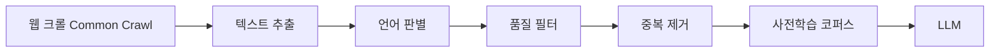
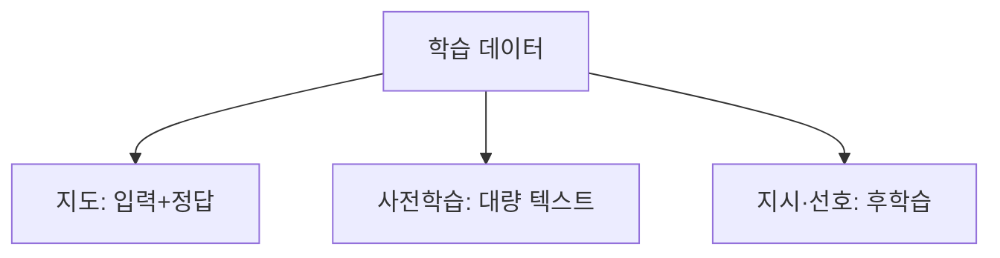

# 학습 데이터 기초

> 모델이 패턴을 배우는 데 쓰는 데이터다. 지도 학습에서는 입력과 정답의 쌍이고, LLM의 사전학습에서는 인터넷 문서 같은 방대한 텍스트다. 무엇을 얼마나, 어떻게 걸러서 넣느냐가 모델 성격을 결정한다.

## 쉽게 말하면
학생이 읽은 교재와 같다. 교재가 오류투성이이거나 한쪽 관점뿐이면 아무리 머리가 좋아도 그대로 배운다. 그래서 AI에서는 "무슨 교재를 어떻게 골랐나"를 따로 문서로 남기려 한다.

## 자세히
- **종류**
  - **지도 학습 데이터**: 입력 + 정답 라벨(이미지와 "고양이"). [라벨링](#data-labeling)이 필요하다.
  - **사전학습 코퍼스**: 라벨 없는 대량 텍스트. 다음 단어를 맞히는 방식으로 학습한다.
  - **지시·선호 데이터**: 질문과 바람직한 답, 사람이 고른 우열 등(후학습용).
- **LLM 사전학습 데이터의 현실(FineWeb 논문·검색 결과 기준)**: 공개 사전학습 코퍼스 대부분의 원천은 웹 크롤 아카이브인 Common Crawl이고, 차이는 텍스트 추출·필터링·중복 제거 방식에 있다.
  - **FineWeb**: 96개 Common Crawl 스냅샷에서 약 15조 토큰(논문 초록 확인). 추출은 Trafilatura, 언어 판별은 fastText, 일부 C4 필터와 자체 휴리스틱 필터를 쓰고, 중복 제거는 스냅샷별로 하는 편이 성능이 좋았다고 저자가 밝힌다(검색 결과 요약).
  - **FineWeb-Edu**: FineWeb에서 교육적 텍스트만 거른 1.3조 토큰. MMLU·ARC 같은 지식·추론 벤치마크에서 성능이 크게 좋았다고 논문이 주장한다(초록 확인).
  - **RedPajama v2**: 필터·중복 제거 **라벨만** 붙여 비필터 상태로 공개, 사용자가 직접 고르게 한다. **DCLM-POOL**은 240조 토큰의 원시 풀(검색 결과 요약).
  - **중복 문제**: 서로 다른 코퍼스가 같은 Common Crawl에서 나와 겹친다. Zyda-2 저자는 DCLM·FineWeb-Edu 내부에 약 80%의 중복이 있다고 보고했다(검색 결과 요약, 원문 미확인).
- **폐쇄 모델의 데이터 구성**은 대부분 공개되지 않았다. 이번 조사에서 GPT-3 논문 초록 페이지에서는 구성 내역을 확인하지 못했고(초록만 제공), 세부는 PDF 본문 확인이 필요하다.
- **한계**: 웹 데이터에는 편향·저작권·개인정보 문제가 따라온다([데이터 라이선스와 출처](#data-licensing-provenance)).
- **데이터 세 분할**은 학습 때가 아니라 모델 개발 단계에서 나눈다([학습·검증·시험 분할](#train-validation-test-split)).

## 그림으로 보기

## 예시
- 사내 분류 모델: 과거 문의 5,000건에 부서 라벨을 붙인 것이 학습 데이터.
- 사내 문서 요약기를 만들 때: 보안 등급 높은 문서를 학습 데이터에서 제외하는 정책을 먼저 정한다(제안).

## 헷갈리는 것과 비교
| 개념 | 차이 |
|---|---|
| 학습 데이터 | 모델을 만드는 재료 |
| 평가 데이터 | 만든 모델을 재는 데이터([분할](#train-validation-test-split)) |
| 검색 문서(RAG) | 모델 밖에서 답할 때 참고, 학습하지 않음 |
| [데이터 중심 AI](#data-centric-ai) | 학습 데이터를 고쳐 성능을 올리는 관점 |

## 더 읽을거리
- [The FineWeb Datasets (arXiv:2406.17557)](https://arxiv.org/abs/2406.17557) — 15조 토큰 코퍼스 구축과 FineWeb-Edu(초록 직접 확인).
- [GPT-3 논문 (arXiv:2005.14165)](https://arxiv.org/abs/2005.14165) — 대규모 웹 코퍼스 학습의 출발점(초록 확인, 데이터 구성은 본문 필요).
