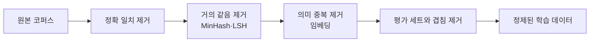
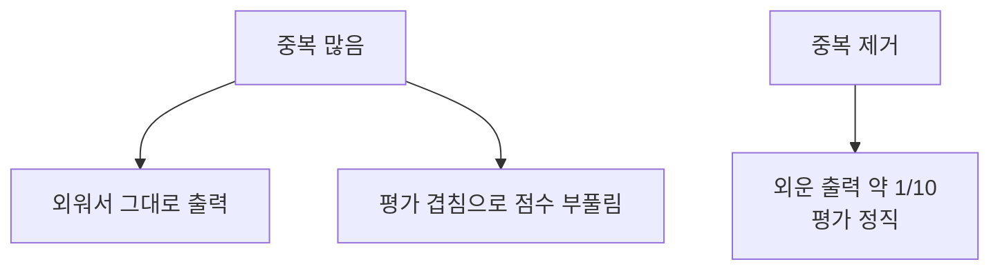

# 학습 데이터 중복 제거

> 언어 모델 학습 데이터에서 같거나 거의 같은 문서·문장을 덜어내는 작업이다. 중복을 줄이면 모델이 학습 문장을 그대로 외워 내놓는 일이 줄고, 학습 데이터와 평가 데이터가 겹쳐 점수가 부풀려지는 일도 줄어든다.

## 쉽게 말하면
같은 문제집 페이지를 열 번 복사해 공부 자료에 넣으면, 학생은 그 페이지를 통째로 외운다. 시험에 그 문제가 나오면 실력이 아니라 암기로 맞힌다. 복사본을 걷어내야 진짜 이해가 늘고 시험 점수도 정직해진다.

## 자세히
- **근거(Lee 외, 2021 "Deduplicating Training Data Makes Language Models Better" 초록, 열람)**: 이 데이터로 학습한 모델이 프롬프트 없이 내놓는 출력의 1% 넘는 부분이 학습 데이터를 그대로 베낀 것이었다. C4에서 61단어짜리 영어 문장 하나가 6만 번 넘게 반복됐고 저자들이 제거했다. 표준 데이터셋 검증 세트의 4% 넘게 학습 데이터와 겹쳤다.
- **중복 제거의 효과(같은 초록)**: 중복을 제거하면 외운 텍스트를 내놓는 일이 약 10분의 1로 줄고, 같거나 더 나은 정확도에 이르는 학습 단계가 줄며, 학습·시험 겹침이 줄어 평가가 더 정확해진다. 저자들은 두 가지 중복 제거 도구와 코드를 공개했다. 초록만 읽어 구체적 알고리즘은 확인하지 못했다.
- **수준(해석)**: ① 정확 일치(문장·문서 해시) ② 거의 같음(MinHash+LSH, [MinHash](#minhash)) ③ 의미 같음([의미적 중복 제거](#semantic-deduplication)). 비용이 싼 단계부터 차례로 적용한다.
- **평가 오염과의 관계**: 학습 데이터에 평가 문제가 들어 있으면 벤치마크 점수가 신뢰를 잃는다([n-gram 겹침 검사](#ngram-overlap-test), [의역 샘플 오염](#rephrased-sample-contamination)). 중복 제거는 학습 세트에서 평가 세트와 겹치는 문서를 빼는 일도 포함한다.
- **주의(해석)**: 너무 공격적으로 제거하면 유용한 반복(정의·코드 관용구)까지 사라지고, 같은 사실의 다양한 서술이 줄 수 있다.

## 그림으로 보기

## 예시
- 사내 문서로 모델을 미세조정할 때 같은 공지가 수십 번 복사돼 있으면 해시로 정확 중복을 먼저 제거하고, 템플릿만 다른 문서는 MinHash로 묶는다.
- 교육 활용: 반복이 많은 문서 모음에서 중복 제거 전후의 문서 수를 세어 본다.

## 헷갈리는 것과 비교
| 개념 | 차이 |
| --- | --- |
| 정확 중복 제거 | 완전히 같은 텍스트 |
| 근사 중복 제거 | 일부 단어만 다른 텍스트 |
| [의미적 중복 제거](#semantic-deduplication) | 뜻이 같은 텍스트 |
| [n-gram 겹침 검사](#ngram-overlap-test) | 평가 오염 점검 |

## 더 읽을거리
- [Deduplicating Training Data Makes Language Models Better (arXiv 2107.06499)](https://arxiv.org/abs/2107.06499) — 외운 출력과 학습·시험 겹침 수치
