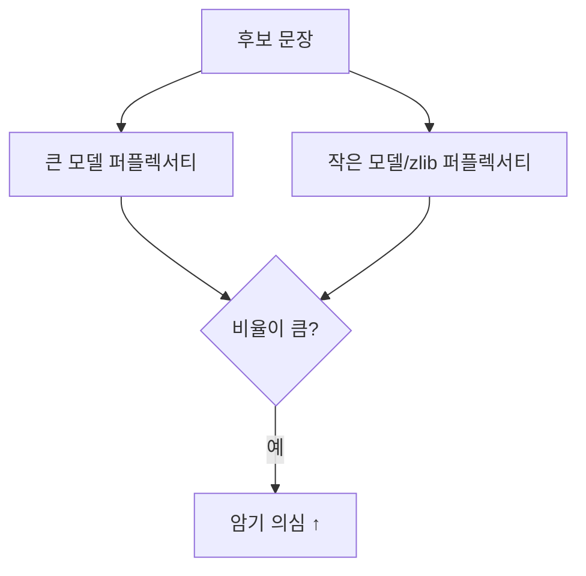

# 학습 데이터 추출 공격

> 모델에 **질의만 해서** 학습 데이터에 있던 문장을 그대로 복원해 내는 공격이다. 모델 내부나 학습 데이터에 접근하지 못해도, 모델이 외운 원문·개인정보가 출력으로 새어 나올 수 있음을 보여 준다.

## 쉽게 말하면
도서관에서 책을 통째로 외운 사람에게 아무 말이나 시키며 수십만 번 이야기를 받아 적게 한다. 그중에서 "너무 술술 나오는" 이야기를 골라 원문과 대조하면, 외운 구절이 진짜 책에 있는 것을 확인할 수 있다.

## 자세히
(Carlini 외 2021, arXiv 2012.07805 초록과 PDF 본문을 직접 읽음. 대상은 GPT-2, 서비스 모델이 아님)
- 목표: 질의 접근만 가진 공격자가 GPT-2의 학습 데이터 개별 사례를 복원. 초록은 개인 식별 정보(이름·전화번호·이메일), IRC 대화, 코드, 128비트 UUID 등 수백 개의 원문 시퀀스를 복원했으며, **학습 데이터에 한 문서에만 나온 시퀀스도 포함**되고 **큰 모델일수록 더 취약**하다고 보고한다.
- 기본 공격(본문): ① GPT-2 XL(15.58억 파라미터)로 샘플 **200,000개** 생성(top-n 샘플링, n=40 설정을 사용) ② 모델의 퍼플렉서티(낮을수록 모델이 확신)로 정렬 ③ 퍼플렉서티가 가장 낮은 것을 후보로 조사.
- 기본 공격의 약점: 출력 다양성이 낮고(MIT 라이선스 같은 흔한 문구가 수백 번 중복) 오탐이 많다. 암기된 내용이 학습 데이터에 **수천 번** 나온 흔한 문구(라이선스·이용 약관)가 많았다.
- 개선: 퍼플렉서티를 다른 척도와 비교해 순위를 매긴다 — 작은 모델과의 비율, zlib 압축 엔트로피와의 비율(문서에 쓰인 zlib 비교), 소문자화 전후 비교, 50토큰 슬라이딩 윈도 최소 퍼플렉서티.
- 결과: 3개 샘플 생성 방식 × 6개 판별 척도 = 18개 설정에서 각 100개씩 총 1,800개 후보를 검수해 **604개가 학습 데이터와 일치**(전체 정답률 33.5%, 최고 설정 67%)했다. 가장 민감한 사례는 한 사람의 이름·주소·이메일·전화번호·팩스번호가 한꺼번에 추출된 것이다(논문은 사생활 보호를 위해 비공개 처리).
- 의미: 중복 제거([중복과 암기](#memorization-from-duplicates))와 차분 프라이버시 같은 방어가 필요하다. 이 결과는 2020년 GPT-2 한 모델의 것이라 오늘의 모델에 그대로 적용된다고 단정할 수 없다.

## 그림으로 보기

## 예시
- 이름과 이메일 형식을 프롬프트로 시작해 모델이 이어 쓰는 연락처를 수집해 보는 레드팀 점검.
- 교육: 사내 모델을 도입할 때 "학습에 쓴 데이터가 출력에 샐 수 있다"는 위험 사례로 쓴다.

## 헷갈리는 것과 비교
| 개념 | 차이 |
|---|---|
| 추출 공격 | 학습 원문을 그대로 복원 |
| [멤버십 추론](#membership-inference) | 특정 데이터가 학습에 쓰였는지 판별 |
| 프롬프트 주입 | 지시를 가로채는 공격, 학습 데이터와 무관 |
| [암기](#memorization-in-llms) | 추출 공격이 이용하는 현상 |

## 더 읽을거리
- [Extracting Training Data from Large Language Models (arXiv 2012.07805)](https://arxiv.org/abs/2012.07805) — 초록과 PDF 본문을 읽은 원 논문.
