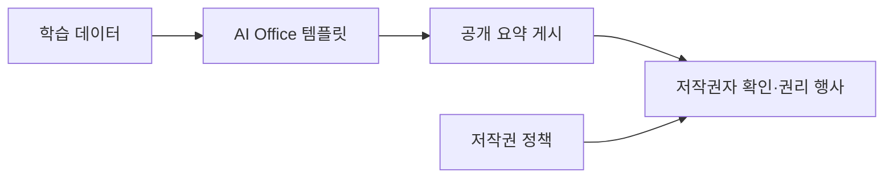

# 학습 데이터 공개 요약

> AI Act 53조에 따라 범용 AI 모델 제공자는 학습에 쓴 콘텐츠의 "충분히 상세한 요약"을 AI Office 템플릿에 맞춰 공개해야 한다. 저작권 투명성이 목적이다.

## 쉽게 말하면
식품 포장의 원재료 표시와 같다. 레시피(모델 비법)를 공개하라는 게 아니라 어떤 재료(데이터 종류·출처)가 들어갔는지 알 수 있게 하라는 것이다.

## 자세히
출처: AI Act 53조(2026-11-15 확인).
- GPAI 제공자 의무 4가지: ① 기술 문서(학습·테스트·평가 결과, 부속서 XI), AI Office 요청 시 제공 ② 하류 제공자용 정보(부속서 XII) ③ EU 저작권법 준수 정책(저작권 지침 4(3)조의 권리 유보 존중 포함) ④ **학습 콘텐츠 요약 공개(AI Office 제공 템플릿 사용)**.
- 요약은 템플릿 형식을 따른다(템플릿 세부 항목은 이 글에서 직접 확인하지 못함).
- **오픈소스 면제(2항)**: 가중치·구조·사용 정보를 공개한 자유 오픈소스 라이선스 모델은 ①②가 면제. 시스템 리스크 모델은 면제 불가. 면제 범위에 ④가 포함되는지는 조문상 ①②만 명시되어 있으므로 ④(요약)와 ③(저작권 정책)은 별도로 확인해야 한다.
- 영업 비밀과 지재권은 보호하며 제공한다.
- 자발적 이행은 [GPAI 실천 규범](#gpai-code-of-practice)의 투명성·저작권 장이 안내한다.

## 그림으로 보기

## 예시
- 모델 제공사가 공개 웹 크롤링 비중, 라이선스 데이터, 합성 데이터의 유형을 요약 페이지에 게시.
- 출판사가 요약을 보고 자기 콘텐츠 포함 여부를 의심해 권리 유보(옵트아웃) 요청.

## 헷갈리는 것과 비교
| 개념 | 차이 |
|---|---|
| 학습 데이터 요약 | 공개 대상: 일반 |
| 기술 문서 | 당국 요청 시 제공 |
| 하류 제공자 정보 | 통합 업체에 제공 |
| 데이터 전체 공개 | 요구되지 않음 |

## 더 읽을거리
- [AI Act Article 53](https://artificialintelligenceact.eu/article/53/) — 제공자 의무 조문
