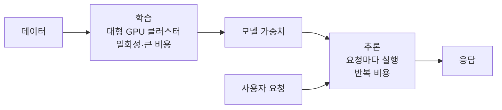
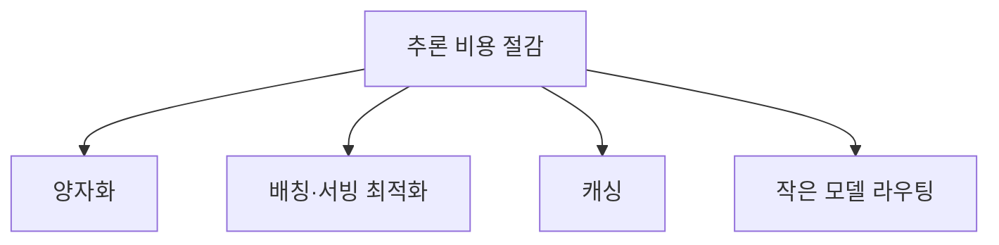

# 학습 vs 추론 비용·장비

> 모델을 만드는 **학습**은 거대한 클러스터를 한동안 쓰는 큰 일회성 비용이고, 모델을 쓰는 **추론**은 요청마다 계속 나가는 반복 비용이다.

## 쉽게 말하면
학습은 식당을 짓고 요리법을 개발하는 일이고, 추론은 매일 손님에게 요리를 내는 일이다. 건설비는 크지만 한 번이다. 반면 손님이 늘수록 매일 재료비와 인건비가 나간다. 인기 서비스일수록 장기적으로는 "내는 비용"이 더 커진다.

## 자세히
- **학습**: 수천~수만 개 GPU를 며칠~몇 달 묶어 돌린다. 계산량이 병목(compute-bound)이라 GPU끼리 빠르게 통신하는 NVLink·InfiniBand 같은 연결이 중요하다. GPT-3급 학습비 추정은 가정에 따라 50만~460만 달러로 갈린다(2차 출처 추정치).
- **추론**: 요청마다 모델 가중치를 메모리에서 읽어야 해서 보통 **메모리 대역폭**이 병목이다. 70B 모델을 FP8로 올리면 약 70GB를 매 토큰 생성마다 훑는다.
- 총비용에서 추론 비중이 70~90%라는 블로그 주장이 흔하지만 업체 글이라 대략치로만 본다.
- **추론 비용을 줄이는 수단**: [양자화](#quantization)로 가중치 줄이기, 요청 묶음 처리(배칭), vLLM 같은 서빙 소프트웨어, [프롬프트 캐싱](#prompt-caching), 작은 모델로 [라우팅](#routing-pattern).
- 같은 GPU([GPU와 VRAM](#gpu-basics))가 두 단계에 모두 쓰인다.
- 토큰당 가격은 몇 년간 빠르게 내려왔다. 그래서 "쓰는 양"이 늘어 총액은 오히려 커지는 일이 흔하다.

## 그림으로 보기

## 예시
- 사내 챗봇을 직접 학습하지 않고 API로 쓰면 학습비는 0이고 추론(토큰) 비용만 낸다. 월 사용량으로 "API vs 자체 서버" 손익분기를 계산한다.
- 하루 10만 요청이면 입력·출력 토큰 평균 × 단가 × 요청 수로 월 비용을 먼저 추산한다.

## 헷갈리는 것과 비교
| 개념 | 차이 |
| --- | --- |
| 학습 | 가중치를 만든다. 계산 병목, 일회성 |
| 파인튜닝 | 기존 모델을 조금 더 학습. 학습보다 훨씬 싸다 |
| 추론 | 가중치를 고정한 채 답을 만든다. 메모리 병목, 반복 |

## 더 읽을거리
- [Navigating the high cost of AI compute (a16z)](https://a16z.com/navigating-the-high-cost-of-ai-compute/) — 학습·추론 비용 구조 개관
- [Why LLM Inference Costs More Than Training](https://aipmbriefs.substack.com/p/why-llm-inference-costs-more-than) — 추론 비중 논거(블로그, 수치는 대략치)
