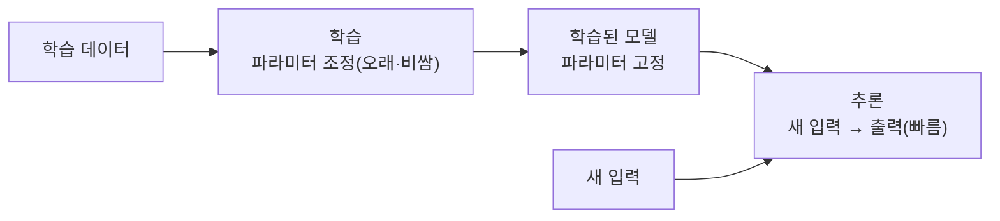
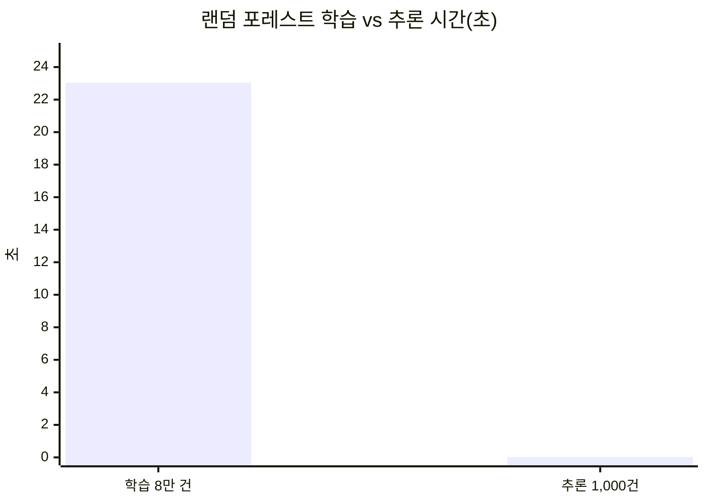

# 학습과 추론

> **학습(training)** 은 데이터를 보며 모델 안의 **숫자(가중치·파라미터)를 조정**하는 단계, **추론(inference)** 은 이미 조정된 모델을 **고정한 채 새 입력에 답을 내는** 단계다. 학습은 비싸고 오래 걸리며 한 번(또는 가끔) 하고, 추론은 서비스에서 매 요청마다 반복된다.

## 쉽게 말하면
요리사가 몇 달 동안 수백 번 연습하며 레시피를 몸에 익히는 시간이 학습이고, 손님 주문이 들어올 때마다 익힌 솜씨로 요리를 내놓는 것이 추론이다. 연습은 오래 걸리지만 한번 익히면 주문 처리는 빠르다.

## 자세히
- **학습**: 입력과 정답(또는 목표)이 있는 데이터를 반복해서 보며, 예측이 틀린 정도(손실)를 줄이는 방향으로 파라미터를 갱신한다. 계산량이 크고(GPU·시간), 데이터와 정답이 필요하다.
- **추론**: 파라미터를 **더 이상 바꾸지 않고** 입력을 넣어 출력을 얻는다. 학습보다 요청당 계산이 훨씬 적지만, 사용량이 많으면 총비용이 학습을 넘을 수 있다. 응답 속도(지연)와 처리량이 핵심 지표다.
- **직접 측정**(scikit-learn 1.9.1, 합성 분류 데이터 10만 건·특성 30개, 학습 8만 건, CPU 1코어):

| 모델 | 학습(fit) 시간 | 추론: 1,000건 | 추론: 1건 | 정확도 | 저장 크기 |
|---|---|---|---|---|---|
| 로지스틱 회귀 | 0.15초 | 0.0004초 | 0.0002초 | 0.795 | 31개 가중치, 약 945바이트 |
| 랜덤 포레스트(나무 50그루) | **23.04초** | 0.0199초 | 0.0030초 | 0.967 | — |

  학습 시간은 추론보다 **수천~수만 배** 길었다(랜덤 포레스트: 23초 vs 1,000건 0.02초). 더 복잡한 모델이 정확도(0.967 vs 0.795)는 높았지만 학습·추론 모두 더 비쌌다. 이 수치는 이 합성 데이터와 장비에서만 의미가 있다.
- **LLM에 대응시키면**: 사전 학습(pre-training)과 미세조정(fine-tuning)은 학습 단계이고, 챗봇에 질문하는 것은 추론이다. LLM에서 추론은 토큰 생성 때마다 모델을 통과하므로 응답 길이만큼 비용이 든다([토큰 가격 읽기](#token-pricing)).
- **헷갈리기 쉬운 점**: 사용자가 챗봇에 정보를 알려 줘도 **추론 단계에서는 모델이 학습(가중치 변경)되지 않는다**. 대화 문맥은 입력(컨텍스트)으로만 쓰인다. 모델이 바뀌려면 별도의 학습·미세조정이 필요하다.
- 한계: 학습과 추론의 경계는 경우에 따라 겹친다(온라인 학습, 추론 시점 계산 확대 등).

## 그림으로 보기



## 예시
```python
model.fit(X_train, y_train)      # 학습: 파라미터 조정
pred = model.predict(X_new)      # 추론: 조정된 모델로 예측
```
- 업무 예: 고객 이탈 예측 모델은 월 1회 재학습(학습 비용), 매일 고객 수만 명에 점수 계산(추론 비용).
- 교육 포인트: "ChatGPT에 비밀을 말하면 모델이 바로 배운다?" → 대화는 추론이며 가중치는 바뀌지 않는다는 점, 다만 서비스 약관에 따라 데이터가 나중 학습에 쓰일 수 있는지는 별개의 정책 문제.

## 헷갈리는 것과 비교
| 개념 | 차이 |
|---|---|
| 학습 | 파라미터를 바꾸는 단계 |
| 추론 | 파라미터를 고정하고 쓰는 단계 |
| 미세조정 | 이미 학습된 모델을 추가로 조금 더 학습 |
| [프롬프트·컨텍스트](#context-window) | 추론 때 주는 입력(가중치는 불변) |

## 더 읽을거리
- [scikit-learn: 사용자 가이드 개요](https://scikit-learn.org/stable/user_guide.html) — fit/predict 인터페이스를 따르는 모델들.
