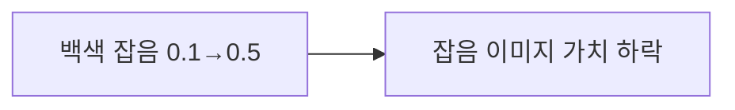
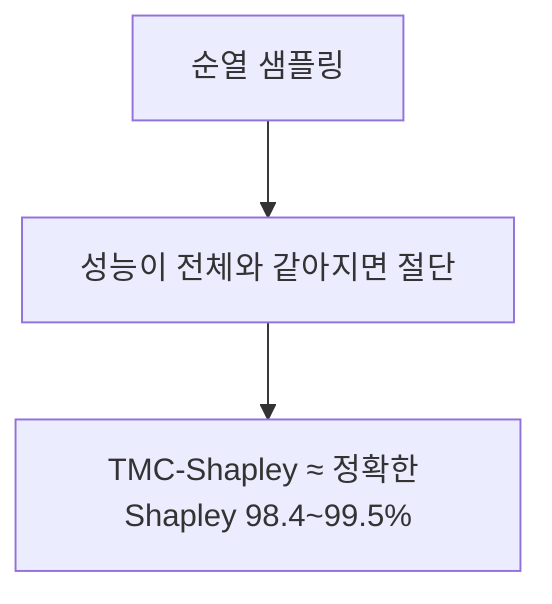

# 학습 노이즈와 가치 추정

> 데이터 가치 평가는 훈련 샘플의 품질이 낮을수록 가치가 낮게 나오는지, 그리고 계산 자체가 노이즈에 얼마나 흔들리는지를 함께 본다. TMC-Shapley는 몬테카를로와 절단으로 비용을 줄인다.

## 쉽게 말하면
사진이 흐릴수록 학습에 도움이 안 되므로 점수(가치)가 낮아야 한다. 또 가치를 계산할 때 쓰는 시험 데이터도 유한해서 점수에 잡음이 낀다.

## 자세히
(Data Shapley arXiv 1904.02868을 하위 에이전트가 원문으로 읽은 노트 기준.)
- **노이즈 실험(그림 2b)**: 개 vs 물고기(ImageNet, 클래스당 500 훈련), Inception-v3 상단만 학습. 이미지 10%(100장)에 백색 잡음을 **0.1, 0.3, 0.5** 수준으로 넣고 10회 반복. 잡음이 클수록 잡음 이미지의 평균 가치(깨끗한 이미지 대비)가 **낮아졌다**.
- **TMC-Shapley**: 순열에 대한 몬테카를로 φᵢ = E_π[V(S_π^i ∪ {i}) − V(S_π^i)]. 부분집합 성능 V(S)가 전체 V(D)의 부트스트랩 기반 허용 오차 안에 들어오면 스캔을 **절단**하고 나머지 한계 기여를 0으로 둔다. 25% 절단이 절단 없는 결과와 순위 상관 약 0.8, **TMC와 정확한 Shapley의 상관 98.4~99.5%**(합성 데이터).
- **G-Shapley**(점당 기울기 1걸음): TMC와의 상관이 일부 0.9~0.95, 라벨 뒤집기 집합 0.57~0.62, 유방암 0.86.
- **응용 수치(참고)**: 도메인 적응 정확도 29.6→37.8%(피부 병변), 84.1→91.5%(성별 검출), 68.4→86.4%(이메일→SMS 스팸).
- **노이즈의 이유**: V 자체가 유한한 시험 세트로 추정되어 잡음이 있어 절단 허용 오차가 필요하다.

## 그림으로 보기

## 예시
- 라벨·화질 불량 의심 샘플의 가치 순위를 확인하고 하위권을 정제.
- 교육 활용: 계산 비용을 줄이는 절단 아이디어를 시험 시간 비유로 설명.

## 헷갈리는 것과 비교
| 개념 | 차이 |
|---|---|
| TMC-Shapley | 순열 몬테카를로 + 절단 |
| G-Shapley | 한 걸음 기울기로 근사 |
| [가치로 오라벨 찾기](#mislabel-detection-by-value) | 낮은 가치 순 검수 |

## 더 읽을거리
- [Data Shapley (arXiv 1904.02868)](https://arxiv.org/abs/1904.02868) — 노이즈 실험·TMC.
