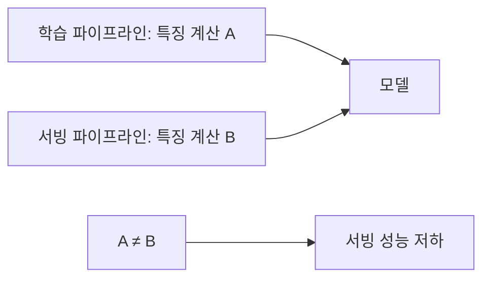
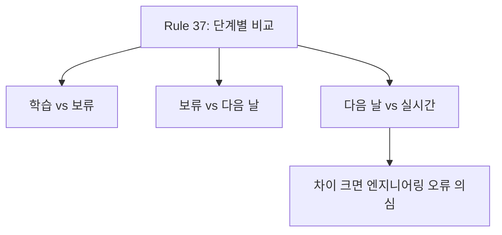

# 학습-서빙 편향

> 모델이 학습·시험 때 낸 성능과 실제 서비스(서빙)에서 낸 성능이 다른 현상이다. 원인은 학습과 서비스에서 같은 특징을 서로 다르게 계산하거나, 데이터가 학습 시점과 서비스 시점 사이에 바뀌었거나, 모델이 자기 입력에 영향을 주는 피드백 고리가 생겼기 때문이다.

## 쉽게 말하면
연습장에서는 완벽하게 치던 골프 샷이 실제 코스에서는 안 맞는다. 연습장 공은 새 공이고 코스 공은 낡은 공이라면, 연습 방식이 아니라 "연습 조건과 실전 조건이 달랐던 것"이 원인이다.

## 자세히
(Google의 「Rules of Machine Learning」 가이드를 직접 열어 확인.)
- **정의(가이드)**: "학습 중 성능과 서빙 중 성능의 차이."
- **세 가지 원인**
  1. 학습 파이프라인과 서빙 파이프라인에서 **데이터를 다르게 처리**한다(같은 특징을 서로 다른 코드로 계산).
  2. 학습 시점과 서빙 시점 사이에 **데이터가 바뀐다**.
  3. 모델과 알고리즘 사이에 **피드백 고리**가 생긴다.
- **권고 규칙(가이드)**
  - **Rule #29**: "학습을 서빙처럼 시키는 가장 좋은 방법은 서빙 시점에 사용한 특징 집합을 저장하는 것이다." 그 특징을 로그로 남기고 그 로그로 학습한다. 일부만 로깅해도 일관성 검증에는 충분하다.
  - **Rule #31**: 학습 때와 서빙 때 같은 테이블을 조인하면 두 시점 사이에 **테이블 값이 바뀔 수 있다**. 서빙 시점에 특징을 로깅하는 것이 가장 단순한 해법이고, 천천히 변하는 테이블을 시간·일 단위로 스냅샷하면 가까워지지만 완전히 해결되지는 않는다.
  - **Rule #37**: 학습 대 보류 데이터, 보류 대 다음 날 데이터, 다음 날 대 실시간 데이터의 세 단계 성능을 비교해 편향을 **측정**한다. 다음 날과 실시간 사이의 차이는 보통 **엔지니어링 오류**를 가리킨다.
- **도구**: TFDV는 학습 데이터와 서빙 데이터의 특징 분포를 비교해 편향을 탐지한다([TFDV](#tfdv)).
- **유사 개념과의 구분**: 시간에 따른 입력 분포 변화는 [데이터 드리프트](#data-drift), 학습 분포 밖 환경의 평가는 [분포 밖 평가](#ood-evaluation).
- **LLM 시대에도(제안)**: 프롬프트 템플릿·전처리가 평가 환경과 운영 환경에서 다르면 같은 종류의 편향이 생긴다.

## 그림으로 보기

## 예시
- 학습 때는 "최근 30일 구매 횟수"를 배치로 계산하고 서빙 때는 실시간 근사로 계산해 값 정의가 달라지는 경우. 서빙 시점의 특징 값을 로그로 남겨 학습에 재사용(Rule #29).
- 학습 때 조인한 "고객 등급" 테이블이 매일 갱신되어 서빙 때 값이 다른 경우(Rule #31).

## 헷갈리는 것과 비교
| 개념 | 차이 |
|---|---|
| 학습-서빙 편향 | 학습과 서빙의 성능·특징 차이 |
| [데이터 드리프트](#data-drift) | 시간에 따른 입력 분포 변화 |
| [분포 밖 평가](#ood-evaluation) | 다른 환경 데이터로 평가 |
| [데이터 누수](#data-leakage) | 시험 정보가 학습에 새어 들어감 |

## 더 읽을거리
- [Rules of Machine Learning (Google)](https://developers.google.com/machine-learning/guides/rules-of-ml) — Rule #29·#31·#37(직접 열어 확인).
- [TensorFlow: TFDV 가이드](https://www.tensorflow.org/tfx/guide/tfdv) — 편향 탐지 기능(직접 열어 확인).
