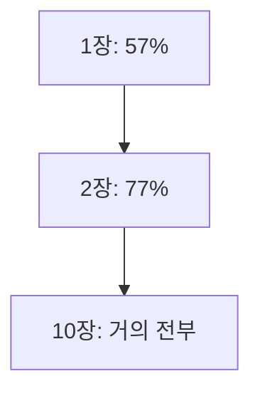

# 학습셋 공격

> 눈에 띄지 않는 변형을 훈련 이미지에 가해 특정 시험 예측을 바꾸는 공격이다. 영향 함수가 "어떤 훈련 입력을 어떻게 바꾸면 시험 손실이 가장 커지는지"를 알려 줘 공격을 만든다.

## 쉽게 말하면
교재의 그림 한 장을 사람 눈엔 같아 보이게 살짝 바꿔 놓으면, 그 교재로 배운 학생이 특정 문제에서만 엉뚱한 답을 쓰게 되는 상황이다.

## 자세히
(Koh & Liang arXiv 1703.04730을 하위 에이전트가 원문으로 읽은 노트 기준. 그림 6의 라벨 수정 수치는 그림만 있어 미확인.)
- **방법**: 영향 함수의 섭동 항 I_pert,loss(z, z_test) = −∇L(z_test)ᵀ H⁻¹ ∇ₓ∇θL(z)로 훈련 입력 z를 어느 방향으로 바꿔야 시험 손실이 커지는지 계산.
- **실험**: Inception v3, 개 vs 물고기 분류, 학습 1,800장·시험 600장, 처음에 맞힌 시험 이미지 591장. **훈련 이미지 1장**을 변형하자 **335/591(57%)** 의 예측이 뒤집혔고 2장이면 77%, 10장이면 1장을 뺀 전부. 변형한 한 장이 개 이미지 30장 중 16장을 뒤집은 경우도 있다.
- **의미**: 소수의 훈련 데이터 오염만으로 시험 동작을 조작할 수 있다. 사람이 훈련 데이터를 검수하기 어려운 환경에서 위험.
- **방어(제안)**: 출처 검증, 이상 샘플 탐지, 영향이 큰 샘플 점검.

## 그림으로 보기

## 예시
- 외부에서 받은 훈련 데이터 중 영향도가 큰 상위 샘플을 사람이 검토.
- 교육 활용: 데이터 중독(poisoning)을 쉬운 비유로 소개.

## 헷갈리는 것과 비교
| 개념 | 차이 |
|---|---|
| 학습셋 공격(중독) | 훈련 데이터를 조작 |
| [적대적 사례](#adversarial-examples) | 추론 입력을 조작 |
| 영향 함수 | 이 공격을 만드는 분석 도구 |

## 더 읽을거리
- [Influence Functions (arXiv 1703.04730)](https://arxiv.org/abs/1703.04730) — 학습셋 공격 절.
