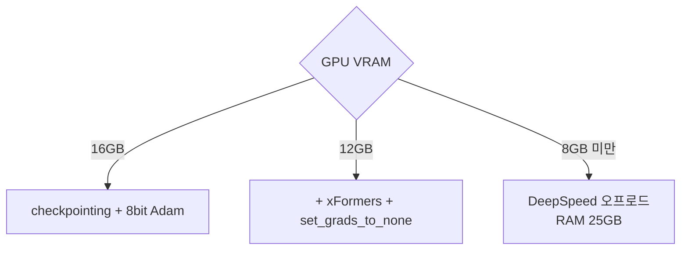

# 학습 VRAM 절약 팁

> 작은 GPU에서도 확산 모델을 파인튜닝하도록 gradient checkpointing, 혼합정밀도, 8비트 Adam, xFormers 같은 메모리 절약 옵션을 켜는 방법 모음이다.

## 쉽게 말하면
작은 책상에서 큰 작업을 할 때 자료를 필요할 때만 꺼내 쓰고, 다 쓰면 서랍에 넣는 정리 습관이다. 속도는 조금 희생하지만 작업이 가능해진다.

## 자세히
HF diffusers DreamBooth 가이드(v0.42.1)의 VRAM별 권장:
- **16GB**: `--gradient_checkpointing`, `--use_8bit_adam`(bitsandbytes).
- **12GB**: 위에 더해 `--enable_xformers_memory_efficient_attention`, `--set_grads_to_none`.
- **8GB 미만**: DeepSpeed(stage 2, fp16, 파라미터·옵티마이저 상태를 CPU로 오프로드). 시스템 RAM 약 25GB 필요, 8비트 Adam은 DeepSpeed와 호환이 안 되는 듯하다고 문서가 적는다.
- 텍스트 인코더까지 학습(`--train_text_encoder`)하려면 24GB 이상 권장.
- 공통: `--mixed_precision=bf16/fp16`로 절약. LoRA를 쓰면 학습 파라미터가 확 줄어 결과 파일이 약 100MB 수준.
- 원리: gradient checkpointing은 중간 활성값을 저장하지 않고 역전파 때 다시 계산(시간↑ 메모리↓). 8비트 Adam은 옵티마이저 상태를 8비트로 저장.

## 그림으로 보기


## 예시
```bash
accelerate launch train_dreambooth.py \
  --mixed_precision=bf16 --gradient_checkpointing --use_8bit_adam
```

## 헷갈리는 것과 비교
| 기법 | 절약 대상 | 대가 |
|---|---|---|
| gradient checkpointing | 활성값 | 재계산 시간 |
| 8비트 Adam | 옵티마이저 상태 | 약간의 정밀도 |
| DeepSpeed 오프로드 | 대부분 | 속도·RAM |
| [QLoRA](#qlora) | 베이스 가중치 | 양자화 오차 |

## 더 읽을거리
- [HF DreamBooth 가이드](https://huggingface.co/docs/diffusers/training/dreambooth) — VRAM 구간별 설정.
- [HF Reduce memory usage](https://huggingface.co/docs/diffusers/optimization/memory) — 추론 쪽 메모리 기법.
