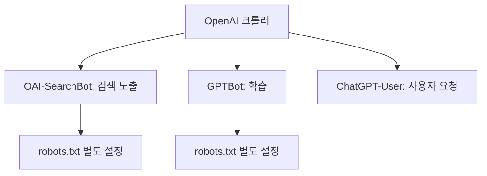
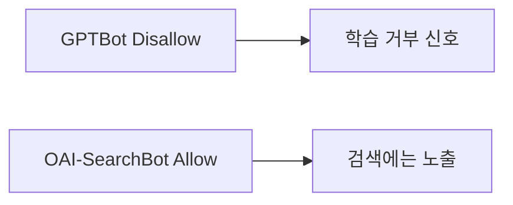

# 학습용·검색용 봇 구분

> AI 회사는 크롤러를 목적별로 나눠 운영한다. 학습용(GPTBot), 검색 노출용(OAI-SearchBot), 사용자 요청용(ChatGPT-User)은 robots.txt로 따로 제어하며, 하나를 막아도 나머지에는 영향이 없다.

## 쉽게 말하면
같은 회사 직원이라도 "책 쓰려고 자료 모으는 사람", "안내 데스크에 올릴 사이트 목록 만드는 사람", "손님 부탁으로 한 번 방문하는 사람"이 따로 있다. 출입 허가도 따로 줄 수 있다.

## 자세히
(OpenAI 크롤러 문서를 직접 열어 확인. 다른 회사 사례는 확인하지 않았다.)
| 크롤러 | 목적 | robots.txt 제어 |
|---|---|---|
| OAI-SearchBot | ChatGPT 검색 기능에 사이트 노출 | 허용/차단. 차단하면 검색 답변에는 안 나오지만 내비게이션 링크로는 나올 수 있다 |
| GPTBot | OpenAI 기반 모델 학습에 쓰일 수 있는 콘텐츠 수집 | 차단하면 학습에 쓰지 말라는 신호 |
| ChatGPT-User | 사용자가 시작한 방문(ChatGPT·Custom GPT·GPT Actions) | 자동 크롤링이 아니므로 robots.txt가 적용되지 않을 수 있고 검색 포함 여부와 무관 |
- **독립 설정**: 예) OAI-SearchBot은 허용하고 GPTBot은 차단해 검색엔 노출하되 학습은 거부할 수 있다.
- **공유 크롤**: 둘 다 허용하면 한 번의 크롤 결과를 양쪽 목적에 쓸 수 있다.
- **반영 지연**: 검색 시스템은 robots.txt 변경을 반영하는 데 약 24시간 걸릴 수 있다.
- **게시 IP**: 각 봇의 IP 목록(JSON)을 공개한다(서버에서 검증 가능).
- **제안**: 목적(검색 노출 vs 학습)을 먼저 정하고 봇별 규칙을 작성한다.

## 그림으로 보기



## 예시
```
User-agent: OAI-SearchBot
Allow: /

User-agent: GPTBot
Disallow: /
```
- 교육 활용: 웹사이트 운영자의 선택지(노출 vs 학습 거부)를 사례로 토론.

## 헷갈리는 것과 비교
| 개념 | 차이 |
|---|---|
| 학습용 봇 | 모델 학습용 수집 |
| 검색용 봇 | 검색 결과 노출용 |
| [선언과 집행의 간극](#declared-vs-enforced-blocking) | robots.txt는 요청일 뿐 |

## 더 읽을거리
- [OpenAI 크롤러 문서](https://developers.openai.com/api/docs/bots) — 봇별 목적·제어.
