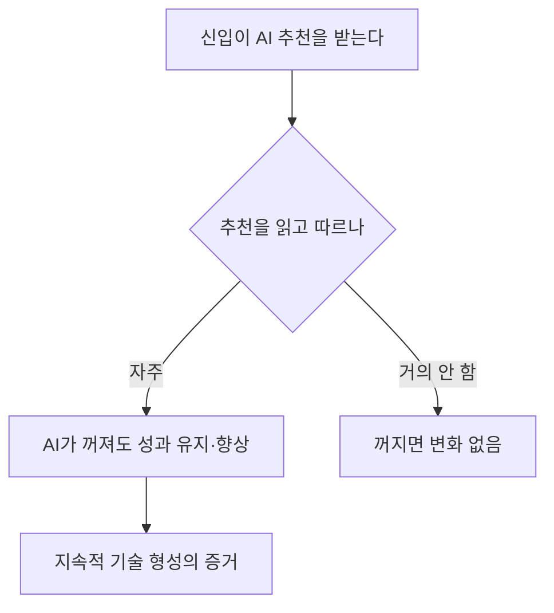
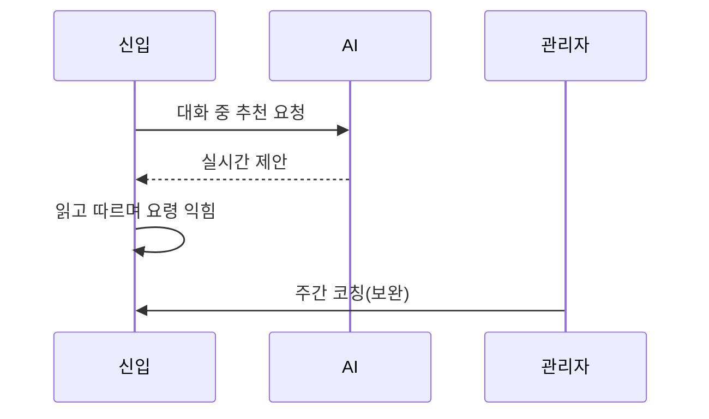

# AI 보조 하의 신입 교육

> 신입이 AI 추천을 곁에 두고 일하면서 배우는 방식. 고객지원 연구는 AI가 꺼진 순간에도 AI를 많이 써 본 상담사의 성과가 남아 있음을 보여, "도구에 기대는 것"과 "실제로 배우는 것"이 함께 일어날 수 있다는 증거를 준다. 단, 추천을 실제로 읽고 따른 사람에게서 두드러졌다.

## 쉽게 말하면
네비게이션을 켜고 운전하는 초보는 길을 못 외운다고들 한다. 그런데 이 연구에서는 네비게이션이 갑자기 꺼졌을 때도 그동안 안내를 열심히 따라 운전한 사람은 길을 더 잘 찾았다. 안내를 "따라 하며 이유를 몸으로 익힌" 사람만 그랬다. 추천을 무시한 사람은 꺼져도 달라진 게 없었다. 교육 설계 쪽에서는 "AI를 쓰게 하라"가 아니라 "AI 추천을 어떻게 읽고 따르게 하라"가 중요해진다.

## 자세히
출처: Brynjolfsson, Li, Raymond "Generative AI at Work" NBER 31161 §5.1–5.3(PDF를 직접 읽음). 한 소프트웨어 회사의 채팅 상담 연구이며 인과 해석에는 저자가 직접 단서(선택 효과 가능성)를 단다.
- **기존 교육의 한계(논문)**: 도입 전에는 관리자가 주간 코칭에서 지난주 대화 몇 개만 검토했고, 흔히 "처리 시간을 줄여라" 같은 지표만 지적했다. AI는 실시간으로 구체적 제안을 준다.
- **채택률**: 상담사가 AI 추천을 따른 비율은 에이전트-월 가중 평균 38%, 사분위 범위 23~50%(서론에서는 평균 35%로 요약). 코파일럿 개발자 연구에서 27~46%를 쓴다는 수치와 비슷하다고 인용.
- **채택과 이득**: 첫 달 채택률 5분위로 나누면 최저 분위도 약 10% 향상, 최고 분위는 약 25%로 2배 이상. 다만 선택 효과(원래 잘하는 사람이 따를 수도)가 섞일 수 있다고 저자가 명시한다.
- **시간이 지나면**: 처음에 덜 따르던 하위 3분위(20% 미만)도 5개월차에 약 50%까지 올라간다. 시니어는 처음엔 덜 따르지만(1년 이상 30% vs 3개월 미만 37%) 점차 올라 비슷해진다.
- **꺼졌을 때의 성과(소프트웨어 장애 활용)**: 장애는 몇 분~몇 시간. 평소에도 30~40%의 채팅은 AI 추천이 없다. 장애 중에도 AI에 노출된 상담사의 채팅 시간이 도입 전보다 짧았고, **노출 기간이 길수록** 더 짧았다(도입 1개월 뒤 장애면 거의 차이 없고 3개월 뒤면 더 빠름). 평소 추천을 **자주 따르던** 상담사는 장애 중에도 큰 개선, **잘 안 따르던** 상담사는 없음. 저자 결론: "내구적 기술 형성의 증거". 단, 장애는 드물고 무작위가 아니어서 추정이 잡음이 많다고 직접 밝힌다.
- **대화 변화**: 텍스트 임베딩(all-MiniLM-L6-v2)으로 보면 도입 후 저숙련자가 고숙련자와 비슷한 방식으로 말하게 됐다는 "시사적 증거".
- **교육에서의 해석(이 글의 제안)**: 신입 온보딩에서 AI 추천을 (1) 보게 하고 (2) 이유를 설명하게 하고 (3) 일부는 AI 없는 연습으로 확인하는 식으로 설계해 볼 수 있다. 위 연구가 그 설계를 검증한 것은 아니다.

## 그림으로 보기

## 예시
- 콜센터 온보딩: 첫 4주는 AI 추천을 켜고, 5주차에 하루는 AI를 끈 상태로 같은 유형 문의를 처리해 숙련도를 점검(제안).
- 교육 담당자가 상담 녹취에서 "추천을 따른 장면 / 무시한 장면"을 뽑아 사례 토론 자료로 쓴다.

## 헷갈리는 것과 비교
| 개념 | 차이 |
|---|---|
| 도구 의존 | AI가 꺼지면 성과가 사라짐 |
| 지속 학습 | AI가 꺼져도 성과가 남음. 이 연구에서 추천을 따른 사람에게 나타남 |
| [근속 기간별 생산성 곡선](#tenure-productivity-curve) | 근속 개월에 따른 성과 그래프 |
| [경험 곡선 단축](#experience-curve-ai) | 신입이 더 빨리 숙련에 닿는 현상 |

## 더 읽을거리
- [NBER Working Paper 31161](https://www.nber.org/system/files/working_papers/w31161/w31161.pdf) — §5.1 채택, §5.2 학습(장애 분석), §5.3 대화 변화
- [Generative AI at Work (arXiv 2304.11771)](https://arxiv.org/abs/2304.11771) — 초록
