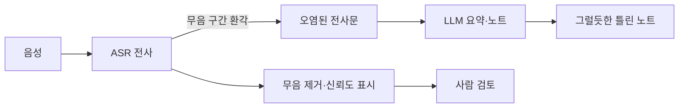

# 전사 오류

> 음성 인식(ASR) 단계에서 생긴 오류. 단어 몇 개가 틀리는 정도를 넘어, 없던 문장이 통째로 생기는 환각까지 있으며 이후 요약·노트 생성 단계로 그대로 전파된다.

## 쉽게 말하면
속기사가 잘못 받아 적은 회의록을 편집자가 아무리 잘 다듬어도 틀린 내용은 남는다. 파이프라인 앞단의 실수는 뒤에서 고칠 수 없는 "원재료 오염"이다.

## 자세히
- **Careless Whisper 연구(Koenecke 외, FAccT 2024, arXiv 2402.08021, 초록 확인)**: OpenAI Whisper의 전사 약 1%에 오디오에 없는 구절·문장이 들어 있었다. 그 환각의 38%가 폭력적 내용·잘못된 연관·거짓 권위 암시 같은 명시적 해악을 포함. 실어증 화자에서 대조군보다 더 자주 발생했고, 저자들은 발성 없는 구간이 길어서라고 연결한다. 수치는 연구 데이터셋 기준이며 모든 환경의 비율이 아니다.
- **단어 오류율(WER)의 한계**: WER은 단어 단위 오류를 센다. 문장 통째 환각은 전체 WER에 작게 반영돼 위험을 가릴 수 있다(해설 글의 관점, 통제 연구는 아님).
- **전파 경로**: 전사 → 화자 구분 → 요약·노트 생성 LLM. LLM은 틀린 전사를 사실로 받아 매끄러운 노트로 만든다. 직접적으로 "전사 오류가 임상 노트 오류로 번지는 정도"를 잰 연구는 이번 조사에서 찾지 못했다.
- **원본 보존 문제**: 일부 제품은 처리 후 원본 오디오를 삭제해(언론 보도 인용) 사후 검증이 불가능해진다. 개인정보 보호와 검증 가능성의 균형이 필요하다.
- **완화**: 무음 구간 제거(VAD)·환각 필터, 신뢰도 낮은 구간 표시, 전사문과 노트 문장 연결, 중요 항목은 사람 확인([임상의 검토·서명](#clinician-review-signoff)).

## 그림으로 보기

## 예시
- 환자가 말을 멈춘 구간에 "약을 두 배로 늘리세요" 같은 문장이 전사에 생기면, 노트에 처방 지시로 들어갈 수 있다.
- 평가: 전사문을 사람이 교정한 정답과 비교해 WER과 별도로 "원본에 없는 문장" 건수를 센다.

## 헷갈리는 것과 비교
| 개념 | 차이 |
|---|---|
| 전사 오류 | 음성→텍스트 단계 |
| [환각](#hallucination) | LLM 생성 단계 일반 |
| [누락·환각](#omission-vs-hallucination) | 노트 단계 오류 유형 |

## 더 읽을거리
- [Careless Whisper: Speech-to-Text Hallucination Harms](https://arxiv.org/abs/2402.08021) — Whisper 환각 연구(초록 확인)
