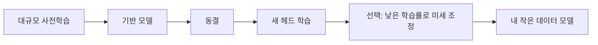
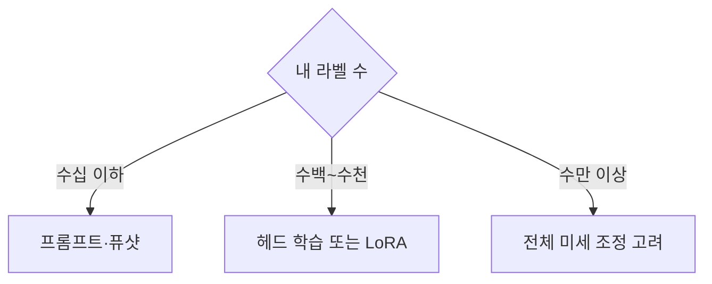

# 소표본 전이학습

> 큰 데이터로 미리 학습된 모델(사전학습 모델)의 **특징 추출 능력을 가져와** 내 작은 데이터에 맞게 마지막 층만, 또는 전체를 조금만 다시 학습하는 방법. 데이터가 모자랄 때 가장 효과가 큰 방법 중 하나다.

## 쉽게 말하면
요리 경력 10년 차를 새로 뽑아 우리 가게 메뉴 3개만 가르치는 것과, 요리를 전혀 모르는 사람에게 처음부터 가르치는 것의 차이다. 기본기(칼질·불 조절)는 이미 있으므로 적은 예제로도 메뉴를 익힌다.

## 자세히
- **정의(Keras 가이드 확인)**: 한 문제에서 배운 특징을 비슷한 새 문제에 재사용. 데이터가 작아 모델을 처음부터 학습하기 어려울 때 가장 유용하다.
- **표준 3단계**
  1. **기반 모델 동결**: 사전학습 가중치를 불러 `trainable=False`.
  2. **새 헤드 학습**: 동결된 기반 위에 새 분류층을 얹어 내 데이터로 학습.
  3. **(선택) 미세 조정**: 헤드가 수렴한 뒤 기반의 전부 또는 일부를 풀어 **아주 낮은 학습률(예: Adam 1e-5)** 로 끝까지 재학습. 무작위 초기화된 층과 함께 학습하면 큰 기울기가 사전학습 특징을 망가뜨리고, 모델이 큰데 데이터가 작아 빨리 과적합하기 때문이다. `trainable`을 바꾼 뒤엔 `compile()`을 다시 해야 한다.
  - 배치 정규화 주의: 미세 조정 때 기반을 `training=False`(추론 모드)로 호출해 통계가 새 데이터로 덮어써지지 않게 한다.
- **Keras 가이드의 실험(고양이 vs 개, 학습 9,305장·검증 2,326장·시험 2,326장, Xception ImageNet)**: 학습 가능 파라미터 약 2,049개의 헤드만 2에폭 학습해 검증 정확도 **0.9705**. 미세 조정 1에폭 후 검증 0.9494, **시험 0.9413**. 가이드는 10에폭 미세 조정에서 개선된다고 쓰지만 보여 준 코드는 1에폭이었고 그때는 오히려 검증 정확도가 떨어졌다. 미세 조정의 이득은 에폭을 늘리고 검증 정확도를 감시해 확인해야 한다(주장 vs 관측 구분).
- **언어 모델에서의 대응**: 사전학습 LLM을 소량의 라벨 데이터로 미세 조정하거나 프롬프트·검색 증강(RAG)으로 대체(Hugging Face 코스는 BERT 텍스트 분류 미세 조정을 다룸). 라벨이 수십~수백 개면 프롬프트·퓨샷이 먼저, 그다음 PEFT(LoRA 등)를 검토한다(일반 지식).
- **한계**: 사전학습 도메인과 내 도메인이 너무 다르면(의료 영상 vs 자연 이미지) 효과가 줄고, 사전학습 데이터의 편향이 따라온다. 시험 세트가 사전학습 데이터와 겹치면 누수.

## 그림으로 보기



## 예시
```python
base = keras.applications.Xception(weights="imagenet", include_top=False, input_shape=(150,150,3))
base.trainable = False
x = base(inputs, training=False)          # 추론 모드 유지
x = keras.layers.GlobalAveragePooling2D()(x)
out = keras.layers.Dense(1)(x)
```
- 제조 불량 이미지 300장: ImageNet 사전학습 기반 위에 헤드만 학습해 시작.

## 헷갈리는 것과 비교
| 방법 | 학습되는 것 | 적합한 데이터 |
|---|---|---|
| 특징 추출(동결) | 헤드만 | 아주 적음 |
| 미세 조정 | 기반 일부/전부 | 적음~중간 |
| 처음부터 학습 | 전부 | 매우 많음 |
| [규제](#regularization-small-data) | 용량 제한 | 보조 수단 |

## 더 읽을거리
- [Keras: Transfer learning & fine-tuning](https://keras.io/guides/transfer_learning/) — 워크플로·BatchNorm 주의·실험 수치(열어 확인).
- [Hugging Face LLM Course ch.3](https://huggingface.co/learn/llm-course/chapter3/1) — 미세 조정 절차(소개 페이지만 열어 확인).
